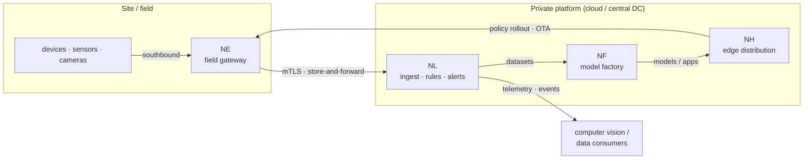

# Architecture Overview

NereidAI is a suite of independently deployable products that together form one
edge-to-cloud loop. There is no single monolith: the suite layer federates the
products, and each domain product owns its own data, APIs, and release cycle.

- **Suite layer (thin):** Sphere (portal, unified API gateway, event glue)
  and Identity (SSO, RBAC).
- **Domain products:** Link (IoT pipeline), Forge (model factory),
  Horizon (edge distribution).
- **Edge / field:** Edge (southbound integration on field gateways),
  Fleet (robot fleets), and the field devices themselves.
- **Thin clients:** Mobile.

## The closed loop

The loop is deliberate: field data flows in, becomes training data, becomes
models, is distributed back out to the field, and the resulting telemetry feeds
the next iteration — with no mandatory cloud dependency at any hop.

## Communication planes

| Plane | How it works |
|---|---|
| **Device / southbound** | Edge is an EdgeX Foundry application service that bridges field devices to Link over the gateway MQTT protocol (`v1/gateway/*`). Transport is TLS/mTLS; buffering is store-and-forward so intermittent WAN links do not lose data. |
| **Ingest** | Link accepts MQTT, HTTP, and CoAP through one shared envelope and SDK, so behaviour is identical across transports. Ingress is rate-limited per device token. |
| **Service-to-service (Link)** | Services communicate only over NATS — never by direct cross-service database access. |
| **Realtime to clients** | All live data (telemetry, presence, alarms, command progress, OTA progress…) is pushed over a single WebSocket connection with multi-subscription; REST is used only for snapshots and writes. Polling is deliberately avoided. |
| **Management / SSO** | Browsers reach products through Sphere, which authenticates against Identity (OIDC) and hands identity to products via a sealed ticket. See [SSO & OIDC](../security/sso-oidc.md). |

## Suite integration

In the default suite deployment, products do **not** each implement their own
login. The browser signs in once against Identity (through Sphere);
Sphere then issues a short-lived, single-use sealed ticket that the product
backend exchanges server-to-server for the verified identity. Identity is
the single source of truth for identities (Keycloak realm `nereidai`); Sphere
never stores users. Products can also run fully standalone, either with a direct
OIDC client or with local accounts.

## Technology stack

| Product | Stack (confirmed) |
|---|---|
| Sphere | Go 1.24, stdlib `net/http`, `log/slog`, `cobra`; React 18 + Ant Design 5 + Vite + TypeScript, embedded into the binary; OIDC relying party; Valkey for multi-replica ticket replay HA |
| Identity | Keycloak 26 + dedicated PostgreSQL (replaceable OIDC engine), declaratively provisioned realm/clients |
| Link | Go, gRPC, NATS (Core / JetStream / KV), PostgreSQL + TimescaleDB, S3-compatible object storage; MQTT / HTTP / CoAP ingress; WebSocket push |
| Forge | FastAPI (Python) backend + worker, React + TS + Ant Design + Vite frontend, Kubeflow Pipelines, Helm charts; images from the private registry |
| Horizon | React 18 / Vite frontend + Express BFF, PostgreSQL; drives Open Horizon Exchange / agbot / edge nodes |
| Edge | Go (EdgeX Foundry App Functions SDK v4), runs on field gateways |
| Fleet | See the product page — early stage (Tech Preview) |
| Mobile | Mobile app and WeChat Mini Program served from a single client codebase |

## Design invariants

- **Private by design** — fully air-gapped operation, no mandatory call-home, no
  runtime internet dependency.
- **Product autonomy** — each product owns its domain end to end; the suite layer
  never absorbs domain logic.
- **Neutral contracts** — APIs and wire contracts stay protocol-, stack-, and
  vendor-agnostic; no hard dependency on a particular edge stack or silicon vendor
  in generic interfaces.
- **Multi-silicon via the factory** — vendor-specific toolchains live only inside
  Forge; every other product consumes versioned artifacts.

See also: [Topology](topology.md) and [Cross-Product Contracts](contracts.md).
