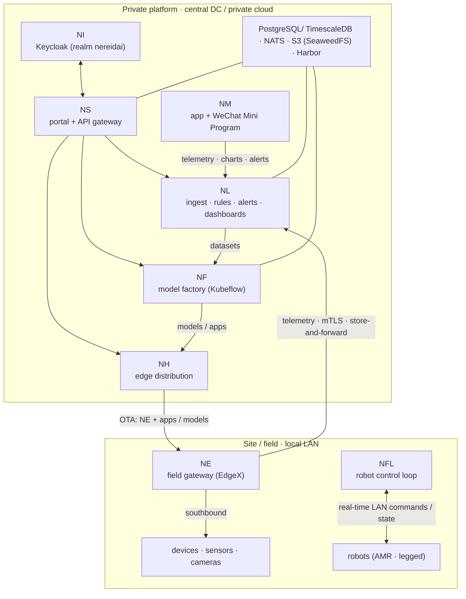

# Deployment Topology

A NereidAI installation spans two physical tiers joined by an often-intermittent
WAN: a **private platform** (cloud or central data center), and one or more
**sites / fields** where devices actually live. Everything is designed to keep
running when the WAN link is degraded or down.

## Tiers

## Central platform

The central tier runs on Kubernetes (k3s or a full cluster) via Helm charts, or —
for Link — as a single all-in-one binary. Which products you run is your
choice; each is independently installable, and none requires the others to start.

| Component | Role |
|---|---|
| Sphere | Portal and unified API gateway; reverse proxy to products; SSO glue |
| Identity | Keycloak realm `nereidai`; the identity source of truth |
| Link | Device ingest, message backbone, rules, alerts, dashboards, OTA orchestration |
| Forge | Dataset / annotation, training, optimization, multi-silicon export, registry (Kubeflow Pipelines) |
| Horizon | Policy-driven distribution of Edge, apps, and models to remote nodes |
| Mobile | Read-only operator window: telemetry, charts, alerts |

## Shared infrastructure

| Dependency | Used by | Notes |
|---|---|---|
| PostgreSQL | most products | Link uses PostgreSQL + TimescaleDB for entity and time-series data |
| NATS | Link | Core / JetStream / KV; the only path for service-to-service communication |
| S3-compatible object storage | Link, Forge | e.g. SeaweedFS; firmware packages, datasets, cold data |
| Private image registry | all | e.g. Harbor; no internet dependency at runtime |
| Kubeflow Pipelines | Forge | training / optimization / evaluation pipelines |
| Open Horizon | Horizon | Exchange / agbot / edge nodes for large-scale rollout |

!!! note "Air-gapped profile"
    In an air-gapped install, all images come from an internal mirror / private
    registry and the whole platform is delivered as an offline bundle. See
    [Air-Gapped Install](../deployment/air-gapped.md).

## Site / field tier

- **Edge** runs on a field gateway and bridges southbound devices (through
  EdgeX device services) into Link. It holds a store-and-forward buffer so
  that telemetry survives WAN outages, and it is delivered / updated by
  Horizon over the same WAN.
- **Fleet** runs the low-latency local control loop for robot fleets
  (commands / state stay on the LAN), while fleet management reaches it over the
  management plane.
- **Devices** connect either directly to Link (MQTT / HTTP / CoAP) or through
  a Edge gateway.

## Network characteristics

| Link | Behaviour |
|---|---|
| Device → Edge | local, southbound, via EdgeX device services |
| Edge → Link | TLS / mTLS over WAN, store-and-forward, replay-safe |
| Horizon → Edge | policy-driven rollout, bandwidth-aware, offline reconciliation |
| Browser → Sphere → products | SSO over the management plane (WAN) |
| Fleet ↔ robots | real-time, low-latency LAN |
