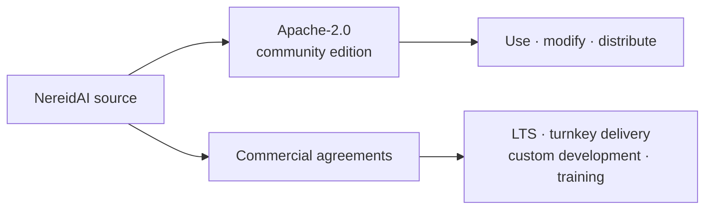

# License & Support

NereidAI is fully open source under the
[Apache License 2.0](https://www.apache.org/licenses/LICENSE-2.0). Copyright
© 2026 YIQISOFT.

!!! note "Community support only"
    Community support is provided through **GitHub issues and Discussions only**.
    **We do not provide free technical support.** If you need contractual response
    commitments, deployment help, or customization, those are available
    commercially — see below.

## What Apache-2.0 gives you

Apache-2.0 is a permissive license:

- Use the software for any purpose, including commercial use.
- Modify it and distribute your modifications.
- Combine it with your own code without a copyleft obligation on that code.
- Each repository ships its own `LICENSE` file and an SPDX identifier.

## Community support

The community edition is supported by the community, in the open:

| Channel | What it is for |
|---|---|
| GitHub issues | Bug reports and reproducible problems in a repository. |
| GitHub Discussions | Questions, ideas, and community help. |

Community support is **best-effort and unscheduled** — there is no SLA. Please
search existing issues and Discussions before opening a new one.

## Commercial options

The following are available **separately under commercial terms**:

- **Enterprise LTS** — with backported fixes and a contractual CVE response SLA.
- **Turnkey air-gapped deployment** — and an on-premises private POC.
- **Custom development** — device/connector integration, multi-vendor silicon/NPU
  acceleration, and industry-specific adaptation.
- **Private training** — and knowledge transfer.

## The community edition

The community edition covers the complete edge-to-cloud loop and can be used in
production on its own. The full edge-to-cloud community edition will be
**open-sourced by the end of 2026** under the terms above; individual modules are
released progressively, with status tracked in the
[NereidAI GitHub organization](https://github.com/NereidAI) and in Discussions.

## Commercial industry solutions

Beyond the platform itself, NereidFactory, NereidSentinel, and NereidMedical are
commercial offerings delivered under separate agreements. See
[Commercial Industry Solutions](../solutions/index.md).

## Next steps

- [Community vs Enterprise](community-vs-enterprise.md) — the capability comparison.
- [Roadmap](roadmap.md) — where the suite stands and where it is going.
- [Support](support.md) — how to get help and how to reach us.
