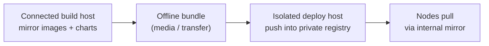

# Air-Gapped Installation

NereidAI is designed for sovereign, regulated, and network-isolated
environments. Every product supports **fully air-gapped operation**: there is no
internet dependency at runtime and **no mandatory call-home**. A privatized
installation pulls only from internal mirrors and a private registry, and every
byte stays inside the customer perimeter.

!!! note "Scope"
    This page explains how offline delivery works and what it guarantees. For
    Kubernetes topologies see [Kubernetes & Helm](kubernetes.md); for how updates
    reach the field see [Edge Delivery](edge-delivery.md).

## The offline guarantee

The suite-wide security posture is the contract this approach implements:

| Capability | Status |
|---|---|
| Air-gapped / offline installation (full image bundles, no internet required) | Available |
| No mandatory call-home; data stays inside the customer perimeter | Available |
| mTLS service-to-service and device-to-platform links | Available |
| Unified SSO and centralized RBAC across all products (Identity) | Available |
| Signed release artifacts and per-release SBOM | Planned |
| Enterprise SLA on CVE response and backported fixes | Commercial contract |
| Compliance baselines (e.g. 等保 2.0) and local-OS / accelerator certifications | Per-engagement roadmap |

Two invariants make this work:

- **Nothing may introduce a runtime external dependency.** Privatized builds
  pull only from internal mirrors and the private registry.
- **The platform never phones home.** Telemetry, models, and identity stay inside
  the deployment.

## What an offline bundle contains

An offline delivery (a *full image bundle*) is self-contained. It carries, at
minimum:

- **Container images** for the suite and its dependencies, mirrored from a vendor
  build host — the identity engine, databases, message backbone, and each product.
- **Helm charts** for the product releases and their dependencies.
- **An image manifest** recording exactly which images and tags were mirrored, so
  the isolated side can be verified against it.

!!! warning "Two repositories, both internal"
    Images live in a **private registry** (Harbor in the reference deployment);
    charts are served from an **internal chart repository**. In the isolated
    environment both are reached over the intranet only.

## How an offline installation proceeds

The shape is the same for every product — mirror, transfer, import, install,
verify — even though each product ships its own offline-preparation tooling:

1. **Prepare on a connected build host.** Mirror every image the release needs
   into the bundle and record a manifest. Each product provides scripts that
   mirror images and package them (Forge also groups images into
   categories).
2. **Transfer the bundle** to the isolated environment over whatever out-of-band
   channel the site allows (removable media, a one-way transfer host).
3. **Import into the private registry** and confirm every image resolves from the
   registry rather than a public source.
4. **Point the nodes at the internal mirror** so the container runtime resolves
   pulls to the private registry — applied identically to every node.
5. **Install from the internal chart repository** using the normal Helm flow
   described in [Kubernetes & Helm](kubernetes.md).
6. **Verify.** Run the product's verification step: everything must pull from the
   private registry, with no public-registry references left in the rendered
   manifests.

!!! note "Reuse before rebuild"
    Imported images are used as-is; the isolated side does not build from source
    or install packages at runtime — the images already contain their
    dependencies.

## Why identity and storage are in the bundle

The offline bundle must include the pieces every product assumes:

- **Identity** (the identity engine plus its dedicated database) is the
  suite identity source of truth; it is deployed once and shared. See
  [SSO & OIDC](../security/sso-oidc.md).
- **Stateful dependencies** — the time-series database, the message backbone, and
  optional S3-compatible object storage — travel with the bundle, so a site with
  no object store can still run the pipeline.

## Supply chain

- Signed release artifacts and a per-release SBOM are on the roadmap (listed as
  *planned* in the security posture); signed offline bundles and enterprise
  supply-chain workflows are offered under commercial terms.
- Containers are tracked by manifest digest; mirrored images keep their digests
  through the import.

!!! info "Operations documentation"
    Step-by-step installation and operations detail lives in each product
    repository: [github.com/NereidAI](https://github.com/NereidAI).

## Related

- [Kubernetes & Helm](kubernetes.md) — topologies, charts, and values.
- [Edge Delivery](edge-delivery.md) — distributing to air-gapped field nodes.
- [Security overview](../security/index.md) — the full posture.
