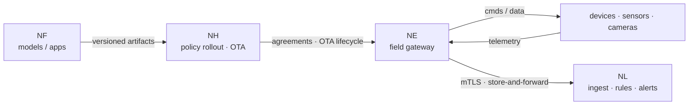

# Edge Delivery

**Horizon** is the edge distribution and deployment product. It distributes
**Edge itself, plus applications and models**, to large numbers of remote
edge nodes: policy-driven rollout, bandwidth-aware delivery, OTA lifecycle, and
autonomous reconciliation while offline.

The nodes it targets are field gateways running **Edge**, the southbound
integration layer that connects field devices into Link.

## The distribution loop

Forge produces models and applications; Horizon delivers them (and
Edge itself) to the field; Edge runs them on the gateway and bridges
the field devices; and device telemetry flows back to Link — the same loop
described in the [architecture overview](../architecture/overview.md).

## Policy-driven rollout

Horizon builds on **Open Horizon**: its console drives the Exchange and the
agreement bots that deploy workloads to edge nodes. Rollout is expressed as
**policy and patterns**, not per-device scripts:

- **Services** are the deployable units, governed by policies, patterns, and
  management policies that decide where they run.
- **Nodes** are the field targets; agreement bots form and maintain the
  agreements that keep the intended services running.
- Rollouts are **phased and canary-based** — percentage or fixed-size batches
  that advance only after an observation pause, with circuit breakers that abort a
  rollout automatically on failure thresholds.

Service deployments are signed before they are published, and the matching public
key is uploaded alongside the service — an integrity check on the distribution
path.

## Bandwidth-aware delivery

Field links are frequently intermittent and low-bandwidth, so delivery is
designed to survive them:

- **Store-and-forward** at the edge means a link outage does not lose data; the
  gateway buffers and forwards when the link returns.
- **Resumable downloads** let a large artifact survive a partial transfer rather
  than restart; download progress is streamed to the UI but not stored as
  telemetry.
- **Autonomous reconciliation while offline**: the edge keeps operating on its
  last known-good configuration and reconciles with the platform on reconnect.

## The OTA lifecycle

Edge is delivered and kept up to date by Horizon over an OTA
lifecycle. Two sources are supported: an **external URL** (the edge downloads it
itself, with enforced integrity verification) or **platform-hosted packages** in
object storage behind an authenticated path (so edges need no object-store
credentials).

Updates move through staged phases — pending, downloading, verified, updating,
rebooting, confirmed — with structured result codes for precise diagnosis.
Process control includes pause, resume, and tiered cancellation: not-yet-started
targets stop immediately while in-progress updates are not interrupted and their
results are still collected.

## NereidEdge on the field gateway

Edge runs on field gateways as an EdgeX Foundry application service. It
provides:

- **Zero-touch onboarding** — devices auto-connect on first telemetry, and the
  edge periodically reports a manifest of its attached device list.
- **Secure mTLS links** to Link, with an outbound-only connection to the
  Link gateway.
- **Local autonomy** — manifest reconciliation, heartbeat liveness grading, and
  connector desired-state reconciliation continue without the platform.
- **Handshake negotiation and feature gating** — on connect the edge negotiates
  protocol version and feature set; non-overlapping versions or missing required
  features are rejected.
- **Configuration lifecycle** — the platform pushes desired state and the edge
  reports actual state, with two levels of configuration (profile templates plus
  instance overrides) merged at dispatch.
- **Schema validation and drift reconciliation** — edges advertise connector
  config schemas, and periodic list reconciliation identifies missing, stale,
  drifted, and extra instances.

!!! note "The edge stays reachable on its own LAN"
    Edge connects to Link over the WAN with an outbound mTLS link;
    site-local commands and state (for example Fleet ↔ robots) run over the
    low-latency local LAN and do not depend on the central link.

!!! info "Operations documentation"
    Step-by-step installation and operations detail lives in each product
    repository: [github.com/NereidAI](https://github.com/NereidAI).

## Related

- [Kubernetes & Helm](kubernetes.md) — where the distribution control plane runs.
- [Air-Gapped Install](air-gapped.md) — offline delivery to isolated sites.
- [Horizon](../products/nereidhorizon.md) and
  [Edge](../products/nereidedge.md) — product pages.
