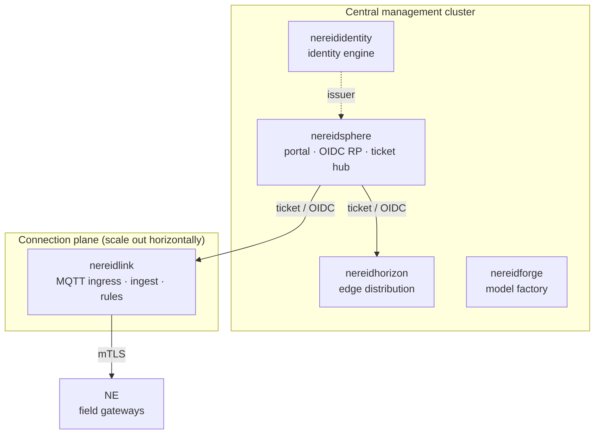

# Kubernetes & Helm

Every domain product is a complete system that can run on its own, and every one
of them can run on Kubernetes. The suite layer does not deploy the products for
you — each product owns its own namespace, Helm release, and release lifecycle.

## One codebase, two forms

Link is the clearest example of the delivery duality: **one codebase, two
forms**.

| Form | Where | Dependencies |
|---|---|---|
| Single host (all-in-one) | A single static binary plus a local stack | Bundles its own database, message backbone, and optional object storage |
| Kubernetes / K3s | The product's Helm chart | Bundled database and message backbone; object storage reused or bring-your-own |

The same product binary serves both forms. The minimum stateful dependencies are
only a database and a message backbone; object storage is optional (needed for
platform-hosted firmware uploads, not for external-URL OTA).

## Namespaces and topology

In the reference topology each product lives in its **own namespace**, named
after the product itself, and the identity plane is deployed once for the whole
suite:

- **Identity is a single suite-wide plane.** No matter how many connection-plane
  clusters exist, they authenticate against one issuer rather than each running an
  identity service.
- **The connection plane scales by adding clusters**, not by adding namespaces:
  isolate MQTT ingress, ingest, and time-series load per tenant or device range.
- **Multi-tenancy is a product concept, not a namespace boundary.** Tenants live
  inside the product's business model; a Kubernetes namespace is not a tenant.

In production each product namespace carries its own resource quotas, a
default-deny network policy with explicit allowances, and an independent registry
pull secret. A lab/POC install can instead use a single all-in-one namespace.

## Helm charts and versioning

Charts come from the **internal chart repository**. All the derived versions —
the chart version, its `appVersion`, and the image tag — come from a single
`VERSION` source of truth, so they cannot drift: the chart version drops the
leading `v` while the app version and image tag keep it. An empty image tag falls
back to the chart's app version.

Deploy the identity plane first, then the portal, then the products: the portal
is the suite's only OIDC relying party and must be reachable before products can
verify handoffs.

## NereidSphere deployment behaviour

Sphere is a stateless portal with sealed cookie sessions, and its
chart exposes the choices that matter at install time:

- **Authentication mode.** By default Sphere authenticates against the identity
  engine. An **emergency local mode** with bcrypt accounts declared at deploy time
  exists for disaster recovery when the identity plane is unreachable — it is
  break-glass only, never the production default. See
  [SSO & OIDC](../security/sso-oidc.md).
- **Multi-replica ticket safety.** A handoff ticket is single-use. With more than
  one Sphere replica the single-use claim must be shared, so Sphere uses a **Valkey**
  key-value topology for cross-replica enforcement. If it cannot confirm single
  use it **fails closed** rather than risk a replay; a process-memory store is
  limited to single-replica development and the chart refuses to render multiple
  replicas with it.

## High availability and bring-your-own infrastructure

- **Link HA** ships as an opt-in overlay: multiple app pods, a
  CloudNativePG PostgreSQL, a multi-node NATS JetStream, shared read-write-many
  storage, and NATS-KV leader election. The default stays single-node.
- **Bring-your-own infrastructure** is supported by disabling the bundled
  dependencies and supplying endpoints and credentials for an existing database,
  message backbone, and object store. The chart fails fast if an external
  dependency is selected but its endpoint is left empty.

## Private registry

All deployment images come from the **private registry** (Harbor in the reference
deployment); there are no public-registry pulls at deploy time. A registry pull
secret is carried into each namespace, and a node-level mirror configuration lets
the container runtime resolve the registry on air-gapped clusters (see
[Air-Gapped Install](air-gapped.md)).

!!! info "Operations documentation"
    Step-by-step installation and operations detail lives in each product
    repository: [github.com/NereidAI](https://github.com/NereidAI).

## Related

- [Air-Gapped Install](air-gapped.md) — offline bundles and private registry.
- [Edge Delivery](edge-delivery.md) — reaching the field nodes.
- [Architecture overview](../architecture/overview.md) — how the pieces talk.
