# Platform Integration

This guide is for **backend systems and third-party developers** that call the
NereidAI platform programmatically. Every product ships its own complete
OpenAPI contract; this page does not repeat those endpoints. It answers the two
questions that decide an integration: **which product's API do I call**, and
**how do I authenticate** — then points to the exact spec.

!!! info "Upper-layer documentation"
    This is a capability-and-flow guide for integrators. Per-endpoint request
    and response schemas live in each product's OpenAPI document, and deep
    developer documentation lives in the product repositories — see
    [NereidAI](https://github.com/NereidAI).

## Choose your entry point

```mermaid
flowchart TD
    A[Your system] --> Q{What are you integrating?}
    Q -->|Device / gateway firmware| D[NL southbound protocol<br/>MQTT or HTTP device endpoints]
    Q -->|Backend service, no interactive user| M{Which data?}
    Q -->|Browser user inside the suite| S[NS single sign-on<br/>then call via the gateway]
    Q -->|One product without the suite| O[Direct OIDC client against NI]
    M -->|Devices, telemetry, remote control| ML[NL REST API<br/>OAuth2 client_credentials]
    M -->|Edge nodes, services, agreements| MH[NH Partner API<br/>X-Api-Key, read-only]
    S --> GW[/NS gateway /p/&#123;product&#125;/]
```

| You are… | Use | Authentication |
|---|---|---|
| A sensor, controller or edge gateway reporting data / taking commands | NL southbound (`v1/me/*` over MQTT/HTTP) | Device credential (token / id+secret / X.509) |
| A server application reading devices/telemetry or issuing commands | NL platform REST (`/v1/tenants/...`) | OAuth2 `client_credentials` → Bearer JWT |
| A third-party system reading edge exchange inventory | NH Partner API (`/api/v1/{org}/...`) | Partner API key (`X-Api-Key`) |
| A web application used by signed-in suite users | Product APIs through the NS gateway | Suite session cookie; CSRF on writes |
| A product integrated without the suite portal | The product's own OIDC login | Authorization-code + PKCE against NI |

The four authentication flows with full sequence diagrams are on the next page:
[Authentication Flows](authentication-flows.md).

## API catalog

Every product is independently deployable and has its own origin. The suite
portal is only involved when Sphere is the entry point.

| Product | API surface | Typical base path | Machine auth | Contract |
|---|---|---|---|---|
| **NS** (Sphere) | Portal, SSO ticket hub, gateway, admin | `/auth/*`, `/api/v1/*`, `/p/{product}/*` | `X-NS-Client-Id` + `X-NS-Client-Secret` for server-to-server calls | Embedded OpenAPI + offline Swagger UI at `/api/docs` |
| **NL** (Link) | Platform REST: tenants, devices, profiles, telemetry, OTA, commands | `/v1/tenants/{tenantId}/...` | OAuth2 `POST /v1/auth/token` (`client_credentials`) → Bearer JWT | Embedded Swagger UI at `/api/docs` |
| **NL** device ingress | Device/gateway wire protocol | MQTT topics `v1/me/*`, `v1/gateway/*`; HTTP `/v1/me/*` | Device credential | Same OpenAPI (device tags) + [Device SDK](../guides/link/device-sdk.md) |
| **NF** (Forge) | Model factory console API (datasets, training jobs, models) | `/api/v1/...` | Session-oriented (suite ticket or local JWT login); tenant from `X-Tenant-Id` | `docs/api/openapi.yaml` |
| **NH** (Horizon) console | Management console API | `/api/...` | Suite session cookie + CSRF | `openapi-console.yaml` |
| **NH** partner | Read-only edge exchange proxy for third parties | `/api/v1/{org}/...` | `X-Api-Key` (`nk_live_…` / `nk_test_…`) | `openapi-partner.yaml` |
| **NI** (Identity) | Standard OIDC / OAuth2 (Keycloak-compatible realm `nereidai`) | `/auth/realms/nereidai/protocol/openid-connect/*` | Client credentials per registered client | OIDC discovery document |
| **NE** (Edge) | No independent REST API | — | Acts as an NL gateway over the southbound wire protocol | See [Gateway integration](../guides/link/integrate-gateway.md) |
| **NFL / NM** (Fleet / Mobile) | No public OpenAPI in this release | — | Fleet is Tech Preview; Mobile uses the narrow Link mobile API subset | Product repositories |

!!! tip "Products are independent"
    You can buy/deploy NL alone, NH alone, and so on. Suite SSO and the `/p/`
    gateway exist only in a suite deployment where NS is the entry point; a
    standalone product is reached directly at its own origin and authenticates
    per its own contract.

## The identity plane

- **NI (Identity)** is the only identity source of truth. Its issuer is a
  Keycloak-compatible realm, for example
  `https://sso.yiqisoft.cn/auth/realms/nereidai` (development:
  `http://localhost:8090/realms/nereidai`).
- Standard OIDC endpoints are published under the issuer's
  `/.well-known/openid-configuration` (authorization, token, JWKS, userinfo).
- In a suite deployment **NS is the only component that speaks OIDC to NI**.
  Backend integrations normally never touch NI directly: machines get NL
  service-account tokens, browsers sign in at NS.
- Customer identity systems (Entra ID, Okta, AD FS, …) are brokered behind NI;
  they never change the API contracts. See
  [SSO & OIDC](../security/sso-oidc.md) for the identity model.

## Calling conventions

These rules apply across products; per-endpoint details are in each OpenAPI
document.

### Requests

- All REST traffic is JSON over HTTPS (`Content-Type: application/json`),
  UTF-8. Device media upload is the documented binary exception
  (`POST /v1/me/blob`).
- Authenticate with an `Authorization: Bearer <jwt>` header (NL REST),
  `X-Api-Key` (NH partner), or the suite session cookie when calling through
  the NS gateway. Never invent identity headers (`X-User-*`,
  `X-NS-Integration-Secret`) — inbound copies are stripped; only the gateway
  may set them.
- Scope every call to your tenant/org. NL encodes it in the path
  (`/v1/tenants/{tenantId}/...`); NF reads it from the token or `X-Tenant-Id`;
  an NH partner key is bound to exactly one org and any other org returns 403.
- Send or honor `X-Request-Id` for correlation. If you do not provide one, the
  gateway generates it; echoing it in your logs makes support traceable.

### Responses

- Success and error bodies are JSON. Arrays are always `[]`, never `null`.
- Use the standard status codes: `401` (missing/expired credential — get a new
  token), `403` (authenticated but not assigned/authorized), `404`, `409`
  (conflict), `413/415` (media size/type), `429` (rate limited — NL also
  temporarily locks an OAuth client after repeated failed logins), `503`
  (for example NL blob storage not configured).
- Machine tokens are short-lived (NL: `expires_in`, typically 1800 s) and have
  **no refresh token** — re-run the client-credentials exchange before/on
  expiry.
- The platform never invents semantics such as measurement units; they come
  from user-defined descriptors. See
  [cross-product contracts](../architecture/contracts.md).

### Air-gapped operation

All endpoints, Swagger UIs and base models are served on-premises with no CDN
or cloud dependency. Partner keys, service-account secrets and OIDC clients are
provisioned by the operator; integrate against the internal origins published
for your deployment.

## Typical recipes

The end-to-end sequences — token call, suite user, partner key, device media —
are on [Authentication Flows](authentication-flows.md), each with a runnable
request example.

## Related

- [Authentication Flows](authentication-flows.md) — the four flows, step by step.
- [SSO & OIDC](../security/sso-oidc.md) · [RBAC](../security/rbac.md) — the identity and authorization model.
- [Device SDK (Go)](../guides/link/device-sdk.md) · [Binary media and S3](../guides/link/media-blobs.md) — device-side integration.
- [Cross-product contracts](../architecture/contracts.md) — compatibility rules.
