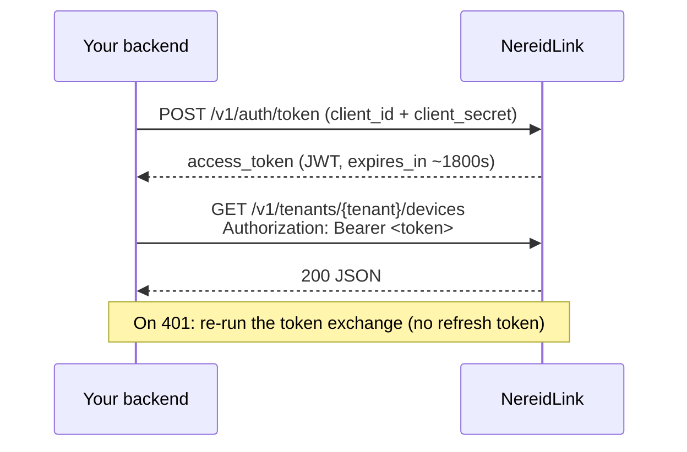
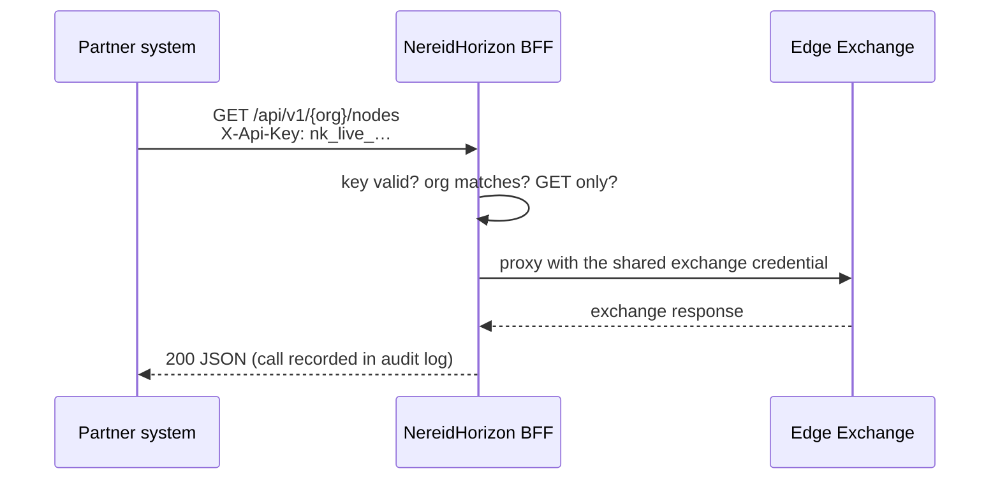
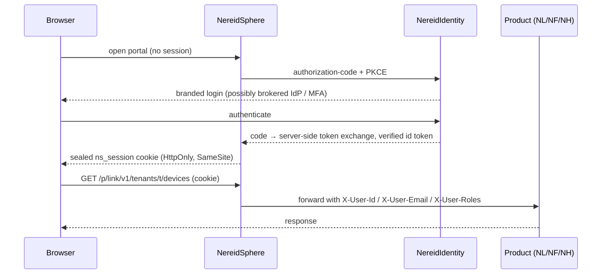

# Authentication Flows

This page walks each integration flow end to end. Pick the flow that matches
your caller type from [Platform Integration](api-integration.md); the
sequence diagram shows who talks to whom, and the recipe is a runnable request.

| Flow | Caller | Credential | Interactive user? |
|---|---|---|---|
| A | Backend service → NL REST | OAuth2 `client_credentials` Bearer JWT | No |
| B | Backend / third party → NH edge data | Partner API key | No |
| C | Browser user → any product in a suite | NS session + gateway / ticket | Yes |
| D | Device or gateway firmware | Device credential over MQTT/HTTP | No |
| E | A product deployed without the suite | OIDC authorization-code + PKCE | Yes |

Identity concepts (why there is one identity plane, where customer IdPs plug
in) are on [SSO & OIDC](../security/sso-oidc.md).

## Flow A — backend service calling NL (client_credentials)

Use this for servers that read devices/telemetry or issue commands with no
interactive user. The operator creates a **service account** in NL scoped to a
tenant with chosen `scopes`; you receive a `client_id` and `client_secret`.



The token endpoint accepts the credentials as JSON, as a form body, or as HTTP
Basic auth; only `grant_type=client_credentials` is supported.

```bash
# 1) Exchange the service-account credentials for a machine token
TOKEN=$(curl -sS https://link.example/v1/auth/token \
  -u "$NL_CLIENT_ID:$NL_CLIENT_SECRET" \
  -H 'Content-Type: application/json' \
  -d '{"grant_type":"client_credentials"}' | jq -r .access_token)

# 2) Call a tenant-scoped REST endpoint
curl -sS "https://link.example/v1/tenants/$TENANT_ID/devices?page=1&page_size=50" \
  -H "Authorization: Bearer $TOKEN"
```

Token response: `{"access_token":"…","token_type":"Bearer","expires_in":1800}`.

- Cache the token until shortly before `expires_in`; there is deliberately **no
  refresh token** — present the secret again.
- Repeated failed logins for one client id are temporarily locked with `429`
  regardless of source address; treat secrets as configuration, never log them.
- The same JWT is the `BearerAuth` scheme documented in the OpenAPI document.
- Command/control endpoints require the corresponding service-account scope;
  read-only integrations should be granted read scopes only.

## Flow B — third party reading edge data from NH (partner key)

For an external system that only needs to **read** Open Horizon exchange
resources (services, patterns, policies, nodes, agreements, users, HA groups).
The operator issues a partner key in the console; the key is bound to one
organization.



```bash
curl -sS "https://horizon.example/api/v1/$ORG/nodes" \
  -H "X-Api-Key: nk_live_<base64url>"
```

- Key formats: `nk_live_<base64url>` (production), `nk_test_<base64url>`
  (non-production). Keys can carry an expiry and can be revoked.
- Every request is forced to the key's org: a `?org=` override or a mismatching
  path org returns `403`. Only `GET` is allowed; all mutations return `403`.
- Partners never talk to the Edge Exchange directly — the BFF holds one shared
  exchange credential, and every call is written to the append-only audit log.
- The console API (`openapi-console.yaml`) is a different surface for browser
  users (Flow C); partners use `openapi-partner.yaml` only.

## Flow C — browser user inside the suite (SSO + gateway)

When NS is the entry point, the user logs in once and reaches every product
without signing in again. Your frontend never handles a password or an
upstream token.

### C.1 Login and the gateway



Rules for a client of the gateway:

- Call products under **`/p/{product}/...`**; the prefix is stripped before
  forwarding (`/p/link/v1/…` → the NL origin's `/v1/…`).
- Credentials are the `ns_session` cookie — send same-origin/credentialed
  requests; you do not present a bearer token.
- Mutating requests carry the double-submit CSRF header `X-Csrf-Token`, equal
  to the readable `ns_csrf` cookie. `OPTIONS` preflight and the server-to-server
  ticket exchange are exempt.
- Never send `X-User-*` or `X-NS-Integration-Secret` yourself: inbound copies
  are always removed, then the gateway stamps the verified values. A product
  trusts those headers **only** on requests arriving from the gateway.

### C.2 Entering a separately hosted product (the ticket)

The browser holds only an NS cookie, so opening an independently hosted product
uses a one-time handoff ticket (30-second, single-use, audience-bound):

```mermaid
sequenceDiagram
    participant U as Browser
    participant NS as NereidSphere
    participant P as Product backend
    U->>NS: GET /auth/enter/{product}?to=/dashboard
    NS->>NS: resolve session; require /nereid{product}/{tenant}/{role} group
    NS-->>U: 302 {product.url}/auth/ns-callback?ticket=…&to=/dashboard
    U->>P: GET /auth/ns-callback?ticket=…
    P->>NS: POST /api/v1/auth/ticket/verify<br/>X-NS-Client-Id / X-NS-Client-Secret
    NS-->>P: identity snapshot + "to"
    P-->>U: product-local session
```

The product backend (not the browser) verifies the ticket:

```http
POST https://sphere.example/api/v1/auth/ticket/verify
X-NS-Client-Id: link
X-NS-Client-Secret: <products[].sso_secret>
Content-Type: application/json

{"ticket":"..."}
```

The response carries the verified identity — `sub`, `preferred_username`,
`email`, `name`, `roles`, and `groups` (suite assignments of the form
`/nereid{product}/{tenant}/{role}`) — plus the relative `to` path. Products are
**default-deny**: a user without an assignment group for that product is
redirected back to the portal; a valid identity alone is not enough. The
product then mints its own normal session (NF, for example, issues its local
JWT and resolves the tenant for `X-Tenant-Id`).

### C.3 Alternative for an ingress: external-auth

A product/ingress that must not implement the ticket exchange can delegate
authentication to `GET https://<ns>/api/v1/auth/verify` (ingress external-auth).
A valid session returns `204` plus the `X-User-*` response headers to forward;
trust those headers only on the authenticated path.

## Flow D — device and gateway firmware

Physical devices and edge gateways do not use user accounts or OAuth. They
authenticate with a device credential provisioned in NL and speak the
southbound wire protocol:

- Credential: access token (MQTT username), `id + secret` (Basic), or mutual
  TLS (X.509).
- Transport: MQTT topics (`v1/me/*` for direct devices, `v1/gateway/*` after
  hello for gateways) or HTTP (`/v1/me/telemetry`, `/v1/me/blob`, long-poll
  commands).
- Gateways additionally negotiate hello/heartbeat/manifest and relay sub-device
  traffic.

This is a full flow of its own — start with the
[Device SDK (Go)](../guides/link/device-sdk.md),
[Direct device integration](../guides/link/integrate-direct-device.md) and
[Gateway integration](../guides/link/integrate-gateway.md). Binary telemetry
(images/documents into S3) is documented at
[Binary media and S3 storage](../guides/link/media-blobs.md). Adding a new
southbound protocol to the platform itself uses the
[Adapter SDK](../guides/link/adapter-sdk.md).

## Flow E — standalone product against your IdP (direct OIDC)

A product sold/deployed **without the suite portal** can be a standard OIDC
relying party directly against NI (which may broker your corporate IdP):

1. Register a confidential/public client for the product with a fixed redirect
   URI; ROPC is disabled, so use **authorization-code + PKCE**.
2. Discover endpoints from
   `https://<issuer>/auth/realms/nereidai/.well-known/openid-configuration`.
3. Complete the code exchange server side, verify the id token against JWKS
   (issuer, audience, expiry, nonce), and build the product's own session.
4. Resolve product-local authorization from the suite role/group claims; the
   product remains the authority for its own RBAC.

In suite deployments this is the `oidc` integration mode, while every other
product typically stays on the default `ns` ticket mode. NS and the product
**must agree on the mode** — a mismatch is the usual cause of login loops.
Details and claim mapping: [SSO & OIDC](../security/sso-oidc.md).

## Decision checklist

1. Is there an interactive user? **No** → A (NL) or B (NH); **Yes** → C (suite)
   or E (standalone).
2. Is the caller firmware? → always D.
3. Does the integration need writes to edge exchange? The NH partner API is
   read-only; operational writes go through the console/API as an authenticated
   user, not a partner key.
4. Confirm the deployment shape: suite (gateway + tickets exist) or standalone
   (direct origins + direct OIDC).
5. Provision credentials out of band with the operator: service account,
   partner key, OIDC client, or device credential. None are self-registered.

## Related

- [Platform integration](api-integration.md) — API catalog and calling conventions.
- [SSO & OIDC](../security/sso-oidc.md) · [RBAC](../security/rbac.md)
- Embedded OpenAPI: NS and NL serve an offline Swagger UI at `/api/docs`; NH
  ships console and partner specs; NF ships `docs/api/openapi.yaml`.
