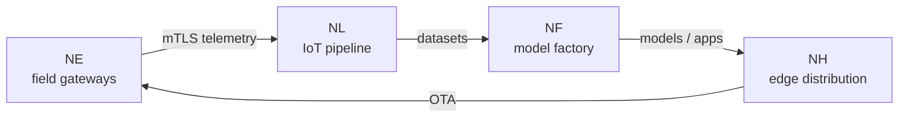

# Getting Started

NereidAI is an end-to-end AIoT platform delivered as a **suite of focused
products**. Every product is an independent repository under the
[NereidAI GitHub organization](https://github.com/NereidAI), and together they
form one closed loop — with no mandatory cloud dependency. See the
[Suite Overview](../products/index.md) for what each product does, and the
[Architecture Overview](../architecture/overview.md) for how the pieces fit.

!!! info "Developer documentation"
    This page orients you; the **product repositories are authoritative** for
    setup, exact commands and internals. Start from the
    [NereidAI organization](https://github.com/NereidAI) and read the product's
    `README` first.

## One suite, independent repositories

The suite layer federates the domain products but never absorbs their logic.
Each product owns its own UI, APIs and release cycle, and carries its own
quick-start guide in its `README`.

| Product | Role |
|---|---|
| [Sphere](../products/nereidsphere.md) | Thin suite layer — single portal, unified API gateway, cross-product event glue. |
| [Identity](../products/nereididentity.md) | Suite SSO and identity center — OIDC / LDAP / SAML federation, RBAC. |
| [Link](../products/nereidlink.md) | Privatized IoT data pipeline — device access, rules, alerts, dashboards. |
| [Forge](../products/nereidforge.md) | Model factory — datasets, training, optimization, multi-silicon export. |
| [Horizon](../products/nereidhorizon.md) | Edge distribution — policy-driven rollout, bandwidth-aware delivery, OTA. |
| [Edge](../products/nereidedge.md) | Southbound edge integration on field gateways — zero-touch, mTLS, autonomy. |
| [Fleet](../products/nereidfleet.md) | Robot fleet management — task scheduling, traffic control, teleoperation. |
| [Mobile](../products/nereidmobile.md) | Operator's mobile window into Link — app and WeChat Mini Program. |

!!! note "Independently deployable"
    Every domain product can run standalone; nothing requires the others to
    start. The suite services (Sphere, Identity) are optional for
    single-product deployments, and are thin layers that never duplicate a
    product's features.



## Find your product's quick start

Open the repository for the product you care about and follow its `README` (and
any `INSTALL` / `docs` guide it links). Link ships one codebase in two
forms — an all-in-one binary or Kubernetes microservices; Edge runs on
field gateways; the newer products (Fleet, Mobile) are early stage,
so check the repository for current scope.

## Run it yourself

A couple of representative entry points, one per product family. Treat these as
signposts — the product repository holds the full command set.

=== "Sphere"

    ```bash
    make dev          # run the backend (configs/dev.yaml)
    make web-dev      # Vite dev server with hot reload
    ```

=== "Link"

    ```bash
    make build        # web build + self-contained binary
    ```

=== "Horizon"

    ```bash
    make dev-all      # PostgreSQL container + backend + frontend
    ```

!!! tip "Maturity varies"
    Products sit at different gates. Verify the current status in the product
    repository rather than assuming a stable interface everywhere — see the
    [Roadmap](../community/roadmap.md).

## Connect a device

- **Field devices → Edge → Link.** Edge runs on a field
  gateway and bridges southbound devices into Link over the gateway MQTT
  protocol, with mTLS and store-and-forward buffering.
- **Direct devices → Link.** Link accepts MQTT, HTTP and CoAP
  through one shared envelope and SDK, so behaviour is identical across
  transports.

<!-- markdownlint-disable-next-line MD033 -->
<details markdown>
<summary>Adding a new southbound protocol</summary>

New protocols are added with the **Link Adapter SDK**, as a separate
project or repository that translates a wire protocol into platform contracts.
The SDK lives under `sdk/` in the Link repository, ships an annotated
skeleton (`adapters/template`) and a full reference adapter (`adapters/coap`),
and never requires importing `internal/` packages.

</details>

## Next steps

- [Suite Overview](../products/index.md) — the full product list.
- [Contributing](contributing.md) — how to engage with the repositories.
- [Conventions](conventions.md) — the shared coding conventions.
