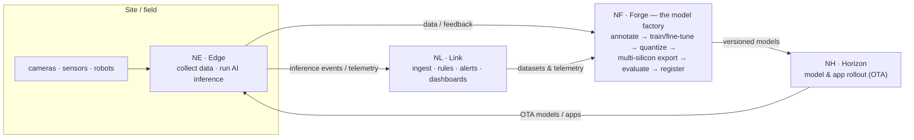

# NereidAI

<strong>Navigate the sea of data</strong> — from devices, to
models, to edge intelligence.

An end-to-end, air-gapped, multi-silicon AIoT platform.
IoT connectivity and AI intelligence in one closed loop — private by design.

[Explore the suite](products/index.md){ .md-button .md-button--primary }
[Architecture](architecture/overview.md){ .md-button }

!!! nr-status "Open-source status — verification in progress"
    The full codebase has **not been published to GitHub yet**. It is currently in
    a strict verification phase: we are auditing every component and feature so the
    open-source release is **100% usable out of the box**. *Supplies before the
    march* — repositories open only once they pass review. Track progress on the
    [roadmap](community/roadmap.md).

## The closed loop

NereidAI ships as a suite of focused products; each can be deployed standalone, and
together they form one unified platform. A thin suite layer ties them together without
absorbing their domain logic.

The loop has two halves that meet in **Forge**: the **IoT half** brings field data
in (Edge, Link) and acts on results; the **AI half** turns that data into models
(Forge) and ships them back to run at the edge (Horizon, Edge). Models improve from
real telemetry, on the next iteration — with no mandatory cloud.

- :material-shield-lock:{ .lg .middle } **Private by design**

    ---

    Fully offline / air-gapped delivery with no mandatory call-home. Data,
    training and inference all stay inside the customer perimeter.

- :material-brain:{ .lg .middle } **From CNNs to large models**

    ---

    One factory for classic vision models (detection / classification /
    segmentation) **and** large models — VLM-assisted labeling plus LLM / VLM
    fine-tuning and serving.

- :material-chip:{ .lg .middle } **Multi-silicon → edge inference**

    ---

    Export one trained model across NVIDIA, AMD, Intel, ARM, Ascend, SOPHGO,
    MetaX, Enflame and Rockchip, then run low-latency CV or VLM inference on the
    gateway.

- :material-robot:{ .lg .middle } **Embodied & physical AI** _roadmap_

    ---

    Take models off the screen and onto robots — NereidFleet orchestrates
    wheeled AMRs, quadrupeds and humanoids over ROS 2 / Open-RMF, toward
    vision-language-action and physical-AI workloads.

- :material-access-point:{ .lg .middle } **Massive device access, in real time**

    ---

    Multi-protocol ingress (MQTT / HTTP / CoAP), a rule engine, alerting and
    dashboards — every change pushed over WebSocket, no polling.

- :material-wifi-off:{ .lg .middle } **Edge autonomy on flaky links**

    ---

    Field gateways keep working while the WAN is down: local autonomy plus
    store-and-forward buffering that safely replays telemetry on reconnect.

- :material-satellite-variant:{ .lg .middle } **Offline distribution at scale**

    ---

    NereidHorizon rolls out Edge itself, apps and models to thousands of remote
    nodes — policy-driven, bandwidth-aware OTA with offline reconciliation.

- :material-sitemap:{ .lg .middle } **One AIoT closed loop**

    ---

    Field data → models → OTA rollout → edge inference → telemetry feedback:
    IoT connectivity and AI intelligence in a single loop, no mandatory cloud.

Apache-2.0 community edition · enterprise LTS, SLAs, hardening and
turnkey private delivery — see <a href="community/community-vs-enterprise.md">Community vs Enterprise</a>.

## From data to edge intelligence

The AI journey is a first-class path, not a side feature:

| # | Stage | What happens | Product |
|---|---|---|---|
| 1 | **Collect** | Cameras, sensors and robots feed images, video and time-series data from the field. | Edge, Link |
| 2 | **Annotate** | Datasets are versioned; vision-language models (Florence-2, Qwen-VL) pre-label for human review. | Forge |
| 3 | **Train / fine-tune** | Kubeflow pipelines train classic vision models or fine-tune LLMs / VLMs (LLaMA-Factory) on the customer's own data. | Forge |
| 4 | **Optimize & export** | Quantize / compile (NNCF, OpenVINO, TensorRT, vLLM) and export for the target silicon. | Forge |
| 5 | **Evaluate & register** | Quality and benchmark metrics — including LLM-as-a-judge — gate each version; approved models enter the registry. | Forge |
| 6 | **Run at the edge** | Models roll out over the air and run as low-latency CV or VLM inference on gateways and devices. | Horizon, Edge |
| 7 | **Monitor & feed back** | Inference events and telemetry drive rules, alerts and the next training round. | Link, Forge |

The same loop powers the commercial solutions — smart-manufacturing inspection,
video/image analytics (NereidSentinel) and medical insights (NereidMedical).

### Toward embodied & physical AI

The next step beyond sensing and analytics is **acting in the physical world**.
[NereidFleet](products/nereidfleet.md) (currently Tech Preview) already
orchestrates heterogeneous embodied devices — wheeled AMRs, quadrupeds and
humanoids — on an open stack (ROS 2, Open-RMF, Zenoh, EdgeX). On the roadmap, the
same Forge-to-edge loop will feed **vision-language-action (VLA)** and physical-AI
models to these robots: perception models trained in Forge, deployed over Horizon,
and closed through Fleet and Link.

## Product suite

Two thin suite services tie the family together; six domain products do the work.
Every domain product is a complete system that can run on its own. **Short names**
are used in prose and **abbreviations** in diagrams — see
[Naming & abbreviations](reference/naming.md).

| Product | Abbr. | What it does |
|---|---|---|
| [NereidSphere](products/nereidsphere.md) | NS | Thin suite layer — single portal, unified API gateway, and cross-product event glue. |
| [NereidIdentity](products/nereididentity.md) | NI | Suite SSO and identity center — OIDC / LDAP / SAML federation, RBAC, token issuance. |
| [NereidLink](products/nereidlink.md) | NL | Privatized IoT data pipeline — device access, rule engine, alerting, dashboards. |
| [NereidForge](products/nereidforge.md) | NF | Model factory — datasets, training, optimization, multi-silicon export, registry. |
| [NereidHorizon](products/nereidhorizon.md) | NH | Edge distribution — policy-driven rollout, bandwidth-aware delivery, OTA. |
| [NereidEdge](products/nereidedge.md) | NE | Southbound edge integration on field gateways — zero-touch, mTLS, autonomy. |
| [NereidFleet](products/nereidfleet.md) | NFL | Robot fleet management — task scheduling, traffic control, teleoperation. |
| [NereidMobile](products/nereidmobile.md) | NM | Operator's window into Link — mobile app and WeChat Mini Program. |

## Where to start

-   :material-rocket-launch:{ .lg .middle } **Getting started**

    ---

    Install the community edition, run your first loop, and connect a device.

    [:octicons-arrow-right-24: Development](development/getting-started.md)

-   :material-server-network:{ .lg .middle } **Deployment**

    ---

    Air-gapped installation, Kubernetes & Helm, and edge delivery.

    [:octicons-arrow-right-24: Deployment](deployment/air-gapped.md)

-   :material-shield-account:{ .lg .middle } **Security**

    ---

    SSO / OIDC, RBAC, mTLS, and compliance posture.

    [:octicons-arrow-right-24: Security](security/index.md)

-   :material-scale-balance:{ .lg .middle } **Community vs Enterprise**

    ---

    What is open source, and what is offered under commercial terms.

    [:octicons-arrow-right-24: Compare](community/community-vs-enterprise.md)

