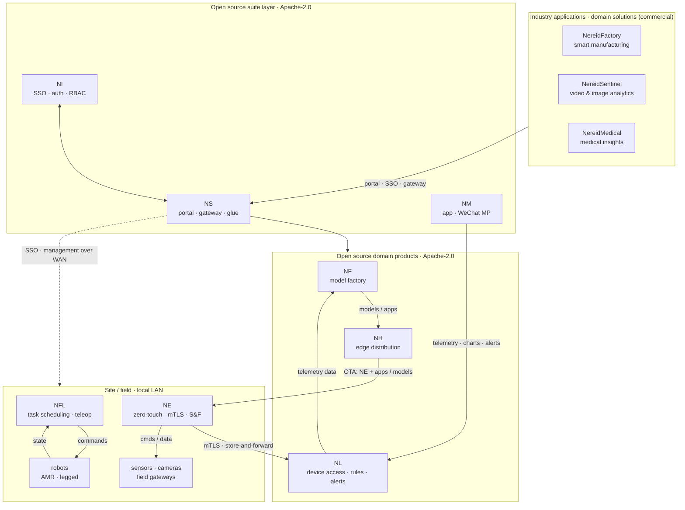

# The NereidAI Suite

NereidAI is an end-to-end AIoT platform built for air-gapped and multi-vendor
silicon environments. It closes the loop from edge data collection
(**Edge**) → multi-silicon model factory (**Forge**) → large-scale
offline edge distribution (**Horizon**) → inference and feedback
(**Link**) — without mandatory cloud dependency.

NereidAI ships as a suite of focused products; each can be deployed standalone, and
together they form one unified platform. A thin suite layer ties them together without
absorbing their domain logic: the **Sphere** portal and API gateway, and the
**Identity** single sign-on and access-control center.

## Two thin services, six domain products

Every domain product is a complete system that can run on its own — the suite
services only federate them. **Short names** are used in prose and
**abbreviations** in diagrams — see [Naming & abbreviations](../reference/naming.md).

| Product | Abbr. | Role | Repository |
|---|---|---|---|
| **NereidSphere** | NS | Thin suite layer — a single portal and a unified API gateway, plus the closed-loop event glue between products. Holds no domain logic and delegates authentication to Identity. | [`NereidSphere`](https://github.com/NereidAI) |
| **NereidIdentity** | NI | Suite authentication and identity center — single sign-on across every product, OIDC / LDAP / SAML federation, RBAC, token issuance, and tenant-aware access governance. | [`NereidIdentity`](https://github.com/NereidAI) |
| **NereidLink** | NL | Privatized IoT data pipeline — multi-protocol device access, unified messaging, rule engine, alerting, and real-time dashboards. One codebase, two forms: an all-in-one binary or Kubernetes microservices. | [`NereidLink`](https://github.com/NereidAI) |
| **NereidForge** | NF | Model factory — dataset / annotation management, training and fine-tuning, optimization and quantization, hardware-targeted export, evaluation, and model registry. | [`NereidForge`](https://github.com/NereidAI) |
| **NereidHorizon** | NH | Edge distribution and deployment — distributes Edge itself, plus applications and models, to large numbers of remote edge nodes: policy-driven rollout, bandwidth-aware delivery, OTA lifecycle, and autonomous reconciliation while offline. | [`NereidHorizon`](https://github.com/NereidAI) |
| **NereidEdge** | NE | Southbound edge integration, delivered and kept up to date by Horizon — runs on field gateways, connects field devices into Link with zero-touch onboarding, secure mTLS links, store-and-forward buffering, local autonomy, and OTA lifecycle. | [`NereidEdge`](https://github.com/NereidAI) |
| **NereidFleet** | NFL | Robot fleet management — multi-robot task scheduling, traffic coordination, a live operations dashboard, and teleoperation, from wheeled AMRs to legged robots. | [`NereidFleet`](https://github.com/NereidAI) |
| **NereidMobile** | NM | The operator's window into Link — mobile app and WeChat Mini Program: sign in through Identity, browse device telemetry and dashboards, lightweight time-series charts, and alert delivery. | [`NereidMobile`](https://github.com/NereidAI) |

## Standalone by default { #standalone-by-default }

The products are loosely coupled, not a monolith. **Every domain product can be
deployed and used entirely on its own** — its own login, its own data, its own
release cycle — with no requirement to install Sphere or Identity, and no runtime
dependency on the other products. You can start with a single product and add the
suite layer later.

Suite-level bindings appear **only when you choose Sphere as the entry point**:

- **Authentication.** Integrated products trust the identity Sphere hands them
  (sealed-ticket handoff by default, or direct OIDC). Sphere and the product must
  agree on the mode; a mismatch causes login loops. Without Sphere, a product uses
  its own direct OIDC client or local accounts. See [SSO & OIDC](../security/sso-oidc.md).
- **Navigation / jump.** The portal's single sign-on *enter product* redirect goes
  through Sphere; standalone you open the product's own URL.
- **Cross-product event glue.** The optional closed-loop events (for example
  Forge → Horizon → Edge) flow through the suite layer; they are opt-in, not a
  startup requirement.

Nothing else couples the products. NereidEdge is not a central portal entry at all:
it runs independently at each edge site.

## How it fits together

Each product owns its domain end to end — its own UI, APIs, and release cycle. The
suite layer is deliberately thin: Sphere provides the common portal, API gateway,
and cross-product event glue, while Identity owns authentication and access
control. Neither duplicates a product's features, and both are optional for
single-product deployments.

## Platform invariants

- **Private by design:** all products support fully air-gapped operation with no
  mandatory call-home and no internet dependency at runtime.
- **Product autonomy:** each product owns its domain end to end; Sphere and
  Mobile are thin layers that never duplicate or absorb another product's
  features or business logic.
- **Neutral contracts:** southbound / wire contracts and platform APIs stay protocol-,
  stack-, and vendor-agnostic.
- **Multi-silicon via the factory:** vendor-specific acceleration, images, and
  toolchains are isolated inside Forge pipelines — every other product consumes
  versioned artifacts, never vendor tooling.

## Next steps

- [Architecture overview](../architecture/overview.md) — how the pieces communicate.
- [Deployment](../deployment/air-gapped.md) — air-gapped installation.
- [Community vs Enterprise](../community/community-vs-enterprise.md) — what is open
  source and what is commercial.
