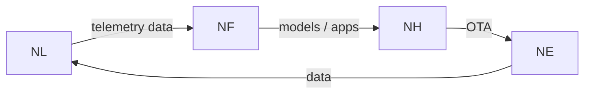

# NereidForge

NereidForge is your organization's own **model factory**. It takes the data you
already hold — images, video and datasets — and turns it into models that
actually run on your field devices, with the entire process staying inside your
own network. No data leaves the building, no cloud account is required, and you
do not need a team of AI specialists to operate it.

If you have ever asked one of these questions, Forge is built for you:

- "We have years of site data — how do we turn it into a model we can actually
  use?"
- "The open-source model is good in general, but it doesn't know our scenarios.
  Can we adapt it ourselves?"
- "A vendor handed us a model file. How do we know whether it is accurate
  enough to trust on our cameras?"
- "Our gateways are small and cheap. Can the model fit, and what do we lose by
  shrinking it?"
- "Our key engineer left. Where are the datasets, the training settings and
  the evaluation reports?"

## What Forge helps you do

### Train a model from nothing but your own data

Start with business data and a problem, not with a model. Forge provides a
standardized production line — data preparation, training, compute scheduling
and run history — that an ordinary engineer can follow end to end, instead of
stitching together a dozen separate open-source tools. Computer-vision models
(detection, classification, segmentation and more) and language /
vision-language models are both first-class citizens, and routine work runs
from templates rather than custom code.

### Strengthen an existing model with your own knowledge

You do not have to start from an empty bench. Take an open-source or base model
and fine-tune it on your organization's data, so it recognizes your products,
your scenes and your terminology. Routine fine-tuning works through zero-code
templates (methods such as LoRA and QLoRA), while algorithm teams can bring
their own training frameworks through a small Python SDK that follows one
simple "environment in, artifacts out" contract. Vendor-specific acceleration
stays isolated in separate training images — there is no catch-all image — and
both routes produce the same registered, versioned output.

### Answer "is this model actually good enough?"

Model quality is measured, not guessed. Every training run is followed by
automatic evaluation, and the report is stored permanently alongside that
exact model version:

- **Vision models** are judged on hard metrics such as mAP and recall, against
  quality gates your team defines.
- **Language models** run standard benchmark suites (such as MMLU) and are
  scored on your own question sets, including the quality of their generated
  answers.

A model that misses the quality gate cannot be promoted by mistake. For any
historical version, you can still trace the exact dataset, training settings,
scores and deployment locations behind it.

### Shrink a model for field hardware — with the accuracy price on paper

Field gateways and cameras carry limited compute, so full-size models must be
compressed. Forge applies precision reduction (quantization) at fp16, int8 and
int4 levels alongside other optimization techniques, then exports the result
for the hardware you actually buy — NVIDIA, AMD, Intel or domestic silicon —
keeping your procurement options open.

Crucially, **every compressed version ships with a before/after report**: how
much smaller it is, how much faster it runs, and how much accuracy was lost in
the trade. You decide with numbers on the table, not with vendor assurances.

### Keep data, models and knowledge as company assets

Everything is registered and versioned: datasets with their provenance, models
with their full lineage, evaluation reports and deployment records. Model
versions move through clear stages — candidate, staging, production, archived —
so the organization owns the capability instead of renting it from individual
experts. Before promoting anything, anyone can upload a test image and see what
the model attends to, without a deployment step.

### Annotate data without a blank canvas

The integrated annotation studios cover images, text and video. A model
proposes draft labels and boxes first, so reviewers correct rather than draw
from scratch; for video, only key frames need manual labeling and the platform
tracks objects through the frames in between. Projects support assignees and
collaborative review, and every dataset version is immutable once finalized.

## A model's journey through Forge

1. **Collect** — import images, video or instruction data in the common
   formats (detection, classification, segmentation and instruction layouts),
   with train/test splits preserved; every dataset is versioned with full
   provenance and supports draft-to-final review workflows.
2. **Annotate** — machine pre-annotation plus human review in the integrated
   studios.
3. **Train** — train from scratch or fine-tune a base model, on the GPU vendor
   of your choice.
4. **Evaluate** — automatic reports and quality gates decide whether the result
   is trustworthy enough to leave the lab.
5. **Optimize** — quantize and export for specific hardware, comparing every
   compressed version against its parent model.
6. **Register and hand off** — the approved model enters the registry, then
   travels to edge sites through [NereidHorizon](nereidhorizon.md).

## Where Forge sits in the suite

Forge is the factory floor of the NereidAI closed loop. It consumes the data
collected at the edge and landed by [NereidLink](nereidlink.md), and produces
the models and applications that [NereidHorizon](nereidhorizon.md) distributes
to field nodes. Vendor-specific acceleration and toolchains stay isolated
inside Forge; every other product only receives clean, versioned model
packages.

!!! info "Developer documentation"

    The authoritative, detailed developer documentation for Forge lives in
    its own repository: <https://github.com/NereidAI/NereidForge>.

!!! tip "Free to use, enterprise assurance available"

    NereidForge is open source under Apache-2.0 and free to run in production,
    including commercial use. Multi-site rollout, HA/DR guidance, LTS with
    backported fixes, contractual CVE response SLAs and turnkey air-gapped
    delivery are available under an enterprise subscription. See
    [Pricing & Purchase](../community/pricing.md) or email
    [jiekechoo@gmail.com](mailto:jiekechoo@gmail.com).

## Technical overview

This section is for technical evaluators; nothing above it requires a machine
learning background.

| Aspect | Detail |
|---|---|
| Role | Privatized model factory — datasets, training, optimization, export, evaluation, registry |
| Value | Turns business data into models that run on field devices; assets stay with the customer |
| Annotation | Integrated Label Studio and CVAT studios with machine pre-annotation and video key-frame tracking |
| Model types | Computer-vision models and language / vision-language models; training from scratch or fine-tuning |
| Optimization | Quantization (fp16 / int8 / int4) and optimization plugins applied before release |
| Export | Multi-framework export to a portable runtime format, with automatic source-framework detection, targeting NVIDIA, AMD, Intel and domestic silicon routes |
| Evaluation | Automatic reports stored with each version; mAP / recall gates for vision, benchmark and generative scoring for language |
| Serving | Model registry with lineage and stage transitions; model serving with on-demand weight loading and try-with-image verification |
| Private by design | Runs fully offline in the customer's own environment; base models shipped with the system |
| Delivery form | Declarative Kubernetes deployment from an internal image registry |
| Language / stack | Python backend and React frontend; orchestrated pipelines and model serving on Kubernetes |
| License | Apache-2.0 |

## Resources

- GitHub: <https://github.com/NereidAI/NereidForge>
- Suite: [product overview](index.md) · [Link](nereidlink.md) ·
  [Horizon](nereidhorizon.md)
- [Architecture overview](../architecture/overview.md) ·
  [Air-gapped install](../deployment/air-gapped.md)
- [Kubernetes & Helm](../deployment/kubernetes.md) · [SSO & OIDC](../security/sso-oidc.md)
- [Community vs Enterprise](../community/community-vs-enterprise.md)
