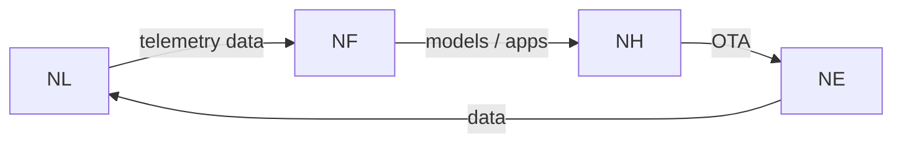

# NereidForge

Forge is a privatized model factory: an on-premises platform that turns
business data — datasets, images and video — into models that run on field
devices, covering data and annotation management, training and fine-tuning,
optimization and quantization, hardware-targeted export, evaluation and a model
registry.

## What it solves

- **Data cannot leave the organisation.** Industrial, government and security
  data is constrained by regulation; the whole factory runs inside the
  customer's own environment and works fully offline, with base models shipped
  rather than downloaded.
- **AI projects are hand-crafted.** Data preparation, annotation, training,
  evaluation and deployment are stitched together by a few experts across many
  separate tools; Forge turns that into one repeatable production line.
- **Capability lives in individuals, not the organisation.** Data, models and
  evaluation reports are registered and versioned, so knowledge outlives staff
  turnover.
- **Lab models do not reach the field.** Field devices have limited compute and
  many silicon variants; one training run produces models targeted at multiple
  hardware routes.
- **Vendor and cloud lock-in.** The platform is privatized and open in its data
  and format choices, so today's investment does not become tomorrow's island.

## Core capabilities

**Data and annotation**

- Dataset management with versions and traceable provenance, including
  draft-to-final workflows.
- Multi-format import — object detection, classification, segmentation and
  instruction formats — with a canonical, split-preserving layout.
- Annotation through integrated Label Studio and CVAT studios, covering images
  and video.
- Machine pre-annotation: a model proposes boxes so annotators review and
  correct rather than draw from scratch; video annotators label key frames and
  the platform tracks the frames between.
- Per-project assignees and collaborative review.

**Training and fine-tuning**

- A standardized pipeline an ordinary engineer can operate, from dataset to
  trained model.
- Support for computer-vision models and for language / vision-language models,
  with fine-tuning on organisation data.
- Per-vendor training images keep vendor-specific acceleration and toolchains
  isolated; there is never a single catch-all image.
- A small Trainer SDK (Python) defines one environment-in/artifacts-out
  contract for custom trainer images, so partner or in-house frameworks run
  in their own image and registry; the built-in trainers use the same SDK.

**Optimization, export and evaluation**

- Optimization and quantization plugins (compile / quantize) applied before a
  model is released.
- Multi-framework export to a portable runtime format, with automatic detection
  of the source framework family.
- Hardware-targeted export, including NVIDIA, AMD, Intel and domestic silicon
  routes, so hardware procurement keeps its options.
- Automated evaluation before release, with the report kept alongside the model
  version.

**Registry, serving and verification**

- A model registry that answers, for any version, what data trained it, how it
  scored and where it is deployed.
- Model serving with on-demand loading of uploaded weights.
- "Try with image" verification of any model artifact without deploying first,
  with a visualization of what the model attends to.

**Delivery**

- Fully privatized delivery: images come from an internal registry and the stack
  runs in an offline machine room.
- Declarative deployment and upgrade on Kubernetes.

## How it fits in the suite

Forge is the model-factory stage of the closed loop. It consumes data
collected at the edge — the telemetry [Link](nereidlink.md) lands — and
produces the models and applications that [Horizon](nereidhorizon.md)
distributes to edge nodes. Per the suite's design, vendor-specific acceleration,
images and toolchains are isolated inside Forge pipelines; every other
product consumes versioned artifacts, never vendor tooling.

!!! info "Developer documentation"

    The authoritative, detailed developer documentation for Forge lives in
    its own repository: <https://github.com/NereidAI>.

## Key facts

| Aspect | Detail |
|---|---|
| Role | Privatized model factory — datasets, training, optimization, export, evaluation, registry |
| Value | Turns business data into models that run on field devices; assets stay with the customer |
| Annotation | Integrated Label Studio and CVAT studios with machine pre-annotation |
| Model types | Computer-vision models and language / vision-language models |
| Export | Multi-framework export to a portable runtime format, targeting several hardware routes |
| Serving | Model registry plus model serving with try-with-image verification |
| Private by design | Runs fully offline in the customer's own environment; base models shipped with the system |
| Delivery form | Declarative Kubernetes deployment from an internal image registry |
| Language / stack | Python backend and React frontend; orchestrated pipelines and model serving on Kubernetes |
| License | Apache-2.0 |

## Resources

- GitHub: <https://github.com/NereidAI>
- Suite: [product overview](index.md) · [Link](nereidlink.md) ·
  [Horizon](nereidhorizon.md)
- [Architecture overview](../architecture/overview.md) ·
  [Air-gapped install](../deployment/air-gapped.md)
- [Kubernetes & Helm](../deployment/kubernetes.md) · [SSO & OIDC](../security/sso-oidc.md)
- [Community vs Enterprise](../community/community-vs-enterprise.md)
