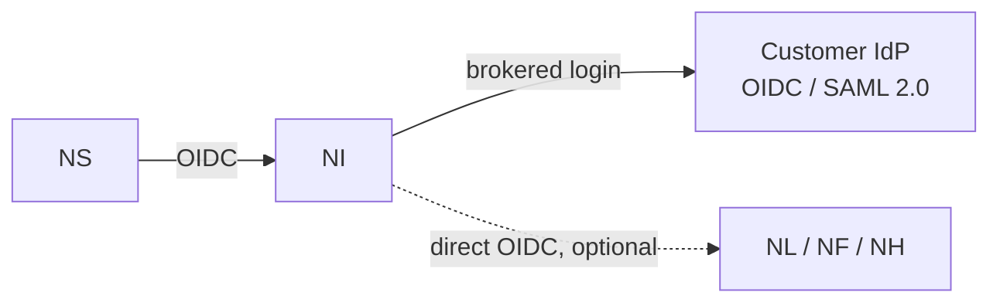

# NereidIdentity

NereidIdentity is the **badge office of the NereidAI suite**. It decides who
you are, what you may access, and hands out the proof that every other product
trusts. Users get one account for the whole platform, and the company's
existing identity system — Microsoft Entra ID, Okta, Auth0, AD FS and similar —
can be connected once instead of being wired into every product separately.

Identity exists because organizations keep asking the same questions:

- "Why does every new system mean another password for every employee?"
- "We already run a corporate IdP. Can the platform use it instead of building
  a parallel user directory?"
- "When someone leaves, how many places do we have to disable their account?"
- "Are we still using the unsafe legacy login flows auditors flag?"
- "Can this run in a fully isolated network with no calls back to a vendor?"

## What Identity helps you do

### Give every person one identity across the suite

A single shared account reaches Sphere, Link, Horizon and Forge. Account
administration is centralized — create, enable or disable, reset passwords and
assign roles in one console — and disabling an account takes effect across the
suite immediately. In the default integration, the domain products do not
implement identity protocols at all; they trust the suite's one-time handoff.

### Connect the identity system you already run

External identity providers are brokered **behind** the identity plane over
standard OIDC or SAML 2.0. Adding, swapping or disabling a provider requires no
change and no restart in Sphere or the products, and group/claim-to-role
mapping happens in one place, so every product receives the same suite roles
from the same upstream identity.

### Choose how tightly a product integrates

Three modes, mixed freely per product:

- **Suite-federated (default):** the product trusts Sphere's one-time handoff
  and needs no identity configuration of its own; full account governance is
  available.
- **Direct OIDC:** a product registers as a standard OIDC client of the
  identity plane and still participates in suite single sign-on.
- **Standalone customer IdP:** used only when a single product is delivered
  without the suite, explicitly outside suite governance.

### Govern roles and account lifecycles

A small, stable role vocabulary — `user`, `operator`, `admin` — keeps
authorization understandable, while fine-grained permissions stay inside each
product. Accounts federated from a customer provider remain read-only in the
suite console because their lifecycle belongs to the customer; a built-in local
administrator remains available as a break-glass path when the identity service
is unreachable.

### Meet modern security expectations

Authentication uses the authorization-code flow with PKCE, refresh tokens and
single logout, with relying parties verifying tokens against published
metadata. The insecure password-grant (ROPC) flow is excluded everywhere, in
line with current OAuth 2.0 practice.

### Run fully isolated

Identity supports complete air-gapped operation with no call-home and no
external runtime dependency, including internal certificate authorities. The
underlying engine (currently Keycloak with PostgreSQL) is an implementation
detail: any standards-compliant engine can replace it through connection
settings, so the platform does not lock you into one identity vendor.

## How identity travels through the suite

1. **Account created or federated** — locally, or brokered from the customer's
   own identity provider.
2. **Roles mapped once** — upstream groups and claims become the suite's
   `user` / `operator` / `admin` roles in one central place.
3. **User signs in** — through Sphere, on the identity provider's own login
   page.
4. **Tokens verified** — relying parties check tokens against the published
   identity metadata; products receive a verified identity, never a
   self-asserted one.
5. **Access changes instantly** — disable an account and suite-wide access is
   removed; federated accounts are governed at their source.

## Where Identity sits in the suite

Identity is the identity source of truth that Sphere talks to and that account
governance is driven from. In the default handoff integration it is invisible
to the domain products; when a product runs direct OIDC it becomes the
product's own identity provider.

!!! info "Developer documentation"

    The authoritative, detailed developer documentation for Identity lives
    in its own repository: <https://github.com/NereidAI/NereidIdentity>.

## Technical overview

This section is for technical evaluators; nothing above it requires an
identity-and-access background.

| Aspect | Detail |
|---|---|
| Role | Suite-wide identity plane — single sign-on and access-control centre |
| Provides | Suite SSO, account and role governance, customer identity federation |
| Standards | OIDC / OAuth 2.0 authorization-code + PKCE, refresh tokens, single logout, published metadata; ROPC excluded |
| Integration modes | Suite-federated handoff (default), direct OIDC, standalone customer IdP; mixed deployments supported |
| Federation | External OIDC and SAML 2.0 providers (e.g. Microsoft Entra ID, Okta, Auth0, Authing, AD FS), brokered behind the identity plane; hot add/swap/disable without restarts |
| Roles | Stable `user` / `operator` / `admin` vocabulary; fine-grained authorization inside each product; central claim-to-role mapping |
| Governance | Central account administration with suite-wide disable; federated accounts read-only; local break-glass administrator |
| Private by design | Fully air-gapped, no call-home, internal certificate authorities supported |
| Replaceability | Keycloak with PostgreSQL today; any compliant OIDC/OAuth2 engine can replace it via relying-party connection settings |
| Delivery form | Container image + Helm chart for the central Kubernetes deployment; a developer stack for local work |
| Positioning | Deployed as an independent service; not a product-facing portal |
| License | Apache-2.0 |

## Resources

- GitHub: <https://github.com/NereidAI/NereidIdentity>
- Suite: [product overview](index.md) · [Sphere](nereidsphere.md)
- [SSO & OIDC](../security/sso-oidc.md) · [RBAC](../security/rbac.md)
- [Architecture overview](../architecture/overview.md) ·
  [Air-gapped install](../deployment/air-gapped.md)
- [Community vs Enterprise](../community/community-vs-enterprise.md)
