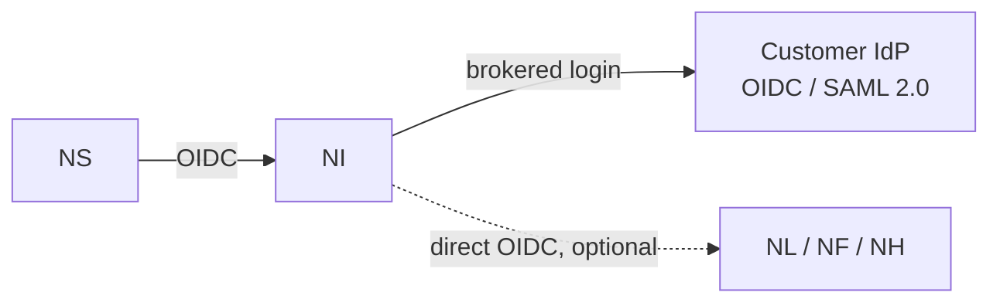

# NereidIdentity

Identity is the suite-wide identity plane for NereidAI: the shared,
replaceable single sign-on and access-control centre behind Sphere,
Link, Horizon and Forge.

## What it solves

- **Many products, one identity.** Users and administrators get a single shared
  account across the suite instead of a separate login per product.
- **Duplicated authentication work.** In the default integration, products do
  not implement identity protocols at all; they trust the suite's one-time
  handoff from Sphere.
- **Customer identity sprawl.** Customer identity systems connect once, behind
  the identity plane, instead of being wired into every product.
- **Engine lock-in.** The identity engine is an implementation detail: another
  standards-compliant engine can replace it with connection-settings changes in
  the relying party.
- **Unsafe legacy flows.** Password-grant (ROPC) authentication is excluded
  everywhere, in line with current OAuth 2.0 best practice.

## Core capabilities

**Single sign-on across the suite**

- Standard OIDC/OAuth2 single sign-on with authorization-code + PKCE, refresh
  tokens and single logout; relying parties verify tokens against the published
  identity metadata.
- Sphere is the single mandatory relying party in the default integration;
  the suite session it holds then reaches every product without a second login.

**Integration modes**

- **Suite-federated (default):** products trust a one-time handoff from
  Sphere and need no identity configuration of their own. Account
  governance is fully available.
- **Direct OIDC (optional, per product):** a product registers as a standard
  OIDC client of the identity plane and still participates in suite SSO.
- **Standalone customer IdP:** used only when a single product is delivered
  without the suite; it is explicitly outside suite governance.
- Mixed deployments are first-class: for example one product on direct OIDC and
  the rest on the suite-federated handoff.

**Identity federation**

- External customer identity providers (for example Microsoft Entra ID, Okta,
  Auth0, Authing, AD FS) are brokered **behind** the identity plane, over OIDC
  or SAML 2.0.
- Adding, swapping, or disabling a customer provider requires no change and no
  restart in Sphere or the products.
- Group/claim-to-role mapping happens in one place, so every product receives
  the same suite roles from the same upstream identity.

**Roles and account governance**

- A small, stable suite vocabulary — `user`, `operator`, `admin` — with
  fine-grained authorization kept inside each product.
- Account administration is centralized: create, enable/disable, reset
  passwords and assign roles in one console; disabling an account takes effect
  across the suite.
- Accounts federated from a customer provider stay read-only in the suite
  console; their lifecycle is owned by the customer.
- A built-in local administrator remains available as a break-glass path when
  the identity service is unreachable.

**Private by design**

- Fully air-gapped operation with no call-home and no external runtime
  dependency; internal certificate authorities are supported.

## How it fits in the suite

Identity is the identity source of truth that Sphere talks to and
that account governance is driven from. In the default handoff integration it is
invisible to the domain products; when a product runs direct OIDC it becomes the
product's own identity provider.

!!! info "Developer documentation"

    The authoritative, detailed developer documentation for Identity lives
    in its own repository: <https://github.com/NereidAI>.

## Key facts

| Aspect | Detail |
|---|---|
| Role | Suite-wide identity plane — single sign-on and access-control centre |
| Provides | Suite SSO, account and role governance, customer identity federation |
| Integration modes | Suite-federated handoff (default), direct OIDC, standalone customer IdP |
| Federation | External OIDC and SAML 2.0 providers, brokered behind the identity plane |
| Governance | Central account administration; federated accounts read-only |
| Delivery form | Container image + Helm chart for the central Kubernetes deployment; a developer stack for local work |
| Positioning | Deployed as an independent service; not a product-facing portal |
| Language / stack | Keycloak with PostgreSQL, replaceable by any compliant OIDC/OAuth2 engine |
| License | Apache-2.0 |

## Resources

- GitHub: <https://github.com/NereidAI>
- Suite: [product overview](index.md) · [Sphere](nereidsphere.md)
- [SSO & OIDC](../security/sso-oidc.md) · [RBAC](../security/rbac.md)
- [Architecture overview](../architecture/overview.md) ·
  [Air-gapped install](../deployment/air-gapped.md)
- [Community vs Enterprise](../community/community-vs-enterprise.md)
