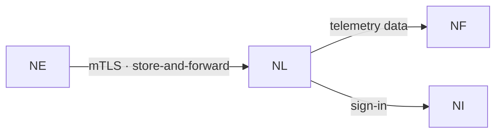

# NereidLink

NereidLink is the **central control room for all your devices and their data**.
Whatever machines, sensors or cameras you operate — and whatever language each
of them speaks — Link brings them into one place where you can watch live data,
receive alarms before incidents escalate, send commands safely, and roll out
updates across the whole fleet. Everything runs inside your own environment;
device data never has to leave your site.

Link is for teams asking questions like these:

- "Our factory floor mixes machines from half a dozen vendors. Can we see them
  all in one system?"
- "Dashboards that refresh every five minutes are not fast enough — can data
  arrive the moment something changes?"
- "Who is allowed to send a command to which device, and what happens if the
  network is down?"
- "How do we upgrade thousands of devices without flying engineers to every
  site?"
- "Our customers' data must stay on their premises, and different teams must
  not see each other's devices."

## What Link helps you do

### Connect any device, regardless of its language

Industrial devices speak many protocols — Modbus, OPC-UA, ONVIF, BACnet,
S7, LLRP, CoAP and more. Link speaks them all through a growing library of
official device services, so adding a new machine no longer means a custom
integration project. Gateways and sub-devices can be registered one by one or
imported in bulk from a spreadsheet, with a validation preview that catches
errors before they reach the platform.

### See what is happening, live

Every change is pushed to your screen the instant it happens — readings,
online status, device state, alarms and command progress — over a permanent
real-time connection rather than periodic polling. Rule chains built in a
visual editor turn raw data into decisions: thresholds, transformations and
automated actions without writing application code.

### Control devices without opening a back door

Remote commands are governed by a command catalog that defines exactly which
commands exist, who may call them, and their timeouts and read/write limits.
Batch commands target whole device groups with live aggregate progress, and
dangerous operations require extra confirmation. An offline device fails
immediately with a clear result instead of quietly queuing a false promise.

### Know about problems first

Alarms follow a complete lifecycle — raised, acknowledged, commented, cleared
— with assignees, escalation chains and delivery through the in-app inbox,
webhooks or email. Link also watches the watchers: link-down alarms, a daily
per-gateway digest and a platform-level dead-man switch ensure a silent device
never goes unnoticed.

### Manage a fleet through its whole life

From first enrollment (single-use claim tokens), through transfers between
customers and groups, to non-destructive decommissioning with a recall window,
every device has an auditable history. Firmware updates support canary
rollouts, circuit breakers and resumable downloads, so a bad build cannot take
a fleet down.

### Keep data, tenants and access under control

Link is built for regulated, multi-customer operations: isolated tenants,
permissions that decide what you may do combined with data scopes that decide
which rows you may see, a tamper-evident audit log, a tenant secret vault, and
storage tiers (hot / warm / cold) with retention rules and legal hold.
Authentication ranges from simple tokens to mutual-TLS certificates and
multi-factor authentication, and the whole platform runs fully air-gapped.

## A device's first day on Link

1. **Enroll** — the device or gateway claims its pre-registered identity with
   a single-use token, or is imported in bulk.
2. **Connect** — it links up over its native protocol (MQTT, HTTP or CoAP),
   with credentials that can be rotated without downtime.
3. **Stream** — readings flow immediately and appear on dashboards in real
   time; the device shadow keeps its last known state.
4. **Automate** — rule chains process the stream and raise alarms or trigger
   actions.
5. **Control and update** — operators send catalog-governed commands, and
   firmware rolls out in guarded waves.
6. **Feed the loop** — the accumulated telemetry becomes training data for
   [NereidForge](nereidforge.md).

## Where Link sits in the suite

Link is the inference-and-feedback stage of the closed loop.
[NereidEdge](nereidedge.md) connects field devices into Link over mutually
authenticated, store-and-forward links; the resulting telemetry feeds
[Forge](nereidforge.md) as training data. Sign-in is
federated through [Identity](nereididentity.md).

!!! info "Developer documentation"

    The authoritative, detailed developer documentation for Link lives in
    its own repository: <https://github.com/NereidAI/NereidLink>.

## Technical overview

This section is for technical evaluators; nothing above it requires an IoT
background.

| Aspect | Detail |
|---|---|
| Role | Privatized IoT data pipeline — device access, messaging, rules, alarms, dashboards |
| Real-time model | Server push over WebSocket; polling is not used; reconnect and session resume built in |
| Device access | MQTT, HTTP and CoAP ingresses; token, password, JWT and X.509 credentials with overlap-window rotation |
| Device services | Modbus, OPC-UA, ONVIF, BACnet, S7, LLRP, CoAP and more; device and adapter SDKs plus simulators |
| Commands | Synchronous request-response with a command catalog (enable switches, timeouts, read/write masks), batch and gateway-relayed commands, risk levels and on-demand probes |
| Data and storage | Unified typed uplink; Hot / Warm / Cold tiers with per-tenant retention and legal hold; S3-compatible object storage; dead-letter queue |
| Rules and state | Visual rule-chain editor, device shadow with drift detection, three-scope attributes, append-only event ledger |
| Alarms | Raise / acknowledge / clear lifecycle, assignees, escalation chains, in-app, webhook and SMTP delivery, dead-man fallback |
| Edge and OTA | Edge handshake and session resume, connector lifecycle, drift reconciliation, link watchdog; canary firmware OTA with circuit breakers and resumable downloads |
| Tenancy | Multi-tenant with RBAC plus data scopes, tenant secret vault, tamper-evident audit, signed licenses that degrade to read-only |
| Security | Built-in certificate authority for device mTLS, TOTP multi-factor authentication, step-up confirmation for dangerous actions |
| Delivery forms | One codebase, two forms — all-in-one single binary or Kubernetes microservices |
| Observability | Prometheus and Grafana; ingress resource accounting; bilingual operator UI (English / 中文) |
| Language / stack | Go; a messaging backbone; PostgreSQL + TimescaleDB; S3-compatible object storage |
| License | Apache-2.0 |

## Resources

- GitHub: <https://github.com/NereidAI/NereidLink>
- Suite: [product overview](index.md) · [Forge](nereidforge.md)
- [Cross-product contracts](../architecture/contracts.md) ·
  [Edge delivery](../deployment/edge-delivery.md)
- [Kubernetes & Helm](../deployment/kubernetes.md) · [Security](../security/index.md)
- [Community vs Enterprise](../community/community-vs-enterprise.md)
