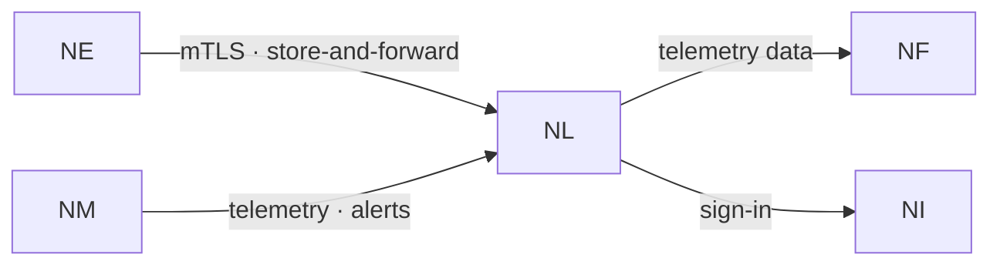

# NereidLink

Link is a privatized IoT data pipeline platform for on-premises enterprise
deployment: multi-protocol device access, a unified messaging pipeline, a rule
engine, alarm notifications and real-time visualization.

## What it solves

- **Protocol and device fragmentation.** Many protocols, one common device contract.
- **Polling and stale data.** All changes are pushed live; no periodic polls.
- **On-premises, regulated operations.** Data never leaves the customer's site.
- **Multi-tenant governance.** Isolated data, fine-grained permissions, metering.

## Core capabilities

**Real-time communication**

- All data changes are pushed over WebSocket — telemetry, presence, attributes,
  device shadow, domain events, alarms, command progress, connector status and
  OTA progress; polling is not used.
- One connection carries multiple subscriptions with server push, reconnect and
  session resume; push is tenant-isolated and bound to access-control data
  scopes.

**Device access and management**

- Four credential types (token, password, JWT, mutual-TLS X.509) with a full
  lifecycle: validity windows, enable/disable, in-place and overlap-window
  rotation, and expiry warnings.
- Lifecycle: pre-registration with single-use claim tokens, transfer between
  customers and groups, non-destructive decommission with a recall window,
  reactivation and archival.
- Simple gateway / sub-device containment, bulk CSV/XLSX import with a
  validation preview, and display aliases and notes.

**Commands and remote control**

- Synchronous request-response commands; offline devices fail immediately rather
  than queue behind a false promise of success.
- A command catalog is the security boundary, with enable switches, timeouts and
  read/write masks; batch commands cover a device-group subtree or an explicit
  list with live aggregate progress, and gateway-relayed commands reach
  sub-devices. Whole-gateway operations carry risk levels, and probes can be run
  on demand.

**Telemetry, storage and state**

- A unified uplink across the MQTT, HTTP and CoAP ingresses, with typed points
  (number / boolean / string) and user-defined descriptors; protocol-agnostic and
  free of business logic.
- Ingest rate limiting, optional message compression, asynchronous forwarding
  with per-destination back-pressure isolation, and a dead-letter queue.
- One data foundation for entity and time-series data, plus S3-compatible object
  storage for firmware, imports/exports and cold data, with tiered Hot / Warm /
  Cold storage, per-tenant and per-domain retention, and legal hold.
- Device shadow with drift detection, three-scope attributes, an append-only
  device-event ledger, and versioned rule chains with a visual node editor and
  tiers of scripting.

**Alarms and notifications**

- A complete raise / acknowledge / clear lifecycle with assignees, comments and
  escalation chains, plus multi-channel delivery (in-app inbox, webhook, SMTP
  email), link-down alarms, a daily per-gateway digest, and a platform-level
  dead-man fallback independent of tenant notifications.

**Edge management and OTA**

- Edge handshake negotiation and session resume; connector lifecycle; two-level
  configuration with schema validation and drift reconciliation; automatic
  discovery and enrollment; and a link watchdog.
- Firmware OTA from an external URL or platform-hosted packages, with phased
  states, structured result codes, canary rollout, circuit breakers and
  resumable downloads.

**Security, tenancy and operations**

- A built-in certificate authority for device mutual TLS, TOTP multi-factor
  authentication, and step-up confirmation for dangerous actions.
- Permissions decide what a caller can do while data scopes decide which rows
  they can reach, enforced for reads and writes; a tenant secret vault and a
  tamper-evident audit log.
- Automated tenant provisioning, machine identities via OAuth2 service accounts,
  and signed licenses that degrade to read-only rather than stop reporting.
- Prometheus and Grafana observability, ingress resource accounting, device and
  adapter SDKs, simulators, a vendor-neutral profile library and a catalog of
  official device services (Modbus, OPC-UA, ONVIF, BACnet, S7, LLRP, CoAP and
  more).

## How it fits in the suite

Link is the inference-and-feedback stage of the closed loop. Edge
connects field devices into Link over mutually authenticated,
store-and-forward links; the resulting telemetry feeds
[Forge](nereidforge.md) as training data, and
[Mobile](nereidmobile.md) is the operator's window into it. Sign-in is
federated through Identity.

!!! info "Developer documentation"

    The authoritative, detailed developer documentation for Link lives in
    its own repository: <https://github.com/NereidAI>.

## Key facts

| Aspect | Detail |
|---|---|
| Role | Privatized IoT data pipeline — device access, messaging, rules, alarms, dashboards |
| Real-time model | Server push over WebSocket; polling is not used |
| Device access | MQTT, HTTP and CoAP ingresses; token, password, JWT and X.509 credentials |
| Device services | Modbus, OPC-UA, ONVIF, BACnet, S7, LLRP, CoAP and more |
| Tenancy | Multi-tenant with RBAC, data scopes and signed licensing |
| Delivery forms | One codebase, two forms — all-in-one single binary or Kubernetes microservices |
| Positioning | Privatized, air-gapped deployment; bilingual operator UI (English / 中文) |
| Language / stack | Go; a messaging backbone; PostgreSQL + TimescaleDB; S3-compatible object storage |
| License | Apache-2.0 |

## Resources

- GitHub: <https://github.com/NereidAI>
- Suite: [product overview](index.md) · [Forge](nereidforge.md) ·
  [Mobile](nereidmobile.md)
- [Cross-product contracts](../architecture/contracts.md) ·
  [Edge delivery](../deployment/edge-delivery.md)
- [Kubernetes & Helm](../deployment/kubernetes.md) · [Security](../security/index.md)
- [Community vs Enterprise](../community/community-vs-enterprise.md)
