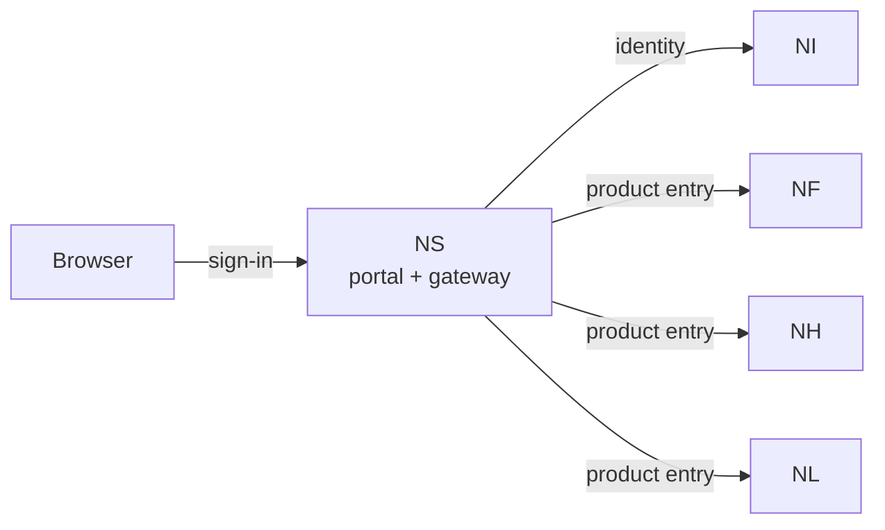

# NereidSphere

Sphere is the thin suite layer for NereidAI: one portal, single sign-on
(SSO), a unified API gateway, and the closed-loop event glue between products.
It holds no domain logic of its own.

## What it solves

- **One login for the whole suite.** Without Sphere every product still
  authenticates and runs standalone; with it enabled, a user signs in once and
  opens any integrated product without re-authenticating.
- **No unified entry point.** It provides a single portal that lists the central
  products in closed-loop order — Forge → Horizon → Link.
- **Cross-product access control.** A session proves identity, not product
  authorization; entry is default-deny and decided by suite assignments.
- **Fragmented edge concerns.** It centralizes sign-in, access control and the
  shared protections in front of every product, so each product does not have to
  solve them alone.
- **Account governance.** It hosts the built-in account administration console,
  which manages identity-service accounts without storing a master password.

## Core capabilities

**Suite SSO and sessions**

- A standards-based OIDC/OAuth2 relying party to Identity: users sign in on
  the identity provider's own login page, so Sphere never handles the
  upstream password.
- A single, sealed session keeps the user signed in across the suite, with idle
  and absolute timeouts and transparent renewal while the session is valid.
- Signing out clears the suite session and, where supported, ends the upstream
  session as well.

**Cross-product entry**

- One sign-in serves every integrated product. Moving into a product is a
  default-deny decision: a user needs an explicit assignment for that product,
  with the suite administrator as the single implicit exception.
- Product entry is handed off with a short-lived, single-use ticket that the
  product exchanges for the verified identity and then manages its own session.
- Each product can integrate through the suite handoff (default) or as a
  standalone identity-provider client, chosen per product.
- Multi-replica deployments share a replay store so a ticket can be consumed
  only once, and entry fails closed if that cannot be guaranteed.

**Unified API gateway**

- One reverse proxy fronts every integrated product: it authenticates the
  session, discards any client-supplied identity headers, and forwards a
  verified identity to the product.
- Cross-cutting protections live here in one place: an exact-origin allowlist,
  per-client rate limiting (with a stricter limit on sign-in), protection
  against cross-site request forgery, upstream timeouts and browser security
  headers.

**Account console and emergency access**

- A built-in administration console manages identity accounts: create,
  enable/disable, reset passwords and assign suite roles. It uses a dedicated
  service account rather than a master administrator password, and protects
  against locking out the last administrator. Federated accounts are read-only.
- Per-product tenant and role assignments are managed from the same console.
- An emergency local-account mode keeps administration reachable when the
  identity service is unavailable; it is clearly labelled as break-glass and is
  not the default.

**Portal and delivery**

- A bilingual portal presents the products and launches each of them.
- Ships as a self-contained binary and container image plus a Helm chart for
  Kubernetes; there is no suite business database to operate.

## How it fits in the suite

Sphere federates the domain products without absorbing them. It is the
**only** suite component that speaks OIDC to Identity, and it hands each
product a short-lived ticket so the product can establish its own session.

Edge runs independently at each edge site and is intentionally **not** a
central portal entry. The identity plane is [Identity](nereididentity.md);
the full loop is in the [architecture overview](../architecture/overview.md).

!!! info "Developer documentation"

    The authoritative, detailed developer documentation for Sphere lives
    in its own repository: <https://github.com/NereidAI>.

## Key facts

| Aspect | Detail |
|---|---|
| Role | Thin suite layer — unified portal, SSO, API gateway and cross-product glue |
| Scope | Federates the domain products; holds no domain logic of its own |
| Products it fronts | Forge, Horizon, Link (closed-loop order) |
| Identity | Delegates authentication to Identity; optional emergency local accounts |
| Delivery form | Self-contained binary / container image plus a Helm chart for Kubernetes |
| Optionality | Each product runs standalone; Sphere is optional for single-product deployments |
| Language / stack | Go backend with an embedded React single-page frontend |
| License | Apache-2.0 |

## Resources

- GitHub: <https://github.com/NereidAI>
- Suite: [product overview](index.md) · [Identity](nereididentity.md)
- [Architecture overview](../architecture/overview.md) ·
  [Cross-product contracts](../architecture/contracts.md)
- [SSO & OIDC](../security/sso-oidc.md) · [RBAC](../security/rbac.md)
- [Kubernetes & Helm](../deployment/kubernetes.md) ·
  [Community vs Enterprise](../community/community-vs-enterprise.md)
