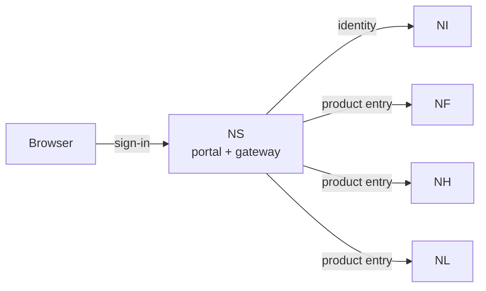

# NereidSphere

NereidSphere is the **front door to the whole NereidAI suite**: one portal,
one login, and one security checkpoint in front of every product. Sign in once
and open Forge, Horizon or Link without logging in again. It deliberately
contains no business logic of its own — it only federates the products, which
keep running perfectly well on their own.

Sphere answers questions that come up as soon as a second product is
installed:

- "Do our people really need a separate account and password for every
  system?"
- "Where is the single entry point that shows what we actually bought?"
- "How do we make sure a user cannot walk from one product into another they
  were never granted?"
- "Who is blocking brute-force sign-ins, cross-site requests and spoofed
  headers?"
- "If the identity system is down, is there a safe way for an administrator to
  get back in?"

## What Sphere helps you do

### Give every user one login

Sphere is a standards-based relying party (OIDC/OAuth2) in front of
[NereidIdentity](nereididentity.md): users enter their credentials on the
identity provider's own login page, so Sphere itself never sees or stores the
upstream password. A single sealed session then keeps them signed in across
the suite, with idle and absolute timeouts and transparent renewal while the
session is valid; signing out clears the suite session and, where supported,
the upstream one too.

### Offer one portal instead of a bookmark collection

A bilingual portal lists the central products in closed-loop order — Forge →
Horizon → Link — and launches each of them. Moving into a product is a
default-deny decision: a user needs an explicit assignment for that product,
with the suite administrator as the single implicit exception. Entry is handed
off with a short-lived, single-use ticket, and in multi-replica deployments a
replay store guarantees the ticket can be consumed only once.

### Enforce access at the boundary

One reverse proxy fronts every integrated product. It authenticates the
session, discards any identity headers supplied by the client (so they cannot
be forged), and forwards only a verified identity. The cross-cutting
protections live here once, rather than being reimplemented per product: an
exact-origin allowlist, per-client rate limiting with a stricter limit on
sign-in, cross-site request forgery protection, upstream timeouts and browser
security headers.

### Administer accounts without a master password

The built-in administration console manages identity accounts — create,
enable or disable, reset passwords, assign suite roles and per-product tenant
access — using a dedicated service account rather than an all-powerful
administrator password. It also protects against locking out the last
administrator; federated accounts remain read-only because their lifecycle
belongs to the customer's own identity provider.

### Keep a break-glass path, clearly labelled

When the identity service is unavailable, an emergency local-account mode
keeps administration reachable. It is explicitly marked as break-glass, is not
the default path, and does not weaken normal operation.

### Stay optional

Every product can run standalone with its own login. Sphere earns its place
when you operate several products together and want one entry point and one
policy; single-product deployments simply do not install it. There is no suite
business database to operate.

## How one sign-in reaches every product

1. **Sign in** — the user authenticates on Identity's login page through
   Sphere.
2. **Establish a session** — Sphere holds one sealed, expiring suite session.
3. **Choose a product** — the portal checks the user's explicit product
   assignment.
4. **Hand off with a ticket** — a single-use, short-lived ticket is exchanged
   by the product for the verified identity.
5. **Work inside the product** — the product establishes its own session; the
   gateway keeps enforcing identity and traffic protections on every request.
6. **Sign out once** — the suite session is cleared and the upstream session
   ends where supported.

## Where Sphere sits in the suite

Sphere federates the domain products without absorbing them. It is the
**only** suite component that speaks OIDC to Identity, and it hands each
product a short-lived ticket so the product can establish its own session.

[NereidEdge](nereidedge.md) runs independently at each edge site and is
intentionally **not** a central portal entry. The identity plane is
[Identity](nereididentity.md); the full loop is in the
[architecture overview](../architecture/overview.md).

!!! info "Developer documentation"

    The authoritative, detailed developer documentation for Sphere lives
    in its own repository: <https://github.com/NereidAI/NereidSphere>.

## Technical overview

This section is for technical evaluators; nothing above it requires an
identity-and-access background.

| Aspect | Detail |
|---|---|
| Role | Thin suite layer — unified portal, SSO, API gateway and cross-product glue |
| Scope | Federates the domain products; holds no domain logic of its own |
| Products it fronts | Forge, Horizon, Link (closed-loop order) |
| Identity | OIDC/OAuth2 relying party delegating authentication to Identity; optional emergency local accounts |
| Sessions | Sealed suite session with idle and absolute timeouts, transparent renewal, single sign-out |
| Product entry | Default-deny with explicit assignments; single-use short-lived tickets; replay store in multi-replica deployments, fail-closed |
| Gateway | Reverse proxy stripping client identity headers; exact-origin allowlist, per-client rate limiting, CSRF protection, upstream timeouts, browser security headers |
| Account console | Create, enable/disable, password reset and role assignment via a dedicated service account; last-admin lockout protection; federated accounts read-only |
| Delivery form | Self-contained binary / container image plus a Helm chart for Kubernetes; no suite business database |
| Optionality | Each product runs standalone; Sphere is optional for single-product deployments |
| Language / stack | Go backend with an embedded React single-page frontend |
| License | Apache-2.0 |

## Resources

- GitHub: <https://github.com/NereidAI/NereidSphere>
- Suite: [product overview](index.md) · [Identity](nereididentity.md)
- [Architecture overview](../architecture/overview.md) ·
  [Cross-product contracts](../architecture/contracts.md)
- [SSO & OIDC](../security/sso-oidc.md) · [RBAC](../security/rbac.md)
- [Kubernetes & Helm](../deployment/kubernetes.md) ·
  [Community vs Enterprise](../community/community-vs-enterprise.md)
