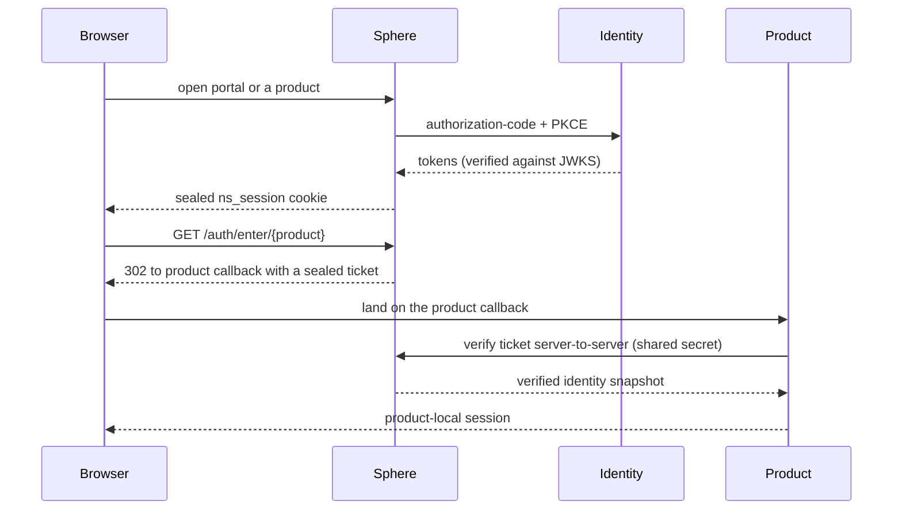

# SSO & OIDC

NereidAI provides single sign-on across the whole suite. There is one identity
source of truth, and products integrate with it through one of two modes. The
model is deliberately narrow: Sphere is the suite SSO entry point, and
it is the **only** suite component that speaks OIDC to the identity plane,
Identity.

## The two integration modes

| Mode | Who completes the browser login | How the product gets identity |
|---|---|---|
| **`ns`** (default) — ticket-based handoff | Sphere (against Identity) | Sphere mints a short-lived, single-use, audience-bound **sealed ticket**; the product backend exchanges it **server-to-server** for the verified identity, then builds its own session. |
| **`oidc`** — direct OIDC client | The product itself (against Identity) | Sphere redirects the browser straight to the product; the product runs its own OIDC authorization-code + PKCE login and builds its own session. |

**Sphere and the product must agree on the mode.** If they disagree, the user hits a
login loop or a ticket / redirect error — this is the single most common
integration misconfiguration.

In the ticket flow the browser holds only an Sphere session cookie, so an
independently hosted product cannot rely on an identity cookie of its own — hence
the server-to-server exchange. In the direct-OIDC flow, Sphere is uninvolved in the
product's own session.

!!! note "Default is `ns`"
    The portal defaults every integrated product to the ticket mode, and each
    product has its own switch. Mixed deployments are first-class — for example
    one product on direct OIDC and the rest on tickets. Either way the browser
    signs in once at Sphere.

## The identity source of truth

- **Identity** (the identity engine, currently Keycloak with realm
  `nereidai`) is the single source of truth for identities. The engine is
  replaceable behind the published OIDC contract.
- **Sphere never stores users.** Its account console manages identities through the
  identity plane's Admin API using a service-account client — never the engine's
  own master password.
- **Local bcrypt accounts are break-glass only.** Sphere can run with local accounts
  declared at deploy time, but that mode is an emergency path for when the
  identity plane is unreachable — never the production default.

## Authorization is product-local

Identity and authorization are separate concerns. Identity/Sphere supply identity — subject,
email, name, and a small set of coarse suite roles — while **RBAC, tenancy, and
feature permissions stay entirely inside each product**. A valid Sphere session proves
who a user is; it does not by itself grant access to a product.

Product access is granted through **suite assignment groups** of the shape
`/nereid{product}/{tenant}/{role}`. This is a suite-wide default-deny policy: a
user with no group for a product cannot enter it. The one exception is the realm
administrator, who implicitly administers every product so that a fresh
deployment's bootstrap admin is never locked out. See [RBAC](rbac.md).

## Identity federation

Customer identity systems — OIDC or SAML 2.0 (Entra ID, Okta, Auth0, AD FS, and
others) — are always connected **behind Identity** using identity brokering,
never directly to Sphere or a product. Adding, swapping, or removing a customer IdP
requires no change to Sphere or the products: they always see the same issuer, the
same clients, and the same claims. Mapping the customer's groups onto the suite
roles happens in one place, at the broker.

The one exception is a **single product sold without the suite**, which may be
configured as a standard OIDC relying party directly against the customer IdP.
That is explicitly outside suite governance and is documented with the product
repositories.

## Direct-to-NI clients

The identity plane publishes a small set of clients:

- The **Sphere login client** is always present — Sphere is the sole OIDC relying party in
  the default (ticket) integration.
- Per-product clients exist only for products deployed in direct-OIDC mode, each
  with its fixed callback path. The ticket flow needs none of them; the product
  callback used by tickets is a product route, not an identity-plane client.

Resource Owner Password Credentials (`grant_type=password`) is not used anywhere:
it is deprecated by OAuth 2.0 best practice, blocks MFA and passkeys, and cannot
work against brokered identity providers.

!!! info "Operations documentation"
    Client registration, realm provisioning, and brokered-IdP setup detail live in
    each product repository: [github.com/NereidAI](https://github.com/NereidAI).

## Related

- [RBAC](rbac.md) — roles, tenant scope, and permission points.
- [Security overview](index.md) — the full posture.
- [Architecture overview](../architecture/overview.md) — the management plane.
