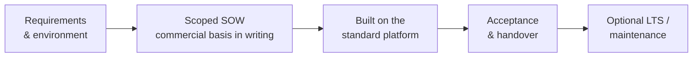

# Custom Development

The open platform covers the common edge-to-cloud loop, but every deployment has
environment-specific gaps: an unlisted device protocol, a new accelerator, a
regulated workflow. **Custom development** is the vendor-run service that closes
those gaps, scoped and delivered under a statement of work.

First, note that Apache-2.0 already gives your own team the right to extend the
platform — that is free and always will be. This page describes the alternative:
having the maintainer team do the work, with delivery responsibility.

!!! note "Commercial service, separate agreement"
    Custom development is delivered under a **separate commercial agreement (SOW)**
    and is not part of the Apache-2.0 community edition. See
    [Community vs Enterprise](../community/community-vs-enterprise.md) for the
    boundary between open source and commercial services.

## Self-service extension vs vendor custom development

| | Self-service extension | Vendor custom development |
|---|---|---|
| Who does the work | Your own team | The NereidAI maintainer team |
| Legal basis | Apache-2.0 rights — use, modify, redistribute | Separate statement of work, scoped per engagement |
| Cost | Free | Chargeable, quoted per project |
| Support | GitHub issues / Discussions, no SLA | Named engineer, milestones, acceptance criteria |
| Deliverable ownership | Yours, under the Apache-2.0 terms | Defined in the agreement; customer-specific deliverables belong to the customer |

## What custom development covers

The scope falls into three categories, the same ones listed under the commercial
options on the [License](../community/license.md) page:

1. **Device and connector integration** — southbound protocols, PLCs and
   controllers, sensors, and legacy systems the platform does not yet speak,
   delivered as connectors for [NereidEdge](../products/nereidedge.md).
2. **Multi-vendor silicon / NPU acceleration** — adapter plugins and
   quantization/export paths for new accelerators, extending the multi-silicon
   reach of [NereidForge](../products/nereidforge.md).
3. **Industry-specific adaptation** — domain workflows, data models, rule packs,
   and portal/reporting adjustments for regulated environments, including
   groundwork for an industry solution such as NereidFactory, NereidSentinel, or
   NereidMedical.

## How an engagement works

1. **Email** [jiekechoo@gmail.com](mailto:jiekechoo@gmail.com) describing the
   gap — devices, protocols, accelerators, or workflows involved.
2. **Scope discussion** — environment, constraints, and concrete acceptance
   criteria.
3. **SOW proposal** — effort, milestones, and the commercial basis, stated in
   writing before any work starts. Where a proof of concept is needed first, it is
   scoped separately and may be chargeable, consistent with
   [Pricing & Purchase](../community/pricing.md).
4. **Delivery** — built on the standard platform, without a private fork, so the
   upgrade path stays open.
5. **Acceptance and handover** — documentation plus private training and knowledge
   transfer.
6. **Optional maintenance** — subsequent changes and LTS coverage continue under a
   subscription or maintenance agreement.

## Why the platform stays one codebase

NereidAI follows an open-core model with one identical codebase and no hidden
features. Custom work is delivered as integration and adaptation **on top of** that
platform, never as a private fork: customer-specific logic belongs to the customer
as defined in the agreement, while generic, reusable enhancements may be upstreamed
by mutual agreement. Your deployment remains upgradable, and the community edition
keeps every capability of the platform itself.

!!! note "Current stage"
    Inquiry and scoping discussions can start now; signed commercial terms take
    effect with the first formally tagged release. There is no public price list —
    each statement of work is quoted individually. Email
    [jiekechoo@gmail.com](mailto:jiekechoo@gmail.com) to start.

## Next steps

- [Pricing & Purchase](../community/pricing.md) — how commercial engagements are packaged and measured.
- [License](../community/license.md) — Apache-2.0 terms and the full list of commercial options.
- [Commercial Industry Solutions](index.md) — the packaged industry products built on the same platform.
- [Community vs Enterprise](../community/community-vs-enterprise.md) — what is open source and what is commercial.
- [Support](../community/support.md) — community channels and commercial support.
