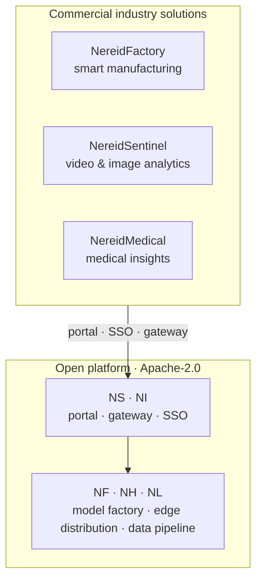

# Commercial Industry Solutions

NereidAI's open platform — the product suite documented under
[Products](../products/index.md) — is the foundation for a family of **commercial
industry solutions**. These solutions are built *on top of* the open platform and
are **not part of the community edition**.

!!! note "Commercial offerings, separate agreements"
    NereidFactory, NereidSentinel, and NereidMedical are licensed, delivered, and
    supported under **separate commercial agreements**. They are not included in the
    Apache-2.0 community edition. See
    [Community vs Enterprise](../community/community-vs-enterprise.md) for what is
    open source and what is commercial.

## Why solutions sit on top of the platform

The open platform already delivers the hard, reusable parts of an edge-AIoT system
— edge data collection, a multi-silicon model factory, offline edge distribution,
and inference feedback. An industry solution composes those building blocks into a
domain-specific product, so every solution inherits the same private-by-design
foundation: air-gapped operation, no mandatory call-home, mTLS links, unified SSO
and RBAC, and multi-vendor silicon support.

## The three solutions

| Solution | Domain | Positioning |
|---|---|---|
| [NereidFactory](nereidfactory.md) | Smart manufacturing | Factory operations and intelligent production. |
| [NereidSentinel](nereidsentinel.md) | Video & image analytics | *Guard with Insight, Shape the Future.* |
| [NereidMedical](nereidmedical.md) | Medical insights | *Empower Healing with Intelligent Insights.* |

-   :material-factory:{ .lg .middle } **NereidFactory**

    ---

    Smart manufacturing — factory operations and intelligent production.

    [:octicons-arrow-right-24: Learn more](nereidfactory.md)

-   :material-cctv:{ .lg .middle } **NereidSentinel**

    ---

    Video & image analytics — *Guard with Insight, Shape the Future.*

    [:octicons-arrow-right-24: Learn more](nereidsentinel.md)

-   :material-hospital-box:{ .lg .middle } **NereidMedical**

    ---

    Medical insights — *Empower Healing with Intelligent Insights.*

    [:octicons-arrow-right-24: Learn more](nereidmedical.md)

## How solutions are delivered

Each solution is scoped, licensed, and supported **per engagement**. Because the
open platform provides the shared substrate, a commercial solution can be tailored
to a customer's environment — including turnkey air-gapped delivery, custom
integration, and private training — without forking the platform.

!!! info "Scope is confirmed per engagement"
    Public material deliberately stays high level. The concrete feature set,
    integration surface, delivery model, and support terms of each solution are
    defined in a commercial agreement, not on this site.

## Next steps

- [Compare community and enterprise](../community/community-vs-enterprise.md) — what
  is open source and what is commercial.
- [License & Support](../community/license.md) — Apache-2.0 and commercial options.
- [Support](../community/support.md) — how to reach us.
