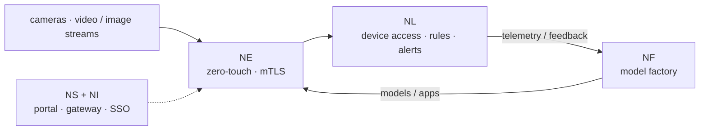

# NereidSentinel

**Guard with Insight, Shape the Future.**

NereidSentinel is a **commercial industry solution** for **video and image
analytics**, built on top of the open NereidAI platform.

!!! note "Commercial solution"
    NereidSentinel is licensed, delivered, and supported under a **separate
    commercial agreement**. It is not part of the Apache-2.0 community edition. See
    [Community vs Enterprise](../community/community-vs-enterprise.md).

## The idea

Video and image streams carry insight that is only useful if it arrives in time and
stays where it is allowed to stay. NereidSentinel approaches that as a platform
problem: capture at the edge, produce and optimize models in a private model
factory, distribute them offline to many nodes, and run inference close to the
cameras — with no mandatory cloud dependency.

!!! abstract "Platform composition"
    The diagram shows how an analytics workload maps onto the **open platform**. It
    is a composition of platform building blocks, not a published feature list for
    NereidSentinel.

## What it builds on

An analytics solution reuses the same platform building blocks as the rest of the
suite:

| Platform building block | Role for an analytics solution |
|---|---|
| [Edge](../products/nereidedge.md) | Connects cameras and gateways with zero-touch onboarding, mTLS, and local autonomy. |
| [Forge](../products/nereidforge.md) | Model factory — datasets, training, quantization, and hardware-targeted export for edge targets. |
| [Horizon](../products/nereidhorizon.md) | Distributes models and apps to large numbers of remote nodes, offline. |
| [Link](../products/nereidlink.md) | Device access, unified messaging, rule engine, alerting, and dashboards. |
| [Sphere](../products/nereidsphere.md) / [Identity](../products/nereididentity.md) | Portal, API gateway, and unified SSO / RBAC across the suite. |

## What we can — and cannot — say here

Because NereidSentinel is delivered commercially, its concrete feature set and scope
are **defined per engagement**. This page describes the value proposition at a high
level only; it does not publish a fixed feature list, pricing, or service levels.

!!! info "Details are per engagement"
    For the specific capabilities, integration surface, delivery plan, and support
    terms that apply to your environment, please
    [reach out](../community/support.md).

## Next steps

- [NereidFactory](nereidfactory.md) — smart manufacturing
- [NereidMedical](nereidmedical.md) — medical insights
- [All commercial solutions](index.md)
- [Community vs Enterprise](../community/community-vs-enterprise.md)
