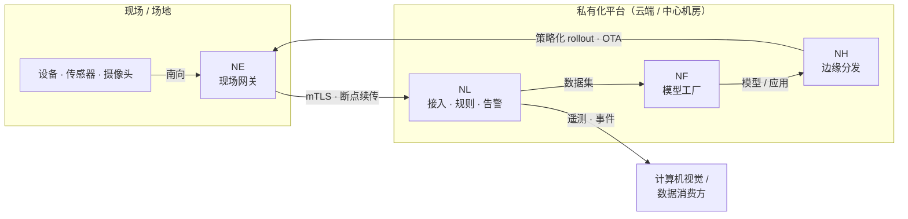

# 架构总览

NereidAI 是一组可独立部署的产品，组合起来构成一个边缘到云端的闭环。它没有
单一单体：套件层把各产品联邦起来，每个领域产品端到端拥有自己的数据、API 与
发布节奏。

- **套件层（轻量）**：Sphere（门户、统一 API 网关、事件粘合）与
  Identity（SSO、RBAC）。
- **领域产品**：Link（IoT 管道）、Forge（模型工厂）、
  Horizon（边缘分发）。
- **边缘 / 现场**：Edge（现场网关上的南向接入）、Fleet（机器人集群）
  以及现场的设备本身。
- **轻量客户端**：Mobile。

## 闭环

这个闭环是有意为之：现场数据流入，成为训练数据，成为模型，再被分发回现场，
产出的遥测又驱动下一轮迭代——而且每一跳都不强制依赖云端。

## 通信平面

| 平面 | 工作方式 |
|---|---|
| **设备 / 南向** | Edge 是一个 EdgeX Foundry 应用服务，把现场设备经网关 MQTT 协议（`v1/gateway/*`）桥接到 Link。传输为 TLS/mTLS；带断点续传缓冲，因此广域网链路间歇性中断也不会丢数据。 |
| **接入** | Link 通过统一的信封与 SDK 接收 MQTT、HTTP、CoAP，使各传输行为完全一致。接入按设备令牌限流。 |
| **服务间（Link）** | 服务之间只经 NATS 通信——绝不跨服务直连数据库。 |
| **面向客户端的实时** | 所有实时数据（遥测、在线状态、告警、命令进度、OTA 进度……）经单条 WebSocket 连接以多路订阅推送；REST 只用于快照与写入。刻意避免轮询。 |
| **管理 / SSO** | 浏览器经 Sphere 访问产品；Sphere 向 Identity（OIDC）认证，并通过密封票据把身份交给产品。见 [SSO 与 OIDC](../security/sso-oidc.md)。 |

## 套件集成

在默认套件部署中，各产品**不**各自实现登录。浏览器经 Sphere 向
Identity 登录一次；随后 Sphere 签发一个短时、单次使用的密封票据，
产品后端以服务端到服务端方式换取已验证身份。Identity 是身份的唯一事实
来源（Keycloak realm `nereidai`）；Sphere 从不存储用户。产品也可以完全
独立运行——使用直接 OIDC 客户端或本地账号。

## 技术栈

| 产品 | 技术栈（已确认） |
|---|---|
| Sphere | Go 1.24、标准库 `net/http`、`log/slog`、`cobra`；React 18 + Ant Design 5 + Vite + TypeScript，内嵌进二进制；OIDC 依赖方；多副本票据重放 HA 使用 Valkey |
| Identity | Keycloak 26 + 独立 PostgreSQL（OIDC 引擎可替换），realm / 客户端声明式provisioned |
| Link | Go、gRPC、NATS（Core / JetStream / KV）、PostgreSQL + TimescaleDB、S3 兼容对象存储；MQTT / HTTP / CoAP 接入；WebSocket 推送 |
| Forge | FastAPI（Python）后端 + worker，React + TS + Ant Design + Vite 前端，Kubeflow Pipelines，Helm charts；镜像来自私有仓库 |
| Horizon | React 18 / Vite 前端 + Express BFF，PostgreSQL；驱动 Open Horizon Exchange / agbot / 边缘节点 |
| Edge | Go（EdgeX Foundry App Functions SDK v4），运行在现场网关 |
| Fleet | 见产品页——早期阶段（Tech Preview） |
| Mobile | 一套客户端代码同时面向 App 与微信小程序 |

## 设计不变量

- **私有化设计**——完全气隙运行，无强制回连，运行期不依赖互联网。
- **产品自治**——每个产品端到端拥有自己的领域；套件层绝不吞并领域逻辑。
- **中立契约**——API 与线契约保持协议、技术栈与厂商中立；通用接口不硬依赖
  特定边缘栈或芯片厂商。
- **多芯片经由模型工厂**——厂商特有工具链只存在于 Forge 内部；其他产品
  只消费版本化产物。

另见：[部署拓扑](topology.md) 与 [跨产品契约](contracts.md)。
