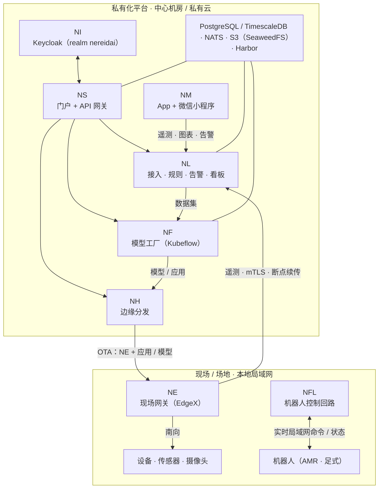

# 部署拓扑

一次 NereidAI 部署横跨两个物理层级，由一条往往间歇性中断的广域网相连：**私有化
平台**（云端或中心机房）与一个或多个**现场 / 场地**——设备实际所在之处。整套设计
都保证广域网链路降级或中断时仍能继续运行。

## 层级

## 中心平台

中心层通过 Helm charts 运行在 Kubernetes（k3s 或完整集群）上，或——对 Link
而言——以单个 all-in-one 二进制运行。运行哪些产品由你决定；每个都可独立安装，
且都不依赖其他产品才能启动。

| 组件 | 职责 |
|---|---|
| Sphere | 门户与统一 API 网关；反向代理到各产品；SSO 粘合 |
| Identity | Keycloak realm `nereidai`；身份的唯一事实来源 |
| Link | 设备接入、消息骨干、规则、告警、看板、OTA 编排 |
| Forge | 数据集 / 标注、训练、优化、多芯片导出、模型仓库（Kubeflow Pipelines） |
| Horizon | 策略化地把 Edge、应用与模型分发到远程节点 |
| Mobile | 只读运营窗口：遥测、图表、告警 |

## 共享基础设施

| 依赖 | 使用方 | 说明 |
|---|---|---|
| PostgreSQL | 多数产品 | Link 使用 PostgreSQL + TimescaleDB 承载实体与时序数据 |
| NATS | Link | Core / JetStream / KV；服务间通信的唯一通道 |
| S3 兼容对象存储 | Link、Forge | 例如 SeaweedFS；固件包、数据集、冷数据 |
| 私有镜像仓库 | 全部 | 例如 Harbor；运行期不依赖互联网 |
| Kubeflow Pipelines | Forge | 训练 / 优化 / 评估流水线 |
| Open Horizon | Horizon | Exchange / agbot / 边缘节点，用于大规模 rollout |

!!! note "气隙配置档"
    在气隙安装中，所有镜像来自内部镜像源 / 私有仓库，整个平台以离线包形式交付。
    见 [气隙安装](../deployment/air-gapped.md)。

## 现场 / 场地层

- **Edge** 运行在现场网关上，把南向设备（经 EdgeX 设备服务）桥接进
  Link。它带断点续传缓冲，使遥测能挺过广域网中断，并且由 Horizon
  经同一条广域网交付 / 更新。
- **Fleet** 运行机器人集群的低延迟本地控制回路（命令 / 状态留在局域网内），
  而集群管理经管理平面触达它。
- **设备** 既可直接接入 Link（MQTT / HTTP / CoAP），也可经 Edge 网关。

## 网络特性

| 链路 | 行为 |
|---|---|
| 设备 → Edge | 本地、南向，经 EdgeX 设备服务 |
| Edge → Link | 广域网上的 TLS / mTLS，断点续传，可安全重放 |
| Horizon → Edge | 策略化 rollout、带宽感知、离线对账 |
| 浏览器 → Sphere → 产品 | 管理平面（广域网）上的 SSO |
| Fleet ↔ 机器人 | 实时、低延迟局域网 |
