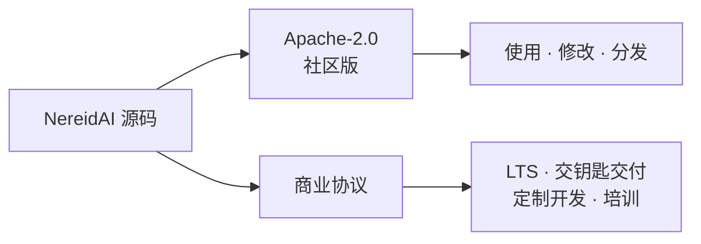

# 开源许可与支持

NereidAI 采用 [Apache License 2.0](https://www.apache.org/licenses/LICENSE-2.0)
**完全开源**。版权所有 © 2026 YIQISOFT。

!!! note "仅提供社区支持"
    社区支持**仅通过 GitHub issues 与 Discussions** 提供。**我们不提供免费技术
    支持。** 如需契约化的响应承诺、部署协助或定制开发，这些按商业条款提供——见下文。

## Apache-2.0 赋予你什么

Apache-2.0 是一种宽松（permissive）许可：

- 可将软件用于任何目的，包括商业用途。
- 可修改并分发你的修改。
- 可与自有代码结合，而无需对自有代码承担 copyleft 义务。
- 每个仓库自带 `LICENSE` 文件与 SPDX 标识。

## 社区支持

社区版由社区在开放环境中支持：

| 渠道 | 用途 |
|---|---|
| GitHub issues | 某仓库中的缺陷报告与可复现问题。 |
| GitHub Discussions | 提问、想法与社区互助。 |

社区支持是**尽力而为、无排期**的——没有 SLA。请在开新帖前先搜索已有的 issues 与
Discussions。

## 商业选项

以下内容**按商业条款单独**提供：

- **企业级 LTS** —— 含回补修复与契约化的 CVE 响应 SLA。
- **交钥匙气隙部署** —— 以及本地私有 POC。
- **定制开发** —— 设备/连接器集成、多厂商芯片/NPU 加速，以及行业特定适配。
- **私有化培训** —— 与知识转移。

## 社区版

社区版覆盖完整的边缘到云端闭环，可独立用于生产。完整的边缘到云端社区版将于
**2026 年底前开源**（按上述条款）；各模块将逐步发布，状态在
[NereidAI GitHub 组织](https://github.com/NereidAI) 与 Discussions 中跟踪。

## 商业行业解决方案

在平台本身之外，NereidFactory、NereidSentinel 与 NereidMedical 是按独立协议交付的
商业产品。请见[商业行业解决方案](../solutions/index.md)。

## 下一步

- [社区版与企业版](community-vs-enterprise.md) —— 能力对比。
- [路线图](roadmap.md) —— 套件当前所处位置与方向。
- [支持](support.md) —— 如何获得帮助、如何联系我们。
