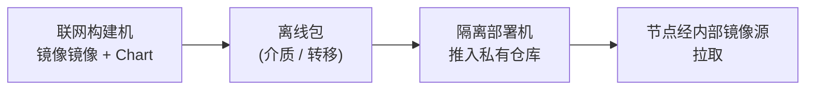

# 气隙安装

NereidAI 面向主权、受监管与网络隔离环境设计。所有产品都支持**完全气隙运行**：
运行期不依赖互联网，且**无强制回连**。私有化安装只从内部镜像源与私有仓库拉取，
所有数据都停留在客户边界之内。

!!! note "范围"
    本页说明离线交付如何运作、能提供什么保证。Kubernetes 拓扑见
    [Kubernetes 与 Helm](kubernetes.md)；更新如何抵达现场见
    [边缘分发](edge-delivery.md)。

## 离线保证

整套件的安全基线与该流程所要兑现的承诺一致：

| 能力 | 状态 |
|---|---|
| 气隙 / 离线安装（完整镜像包，无需互联网） | 已具备 |
| 无强制回连；数据留在客户边界内 | 已具备 |
| 服务间与服务到设备链路的 mTLS | 已具备 |
| 覆盖所有产品的统一 SSO 与集中式 RBAC（Identity） | 已具备 |
| 签名发布产物与逐版本 SBOM | 规划中 |
| CVE 响应与反向移植修复的企业级 SLA | 商业合同 |
| 合规基线（如 等保 2.0）与本地 OS / 加速卡认证 | 逐项目路线图 |

有两条不变量支撑这一切：

- **不得引入任何运行期外部依赖。** 私有化构建只从内部镜像源与私有仓库拉取。
- **平台从不回连。** 遥测、模型与身份数据都留在部署内部。

## 离线包包含什么

离线交付（*完整镜像包*）是自包含的，至少包含：

- **容器镜像**——套件及依赖的镜像，从厂商构建机镜像而来：身份引擎、数据库、
  消息骨干以及各产品镜像。
- **Helm Chart**——各产品发布及其依赖的 Chart。
- **镜像清单**——准确记录镜像与标签，供隔离侧核对。

!!! warning "两个仓库，均在内网"
    镜像存放于**私有仓库**（参考部署中为 Harbor）；Chart 由**内部 Chart 仓库**
    提供。在隔离环境中，两者都仅经内网访问。

## 离线安装如何进行

各产品都自带离线准备工具，但整体形态一致——镜像、转移、导入、安装、校验：

1. **在联网构建机上准备。** 把该发布需要的全部镜像镜入离线包并记录清单。各产品
   都提供镜像与打包脚本（Forge 还会把镜像按类别分组）。
2. **转移离线包**到隔离环境——使用现场允许的任何带外通道（可移动介质、单向
   转移主机）。
3. **导入私有仓库**，并确认每个镜像都解析自仓库而非公共来源。
4. **让节点指向内部镜像源**，使容器运行时把拉取解析到私有仓库——对所有节点
   一致应用。
5. **从内部 Chart 仓库安装**，沿用 [Kubernetes 与 Helm](kubernetes.md) 中描述的
   常规 Helm 流程。
6. **校验。** 运行产品的校验步骤：一切都必须从私有仓库拉取，渲染后的清单中不得
   残留任何公共仓库引用。

!!! note "先复用，再重建"
    导入后的镜像即用即取；隔离侧不从源码构建、不在运行期安装依赖包——镜像本身
    已包含依赖。

## 为什么身份与存储在离线包内

离线包必须包含每个产品都假定存在的基础组件：

- **Identity**（身份引擎及其专用数据库）是套件身份的唯一源头，全局部署
  一套、共享使用。见 [SSO 与 OIDC](../security/sso-oidc.md)。
- **有状态依赖**——时序数据库、消息骨干，以及可选的 S3 兼容对象存储——随包交付，
  因此没有对象存储的现场也能跑通管道。

## 供应链

- 签名发布产物与逐版本 SBOM 在路线图上（安全基线中列为*规划中*）；签名离线包与
  企业级供应链流程按商业条款提供。
- 容器按清单摘要追踪；镜像在导入过程中保持其摘要不变。

!!! info "运维文档"
    逐步的安装与运维细节在各产品仓库中：
    [github.com/NereidAI](https://github.com/NereidAI)。

## 相关

- [Kubernetes 与 Helm](kubernetes.md) —— 拓扑、Chart 与取值。
- [边缘分发](edge-delivery.md) —— 向气隙现场节点分发。
- [安全总览](../security/index.md) —— 完整基线。
