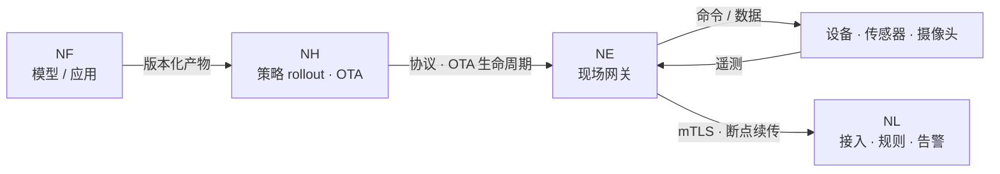

# 边缘分发

**Horizon** 是边缘分发与部署产品。它把 **Edge 本身，以及应用与模型**
分发到大量远程边缘节点：策略化 rollout、带宽感知投递、OTA 生命周期，以及离线期间
的自治对账。

它面向的节点是运行 **Edge** 的现场网关——把现场设备接入 Link 的南向
接入层。

## 分发闭环

Forge 产出模型与应用；Horizon 把它们（连同 Edge 本身）投递到
现场；Edge 在网关上运行并把现场设备桥接进来；设备遥测再流回 Link——
这正是[架构总览](../architecture/overview.md)中描述的同一个闭环。

## 策略化 rollout

Horizon 构建于 **Open Horizon** 之上：其控制台驱动 Exchange 与把工作负载
部署到边缘节点的协议机器人。rollout 以**策略与 pattern** 表达，而非逐设备脚本：

- **Service** 是可部署单元，由策略、pattern 与管理策略决定其运行位置。
- **Node** 是现场目标；协议机器人建立并维持协议，使目标服务持续运行。
- rollout 是**分阶段、灰度式**的——按百分比或固定批量推进，观察通过后才进入下一批；
  达到失败阈值时熔断器会令 rollout 自动中止。

服务部署在发布前会被签名，与之匹配的公钥随服务一并上传——这是分发路径上的一道
完整性校验。

## 带宽感知投递

现场链路常常断续且带宽有限，因此投递被设计为能扛过这些情况：

- 边缘侧的**断点续传（store-and-forward）**意味着链路中断不会丢数据；网关先缓冲，
  链路恢复后再转发。
- **可续传下载**让大产物在传输中断后继续，而不必从头再来；下载进度会流式推到 UI，
  但不会作为遥测存储。
- **离线期间自治对账**：边缘按最后一份已知良好配置继续运行，并在重连时与平台对账。

## OTA 生命周期

Edge 由 Horizon 经 OTA 生命周期交付并持续更新。支持两种来源：
**外部 URL**（边缘自行下载，并强制完整性校验），或**平台托管包**（对象存储中的
鉴权路径，边缘无需对象存储凭证）。

更新按阶段推进——待下发、下载中、已校验、更新中、重启中、已确认——并配有结构化
结果码以便精确诊断。过程控制包括暂停、恢复与分级取消：尚未开始的目标立即停止，
而正在进行的更新不被打断，其结果仍会被回收。

## 现场网关上的 NereidEdge

Edge 作为 EdgeX Foundry 应用服务运行在现场网关上，提供：

- **零触碰上线**——设备首次上报遥测即自动连接，边缘周期性上报其挂载设备清单。
- **到 Link 的安全 mTLS 链路**，且仅建立到 Link 网关的出站连接。
- **本地自治**——清单对账、心跳保活分级与连接器期望态对账在无平台时仍继续。
- **握手协商与特性门控**——上线时协商协议版本与特性集；版本不重叠或必需特性缺失
  即拒绝。
- **配置生命周期**——平台下发期望态，边缘上报实际态；两级配置（Profile 模板加
  实例级覆盖）在派发时合并。
- **Schema 校验与漂移对账**——边缘上报连接器配置 Schema，周期性清单对账识别缺失、
  过期、漂移与多余实例。

!!! note "边缘在本局域网内始终可达"
    Edge 通过 WAN 以出站 mTLS 链路连接 Link；现场本地的命令与状态
    （例如 Fleet ↔ 机器人）走低时延局域网，不依赖中心链路。

!!! info "运维文档"
    逐步的安装与运维细节在各产品仓库中：
    [github.com/NereidAI](https://github.com/NereidAI)。

## 相关

- [Kubernetes 与 Helm](kubernetes.md) —— 分发控制面运行在哪里。
- [气隙安装](air-gapped.md) —— 向隔离现场离线交付。
- [Horizon](../products/nereidhorizon.md) 与
  [Edge](../products/nereidedge.md) —— 产品页。
