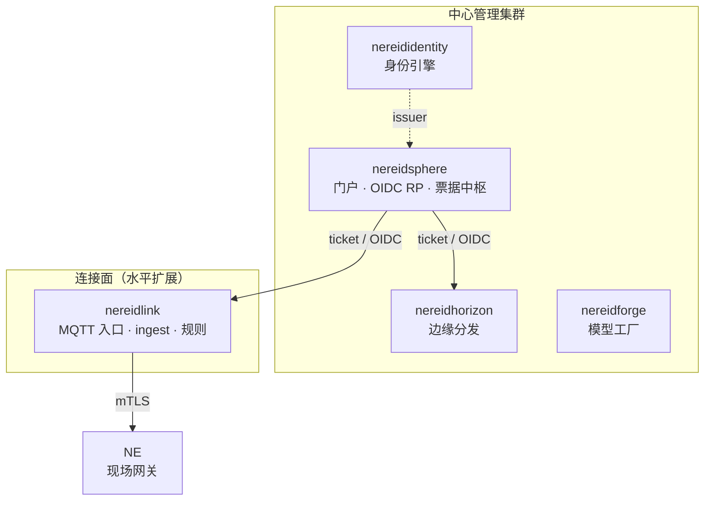

# Kubernetes 与 Helm

每个领域产品都是可独立运行的完整系统，且都能运行在 Kubernetes 上。套件层并不会
替你部署各产品——每个产品拥有自己的命名空间、Helm release 与发布生命周期。

## 一套代码，两种形态

Link 最能说明这种交付二元性：**一套代码，两种形态**。

| 形态 | 位置 | 依赖 |
|---|---|---|
| 单机（all-in-one） | 单个静态二进制 + 本地栈 | 自带数据库、消息骨干与可选对象存储 |
| Kubernetes / K3s | 产品的 Helm Chart | 自带数据库与消息骨干；对象存储复用或自带 |

同一个产品二进制同时服务两种形态。最小的有状态依赖只包括一个数据库与一个消息
骨干；对象存储是可选的（平台托管固件上传需要它，外部 URL OTA 不需要）。

## 命名空间与拓扑

在参考拓扑中，每个产品位于以自身命名的**独立命名空间**，而身份平面整套件只部署
一套：

- **身份是整套件唯一的一个平面。** 无论有多少个连接面集群，它们都对着同一个
  issuer 认证，而不是各自运行身份服务。
- **连接面靠加集群扩展**，而不是靠加命名空间：按租户或设备号段隔离 MQTT 入口、
  ingest 与时序负载。
- **多租户是产品概念，不是命名空间边界。** 租户存在于产品的业务模型内；
  Kubernetes 命名空间不是租户。

生产形态下每个产品命名空间各自带有资源配额、默认拒绝并显式放行的网络策略，以及
独立的仓库拉取凭证。实验 / POC 安装则可改用单一 all-in-one 命名空间。

## Helm Chart 与版本

Chart 来自**内部 Chart 仓库**。所有派生版本——Chart 版本、其 `appVersion` 与镜像
标签——都源自唯一的 `VERSION` 事实来源，因此不会漂移：Chart 版本去掉前导 `v`，
而 appVersion 与镜像标签原样保留。镜像标签留空时回退到 Chart 的 appVersion。

先部署身份平面，再部署门户，最后部署各产品：门户是套件唯一的 OIDC 依赖方，必须在
产品能够验证交接之前就可达。

## NereidSphere 的部署行为

Sphere是采用密封 Cookie 会话的无状态门户，其 Chart 暴露了安装时最
关键的几个选择：

- **认证模式。** 默认 Sphere 对着身份引擎认证。当身份平面不可达时，还提供带 bcrypt
  账号（部署时声明）的**应急本地模式**用于灾难恢复——它仅是最后的应急通道，绝
  不是生产默认。见 [SSO 与 OIDC](../security/sso-oidc.md)。
- **多副本票据安全。** 交接票据是一次性的。当 Sphere 有多个副本时，一次性认领必须
  共享，因此 Sphere 使用 **Valkey** 键值拓扑做跨副本强制。若无法确认一次性，它会
  **失败即关闭（fail closed）**，而不冒重放风险；进程内存存储在仅单副本的开发
  环境才支持，且 Chart 拒绝以此渲染多副本。

## 高可用与自带基础设施

- **Link 高可用**以可选叠加层交付：多应用副本、CloudNativePG PostgreSQL、
  多节点 NATS JetStream、读写多路（RWX）共享存储与 NATS-KV 选主。默认仍为单节点。
- **自带基础设施**：关闭自带依赖，改为提供已有数据库、消息骨干与对象存储的端点
  与凭据。若选了外部依赖却把端点留空，Chart 会快速失败。

## 私有仓库

所有部署镜像都来自**私有仓库**（参考部署中为 Harbor）；部署期不拉取任何公共仓库。
仓库拉取凭证会带入各命名空间，节点级镜像源配置使容器运行时能在气隙集群上解析该
仓库（见 [气隙安装](air-gapped.md)）。

!!! info "运维文档"
    逐步的安装与运维细节在各产品仓库中：
    [github.com/NereidAI](https://github.com/NereidAI)。

## 相关

- [气隙安装](air-gapped.md) —— 离线包与私有仓库。
- [边缘分发](edge-delivery.md) —— 如何抵达现场节点。
- [架构总览](../architecture/overview.md) —— 各部分如何通信。
