# 平台对接指南

本篇面向以编程方式调用 NereidAI 平台的**后端系统与第三方开发者**。每个产品都自带完整的
OpenAPI 契约，本页不重复罗列端点，只回答决定一次对接的两个问题：**该调哪个产品的 API、如何
鉴权**，然后给出对应规范的确切入口。

!!! info "上层文档"
    本页是面向集成方的能力与流程说明。逐端点的请求/响应 schema 见各产品的 OpenAPI 文档，深度
    开发者文档位于各产品仓库——见 [NereidAI](https://github.com/NereidAI)。

## 选择接入点

```mermaid
flowchart TD
    A[你的系统] --> Q{你要对接什么？}
    Q -->|设备 / 网关固件| D[NL 南向协议<br/>MQTT 或 HTTP 设备端点]
    Q -->|无交互用户的后端服务| M{需要哪类数据？}
    Q -->|套件内的浏览器用户| S[NS 单点登录<br/>再经网关调用]
    Q -->|不随套件交付的单产品| O[直连 NI 的 OIDC 客户端]
    M -->|设备、遥测、远程控制| ML[NL REST API<br/>OAuth2 client_credentials]
    M -->|边缘节点、服务、协议| MH[NH Partner API<br/>X-Api-Key，只读]
    S --> GW[/NS 网关 /p/&#123;product&#125;/]
```

| 你的身份 | 使用 | 鉴权方式 |
|---|---|---|
| 上报数据/接收命令的传感器、控制器或边缘网关 | NL 南向（MQTT/HTTP 的 `v1/me/*`） | 设备凭据（token / id+secret / X.509） |
| 读取设备/遥测或下发命令的服务端应用 | NL 平台 REST（`/v1/tenants/...`） | OAuth2 `client_credentials` → Bearer JWT |
| 读取边缘交换库存的第三方系统 | NH Partner API（`/api/v1/{org}/...`） | Partner API key（`X-Api-Key`） |
| 套件登录用户使用的 Web 应用 | 经 NS 网关调用产品 API | 套件会话 cookie；写操作带 CSRF |
| 不经过套件门户集成的产品 | 产品自身的 OIDC 登录 | 对 NI 的授权码 + PKCE |

四种鉴权流程的完整时序图在下一页：[认证流程](authentication-flows.md)。

## API 目录

每个产品可独立部署、各有独立 origin。只有在以 Sphere 为入口的套件部署中才会涉及套件门户。

| 产品 | API 面 | 典型基础路径 | 机器鉴权 | 契约 |
|---|---|---|---|---|
| **NS**（Sphere） | 门户、SSO 票据中心、网关、管理 | `/auth/*`、`/api/v1/*`、`/p/{product}/*` | 服务间调用用 `X-NS-Client-Id` + `X-NS-Client-Secret` | 内嵌 OpenAPI + 离线 Swagger UI：`/api/docs` |
| **NL**（Link） | 平台 REST：租户、设备、profile、遥测、OTA、命令 | `/v1/tenants/{tenantId}/...` | OAuth2 `POST /v1/auth/token`（`client_credentials`）→ Bearer JWT | 内嵌 Swagger UI：`/api/docs` |
| **NL** 设备接入 | 设备/网关线协议 | MQTT 主题 `v1/me/*`、`v1/gateway/*`；HTTP `/v1/me/*` | 设备凭据 | 同一 OpenAPI（device 标签）+ [设备 SDK](../guides/link/device-sdk.md) |
| **NF**（Forge） | 模型工厂控制台 API（数据集、训练任务、模型） | `/api/v1/...` | 面向会话（套件票据或本地 JWT 登录）；租户取自 `X-Tenant-Id` | `docs/api/openapi.yaml` |
| **NH**（Horizon）控制台 | 管理控制台 API | `/api/...` | 套件会话 cookie + CSRF | `openapi-console.yaml` |
| **NH** partner | 面向第三方的只读边缘交换代理 | `/api/v1/{org}/...` | `X-Api-Key`（`nk_live_…` / `nk_test_…`） | `openapi-partner.yaml` |
| **NI**（Identity） | 标准 OIDC / OAuth2（Keycloak 兼容 realm `nereidai`） | `/auth/realms/nereidai/protocol/openid-connect/*` | 按已注册客户端进行客户端认证 | OIDC discovery 文档 |
| **NE**（Edge） | 无独立 REST API | — | 作为 NL 网关走南向线协议 | 见[网关接入](../guides/link/integrate-gateway.md) |
| **NFL / NM**（Fleet / Mobile） | 本版本无公开 OpenAPI | — | Fleet 为技术预览；Mobile 使用 NL 窄量移动 API 子集 | 各产品仓库 |

!!! tip "产品彼此独立"
    你可以单独购买/部署 NL、单独部署 NH 等。套件 SSO 与 `/p/` 网关只存在于以 NS 为入口的
    套件部署中；独立产品直接在自己的 origin 上、按自己的契约鉴权。

## 身份平面

- **NI（Identity）**是唯一身份事实源。其 issuer 为 Keycloak 兼容 realm，例如
  `https://sso.yiqisoft.cn/auth/realms/nereidai`（开发环境：
  `http://localhost:8090/realms/nereidai`）。
- 标准 OIDC 端点通过 issuer 下的 `/.well-known/openid-configuration` 发布
  （授权、token、JWKS、userinfo）。
- 套件部署中**只有 NS 与 NI 进行 OIDC 对话**。后端集成通常完全不直接接触 NI：机器拿 NL
  服务账号 token，浏览器在 NS 登录。
- 客户身份系统（Entra ID、Okta、AD FS……）通过 NI 背后的身份代理接入，绝不改变 API 契约。
  身份模型见 [SSO 与 OIDC](../security/sso-oidc.md)。

## 调用约定

以下规则跨产品通用；逐端点细节以各 OpenAPI 文档为准。

### 请求

- 所有 REST 流量为 HTTPS 上的 JSON（`Content-Type: application/json`）、UTF-8。设备媒体
  上传是文档明确的二进制例外（`POST /v1/me/blob`）。
- 按场景鉴权：NL REST 用 `Authorization: Bearer <jwt>`，NH partner 用 `X-Api-Key`，经 NS
  网关时用套件会话 cookie。绝不要自造身份头（`X-User-*`、
  `X-NS-Integration-Secret`）——入口的伪造副本会被剥除，只有网关能设置它们。
- 每次调用都要落到你的租户/org。NL 在路径中编码（`/v1/tenants/{tenantId}/...`）；NF 从
  token 或 `X-Tenant-Id` 读取；NH partner key 绑定唯一一个 org，访问其他 org 返回 403。
- 发送或保留 `X-Request-Id` 以便串联。不提供时网关会生成；在日志中回传它便于支持排查。

### 响应

- 成功与错误体均为 JSON。数组始终为 `[]`，绝不为 `null`。
- 使用标准状态码：`401`（凭据缺失/过期——重新取 token）、`403`（已认证但未分配/无权限）、
  `404`、`409`（冲突）、`413/415`（媒体大小/类型）、`429`（限流——NL 对反复登录失败的
  OAuth 客户端还会临时锁定）、`503`（例如 NL 未配置 blob 存储）。
- 机器 token 短时效（NL 的 `expires_in` 通常 1800 秒），且**没有 refresh token**——到期前
  或收到 401 时重新执行 client_credentials 交换。
- 平台从不臆造语义（例如测量单位）；语义只来自用户定义的描述符。见
  [跨产品契约](../architecture/contracts.md)。

### 气隙运行

所有端点、Swagger UI 与基座模型均在本地提供，不依赖任何 CDN 或云。Partner key、服务账号
secret 与 OIDC 客户端由运维预置；请对接你所在部署发布的内网 origin。

## 典型配方

端到端时序——取 token、套件用户、partner key、设备媒体——都在
[认证流程](authentication-flows.md)，每个都带可直接运行的请求示例。

## 相关链接

- [认证流程](authentication-flows.md)——逐步讲清四类流程。
- [SSO 与 OIDC](../security/sso-oidc.md) · [RBAC](../security/rbac.md)——身份与授权模型。
- [设备 SDK（Go）](../guides/link/device-sdk.md) · [二进制媒体与 S3](../guides/link/media-blobs.md)——设备侧对接。
- [跨产品契约](../architecture/contracts.md)——兼容性规则。
