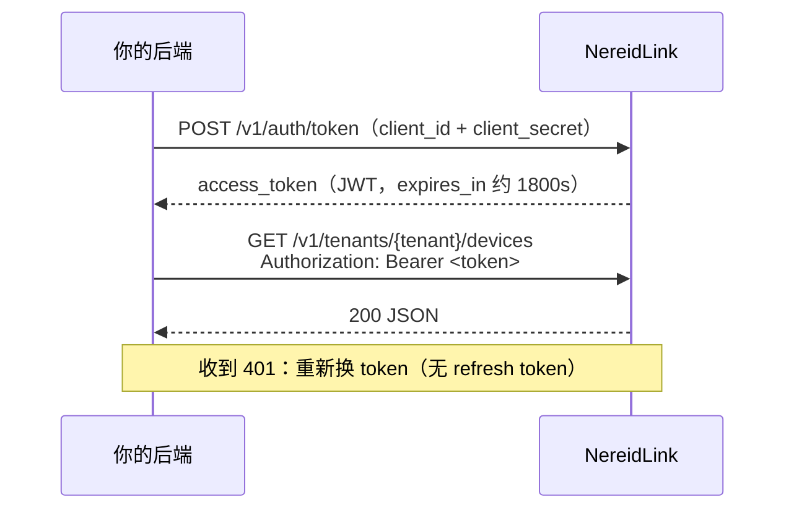
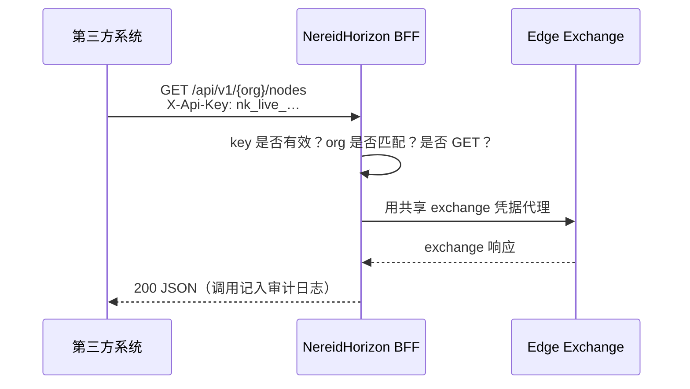
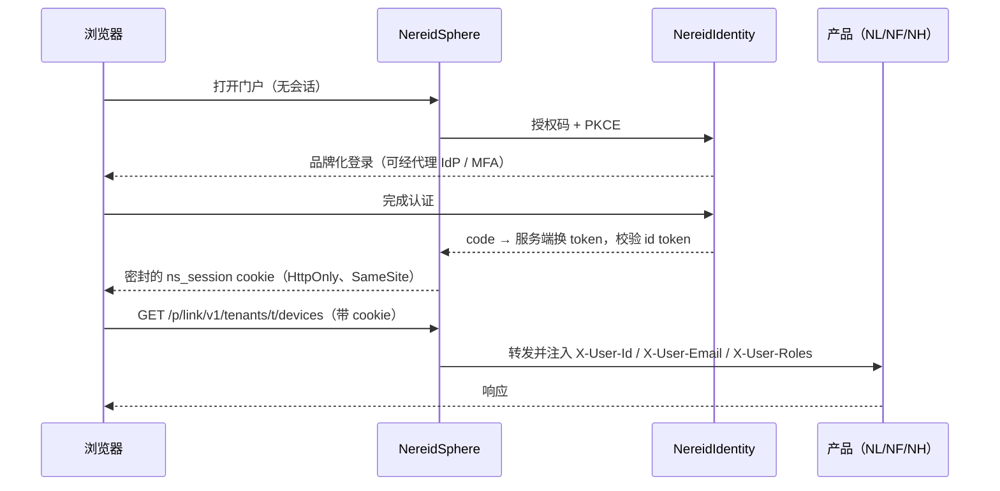
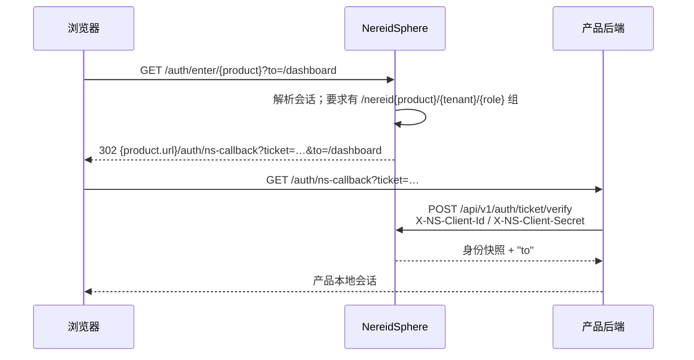

# 认证流程

本页逐个讲清每种对接流程。请根据[平台对接指南](api-integration.md)中你的调用方类型选择对应
流程；时序图展示谁与谁通信，配方是可直接运行的请求。

| 流程 | 调用方 | 凭据 | 是否有交互用户 |
|---|---|---|---|
| A | 后端服务 → NL REST | OAuth2 `client_credentials` Bearer JWT | 否 |
| B | 后端 / 第三方 → NH 边缘数据 | Partner API key | 否 |
| C | 套件中的浏览器用户 → 任意产品 | NS 会话 + 网关 / 票据 | 是 |
| D | 设备或网关固件 | MQTT/HTTP 设备凭据 | 否 |
| E | 不随套件部署的产品 | OIDC 授权码 + PKCE | 是 |

身份概念（为什么只有一个身份平面、客户 IdP 接在哪里）见
[SSO 与 OIDC](../security/sso-oidc.md)。

## 流程 A —— 后端服务调用 NL（client_credentials）

用于没有交互用户、读取设备/遥测或下发命令的服务器。运维在 NL 中创建一个限定租户、带指定
`scopes` 的**服务账号**；你会拿到 `client_id` 与 `client_secret`。



token 端点接受 JSON、表单或 HTTP Basic 三种凭据形式；仅支持
`grant_type=client_credentials`。

```bash
# 1）用服务账号凭据换取机器 token
TOKEN=$(curl -sS https://link.example/v1/auth/token \
  -u "$NL_CLIENT_ID:$NL_CLIENT_SECRET" \
  -H 'Content-Type: application/json' \
  -d '{"grant_type":"client_credentials"}' | jq -r .access_token)

# 2）调用租户作用域 REST 端点
curl -sS "https://link.example/v1/tenants/$TENANT_ID/devices?page=1&page_size=50" \
  -H "Authorization: Bearer $TOKEN"
```

Token 响应：`{"access_token":"…","token_type":"Bearer","expires_in":1800}`。

- 把 token 缓存到接近 `expires_in`；这里特意**没有 refresh token**——需要时再次出示
  secret 换取。
- 同一 client id 反复失败会被临时锁，返回 `429`，与来源地址无关；secret 当作配置，切勿
  记录日志。
- 同一 JWT 即 OpenAPI 文档中的 `BearerAuth` 方案。
- 命令/控制类端点要求对应服务账号 scope；只读集成应只授予只读 scope。

## 流程 B —— 第三方读取 NH 边缘数据（partner key）

用于只需**只读** Open Horizon 交换资源（服务、pattern、策略、节点、协议、用户、HA 组）的
外部系统。运维在控制台签发绑定某一组织的 partner key。



```bash
curl -sS "https://horizon.example/api/v1/$ORG/nodes" \
  -H "X-Api-Key: nk_live_<base64url>"
```

- Key 格式：`nk_live_<base64url>`（生产）、`nk_test_<base64url>`（非生产）。Key 可设过期、
  可吊销。
- 每次请求被强制限定在该 key 的 org：`?org=` 覆盖或路径 org 不一致一律 `403`。只允许
  `GET`；任何修改返回 `403`。
- 合作方不直接访问 Edge Exchange——BFF 持有一套共享 exchange 凭据，且每次调用写入只追加的
  审计日志。
- 控制台 API（`openapi-console.yaml`）是面向浏览器用户的另一套面（流程 C）；合作方只用
  `openapi-partner.yaml`。

## 流程 C —— 套件内浏览器用户（SSO + 网关）

以 NS 为入口时，用户登录一次即可进入每个产品，无需再次登录。你的前端不处理密码，也接触不到
上游 token。

### C.1 登录与网关



网关调用方规则：

- 在 **`/p/{product}/...`** 下调用产品；前缀在转发前被剥除
  （`/p/link/v1/…` → NL origin 的 `/v1/…`）。
- 凭据是 `ns_session` cookie——发同源/带凭据请求即可，无需出示 bearer token。
- 修改类请求要带双提交 CSRF 头 `X-Csrf-Token`，其值等于 JavaScript 可读的 `ns_csrf`
  cookie。`OPTIONS` 预检与服务间票据交换豁免。
- 不要自行发送 `X-User-*` 或 `X-NS-Integration-Secret`：入站副本总会被剥除，再由网关加盖
  已验证的值。产品**仅在请求来自网关时**信任这些头。

### C.2 进入独立托管的产品（票据）

浏览器只持有 NS cookie，因此进入独立托管的产品使用一次性交接票据（30 秒有效、单次使用、
绑定 audience）：



由产品后端（而非浏览器）核验票据：

```http
POST https://sphere.example/api/v1/auth/ticket/verify
X-NS-Client-Id: link
X-NS-Client-Secret: <products[].sso_secret>
Content-Type: application/json

{"ticket":"..."}
```

响应携带已验证身份——`sub`、`preferred_username`、`email`、`name`、`roles`，以及 `groups`
（形如 `/nereid{product}/{tenant}/{role}` 的套件分配组）——还有相对路径 `to`。产品采用
**默认拒绝**：没有该产品分配组的用户会被退回门户；仅有身份不构成授权。随后产品签发自己的
常规会话（例如 NF 会签发本地 JWT，并为 `X-Tenant-Id` 解析租户）。

### C.3 网关的另一种用法：external-auth

不想实现票据交换的产品/Ingress 可把认证委托给
`GET https://<ns>/api/v1/auth/verify`（Ingress external-auth）。有效会话返回 `204` 与需要
转发的 `X-User-*` 响应头；仅在已认证路径上信任这些头。

## 流程 D —— 设备与网关固件

物理设备与边缘网关不使用用户账号或 OAuth。它们用 NL 中预置的设备凭据认证，走南向线协议：

- 凭据：访问 token（MQTT 用户名）、`id + secret`（Basic）、或双向 TLS（X.509）。
- 传输：MQTT 主题（直连设备 `v1/me/*`，网关 hello 之后 `v1/gateway/*`）或 HTTP
  （`/v1/me/telemetry`、`/v1/me/blob`、长轮询命令）。
- 网关还需协商 hello/心跳/manifest，并中继子设备流量。

这本身是一条完整流程——请从[设备 SDK（Go）](../guides/link/device-sdk.md)、
[直连设备接入](../guides/link/integrate-direct-device.md)与
[网关接入](../guides/link/integrate-gateway.md)开始。二进制遥测（图片/文档落 S3）见
[二进制媒体与 S3 存储](../guides/link/media-blobs.md)。为平台新增一种南向协议使用
[适配器 SDK](../guides/link/adapter-sdk.md)。

## 流程 E —— 独立产品对接你的 IdP（直接 OIDC）

**不随套件门户**销售/部署的产品，可作为标准 OIDC 依赖方直接对接 NI（NI 可代理你的企业
IdP）：

1. 为该产品注册带固定重定向 URI 的客户端；ROPC 已禁用，因此使用**授权码 + PKCE**。
2. 从
   `https://<issuer>/auth/realms/nereidai/.well-known/openid-configuration`
   获取端点。
3. 在服务端完成换码，对照 JWKS 校验 id token（issuer、audience、过期、nonce），建立产品
   自己的会话。
4. 从套件角色/组 claim 解析产品本地授权；产品仍是自身 RBAC 的权威。

套件部署中这对应 `oidc` 集成模式，而其他产品通常保持默认的 `ns` 票据模式。NS 与产品
**必须在模式上一致**——不一致是登录循环最常见的原因。细节与 claim 映射见
[SSO 与 OIDC](../security/sso-oidc.md)。

## 决策清单

1. 有交互用户吗？**没有** → A（NL）或 B（NH）；**有** → C（套件）或 E（独立）。
2. 调用方是固件？一律走 D。
3. 集成需要写 edge exchange 吗？NH partner API 只读；运营类写入应以认证用户身份走控制台/API，
   而非 partner key。
4. 确认部署形态：套件（有网关+票据）还是独立（直连 origin + 直接 OIDC）。
5. 与运维带外约定并预置凭据：服务账号、partner key、OIDC 客户端或设备凭据。这些都不能自助
   注册。

## 相关链接

- [平台对接指南](api-integration.md)——API 目录与调用约定。
- [SSO 与 OIDC](../security/sso-oidc.md) · [RBAC](../security/rbac.md)
- 内嵌 OpenAPI：NS 与 NL 在 `/api/docs` 提供离线 Swagger UI；NH 提供 console 与 partner
  两份规范；NF 为 `docs/api/openapi.yaml`。
