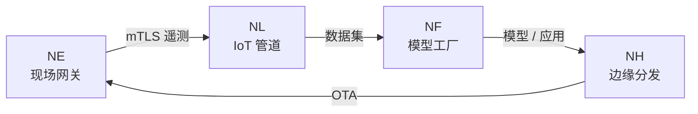

# 快速开始

NereidAI 是端到端的 AIoT 平台，以**一组专注的产品**形态交付。每个产品都是
[NereidAI GitHub 组织](https://github.com/NereidAI)下的独立仓库，组合起来构成
一个闭环，且不强制依赖云端。各产品的职责见
[套件总览](../products/index.md)，各部分如何协作见
[架构总览](../architecture/overview.md)。

!!! info "开发者文档"
    本页用于帮助你定位方向；**产品仓库才是权威来源**，包含安装、确切命令与
    内部实现。请从 [NereidAI 组织](https://github.com/NereidAI) 进入，并先阅读
    对应产品的 `README`。

## 一个套件，多个独立仓库

套件层做联邦，但绝不吞并领域产品的逻辑。每个产品端到端拥有自己的 UI、API 与
发布节奏，并在其 `README` 中带有自己的快速开始。

| 产品 | 职责 |
|---|---|
| [Sphere](../products/nereidsphere.md) | 轻量套件层——统一门户、统一 API 网关、跨产品事件粘合。 |
| [Identity](../products/nereididentity.md) | 套件统一身份中心——OIDC / LDAP / SAML 联邦、RBAC。 |
| [Link](../products/nereidlink.md) | 私有化 IoT 数据管道——设备接入、规则、告警、看板。 |
| [Forge](../products/nereidforge.md) | 模型工厂——数据集、训练、优化、多芯片导出。 |
| [Horizon](../products/nereidhorizon.md) | 边缘分发——策略化 rollout、带宽感知投递、OTA。 |
| [Edge](../products/nereidedge.md) | 现场网关上的南向边缘接入——零触碰、mTLS、本地自治。 |
| [Fleet](../products/nereidfleet.md) | 机器人集群管理——任务调度、交通管制、远程操作。 |
| [Mobile](../products/nereidmobile.md) | Link 的移动窗口——App 与微信小程序。 |

!!! note "可独立部署"
    每个领域产品都能单独运行，不依赖其他产品启动。套件服务（Sphere、
    Identity）对单产品部署均为可选，且是永不复制产品功能的轻量层。



## 找到产品的快速开始

打开你关心的产品仓库，按其 `README`（以及它链接的 `INSTALL` / `docs` 指南）
操作。Link 以一套代码交付两种形态——all-in-one 单二进制或 Kubernetes
微服务；Edge 运行在现场网关上；较新的产品（Fleet、Mobile）
尚处早期阶段，请以仓库当前范围为准。

## 自己跑起来

以下每个产品族各给出一个有代表性的入口。把它们当作路标即可——完整命令见
产品仓库。

=== "Sphere"

    ```bash
    make dev          # 运行后端（configs/dev.yaml）
    make web-dev      # 带热重载的 Vite 开发服务器
    ```

=== "Link"

    ```bash
    make build        # 构建 Web 资源 + 自包含二进制
    ```

=== "Horizon"

    ```bash
    make dev-all      # PostgreSQL 容器 + 后端 + 前端
    ```

!!! tip "成熟度不一"
    各产品处于不同成熟度阶段。请以产品仓库中的当前状态为准，切勿假定所有
    产品都拥有稳定接口——见[路线图](../community/roadmap.md)。

## 接入设备

- **现场设备 → Edge → Link。** Edge 运行在现场网关上，把
  南向设备经网关 MQTT 协议桥接进 Link，具备 mTLS 与断点续传缓冲。
- **设备直连 Link。** Link 通过同一套共享信封与 SDK 接受 MQTT、
  HTTP 与 CoAP，因此各传输行为一致。

<!-- markdownlint-disable-next-line MD033 -->
<details markdown>
<summary>新增一种南向协议</summary>

新协议通过 **Link Adapter SDK** 以独立项目或仓库的形式添加，把一种线协议
翻译为平台契约。该 SDK 位于 Link 仓库的 `sdk/` 下，附带带注释骨架
（`adapters/template`）与完整参考适配器（`adapters/coap`），且无需导入
`internal/` 包。

</details>

## 下一步

- [套件总览](../products/index.md) —— 完整产品列表。
- [贡献指南](contributing.md) —— 如何参与仓库协作。
- [代码规范](conventions.md) —— 共享的编码规范。
