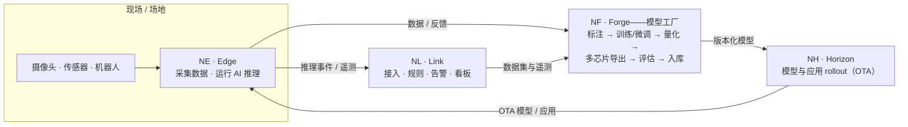

# NereidAI

<strong>在数据海洋中导航</strong>——从设备、到模型、到边缘智能。

端到端、气隙、多芯片的 AIoT 平台。IoT 连接与 AI 智能同在一个闭环——
私有化设计。

[了解产品套件](products/index.md){ .md-button .md-button--primary }
[架构总览](architecture/overview.md){ .md-button }

!!! nr-status "开源状态 · 正在严格验证中"
    全部代码**尚未发布到 GitHub**，目前正处于严格验证阶段：我们正在逐一审核所有代码与
    功能，确保开源后**开箱 100% 可用**。兵马未动，粮草先行——待审核通过后才会正式开放
    仓库。进展可在[路线图](community/roadmap.md)跟踪。

## 闭环

NereidAI 以一组专注的产品形态交付，每个产品都可独立部署，组合起来构成统一平台。
一个轻量的套件层把它们串联起来，而不吞并各自的领域逻辑。

这个闭环有两半，在 **Forge** 汇合：**IoT 那一半**把现场数据接进来（Edge、Link）
并对结果采取行动；**AI 那一半**把数据变成模型（Forge），再送回边缘运行（Horizon、
Edge）。模型在真实遥测中不断迭代，下一轮更准——且不强制上云。

- :material-shield-lock:{ .lg .middle } **私有化设计**

    ---

    完全离线 / 气隙交付，无强制回连。数据、训练与推理全程留在客户边界内。

- :material-brain:{ .lg .middle } **从 CNN 到大模型**

    ---

    一个工厂同时覆盖经典视觉模型（检测 / 分类 / 分割）**与**大模型——VLM 辅助
    标注、LLM / VLM 微调与推理服务。

- :material-chip:{ .lg .middle } **多芯片 → 边缘推理**

    ---

    同一个训练好的模型导出到 NVIDIA、AMD、Intel、ARM、昇腾、算能、登临、灵汐、
    瑞芯微，在网关上跑低延迟的 CV 或 VLM 推理。

- :material-robot:{ .lg .middle } **具身智能与物理 AI** _路线中_

    ---

    让模型走出屏幕、落到机器人上——NereidFleet 基于 ROS 2 / Open-RMF 编排轮式
    AMR、四足与人形机器人，迈向视觉-语言-动作（VLA）与物理 AI 负载。

- :material-access-point:{ .lg .middle } **海量设备实时接入**

    ---

    多协议接入（MQTT / HTTP / CoAP）、规则引擎、告警与看板；所有变化经
    WebSocket 推送，不轮询。

- :material-wifi-off:{ .lg .middle } **弱网下的边缘自治**

    ---

    广域网中断时现场网关继续工作：本地自治 + 断点续传缓冲，恢复后安全重放遥测。

- :material-satellite-variant:{ .lg .middle } **大规模离线分发**

    ---

    NereidHorizon 把 Edge 本身、应用与模型 rollout 到成千上万远程节点——策略驱动、
    带宽感知的 OTA，支持离线对账。

- :material-sitemap:{ .lg .middle } **一个 AIoT 闭环**

    ---

    现场数据 → 模型 → OTA rollout → 边缘推理 → 遥测反馈：IoT 连接与 AI 智能同在
    一个闭环，不强制上云。

Apache-2.0 社区版 · 企业级 LTS、SLA、加固与交钥匙私有化交付——见
<a href="community/community-vs-enterprise.md">社区版与企业版</a>。

## 从数据到边缘智能

AI 链路是一等公民，而非附属功能：

| # | 阶段 | 发生了什么 | 产品 |
|---|---|---|---|
| 1 | **采集** | 摄像头、传感器与机器人从现场汇入图像、视频与时序数据。 | Edge、Link |
| 2 | **标注** | 数据集带版本；视觉语言模型（Florence-2、Qwen-VL）预标注，再由人工复核。 | Forge |
| 3 | **训练 / 微调** | Kubeflow 流水线训练经典视觉模型，或在客户自有数据上微调 LLM / VLM（LLaMA-Factory）。 | Forge |
| 4 | **优化与导出** | 量化 / 编译（NNCF、OpenVINO、TensorRT、vLLM），面向目标芯片导出。 | Forge |
| 5 | **评估与入库** | 质量与基准指标（含 LLM-as-judge）对每个版本把关；通过的模型进入模型仓库。 | Forge |
| 6 | **边缘运行** | 模型经 OTA rollout，在网关与设备上跑低延迟的 CV 或 VLM 推理。 | Horizon、Edge |
| 7 | **监控与反馈** | 推理事件与遥测驱动规则、告警，并进入下一轮训练。 | Link、Forge |

同一条闭环也支撑着商业解决方案——智能制造质检、视频 / 图像分析（NereidSentinel）
与医疗洞察（NereidMedical）。

### 迈向具身智能与物理 AI

在感知与分析之上，下一步是**在物理世界中行动**。[NereidFleet](products/nereidfleet.md)
（当前 Tech Preview）已在开放技术栈（ROS 2、Open-RMF、Zenoh、EdgeX）上编排异构具身
设备——轮式 AMR、四足与人形机器人。路线图上，同一条 Forge→边缘闭环将为这些机器人
输送**视觉-语言-动作（VLA）**与物理 AI 模型：在 Forge 中训练的感知模型，经 Horizon
部署，由 Fleet 与 Link 完成回路。

## 产品套件

两个轻量套件服务把整个家族串联起来，六个领域产品承担实际工作。
每个领域产品都是可独立运行的完整系统。**正文用短词**、**图表用缩写**——见
[命名与简写](reference/naming.md)。

| 产品 | 缩写 | 职责 |
|---|---|---|
| [NereidSphere](products/nereidsphere.md) | NS | 轻量套件层——统一门户、统一 API 网关与跨产品事件粘合。 |
| [NereidIdentity](products/nereididentity.md) | NI | 套件统一身份中心——OIDC / LDAP / SAML 联邦、RBAC、令牌签发。 |
| [NereidLink](products/nereidlink.md) | NL | 私有化 IoT 数据管道——设备接入、规则引擎、告警、看板。 |
| [NereidForge](products/nereidforge.md) | NF | 模型工厂——数据集、训练、优化、多芯片导出、模型仓库。 |
| [NereidHorizon](products/nereidhorizon.md) | NH | 边缘分发——策略化 rollout、带宽感知投递、OTA。 |
| [NereidEdge](products/nereidedge.md) | NE | 现场网关上的南向边缘接入——零触碰、mTLS、本地自治。 |
| [NereidFleet](products/nereidfleet.md) | NFL | 机器人集群管理——任务调度、交通管制、远程操作。 |
| [NereidMobile](products/nereidmobile.md) | NM | Link 的移动窗口——App 与微信小程序。 |

## 从哪里开始

-   :material-rocket-launch:{ .lg .middle } **快速开始**

    ---

    安装社区版，跑通第一个闭环，接入一台设备。

    [:octicons-arrow-right-24: 开发指南](development/getting-started.md)

-   :material-server-network:{ .lg .middle } **部署**

    ---

    气隙安装、Kubernetes 与 Helm、边缘分发。

    [:octicons-arrow-right-24: 部署](deployment/air-gapped.md)

-   :material-shield-account:{ .lg .middle } **安全**

    ---

    SSO / OIDC、RBAC、mTLS 与合规基线。

    [:octicons-arrow-right-24: 安全](security/index.md)

-   :material-scale-balance:{ .lg .middle } **社区版与企业版**

    ---

    哪些是开源的，哪些按商业条款提供。

    [:octicons-arrow-right-24: 对比](community/community-vs-enterprise.md)

