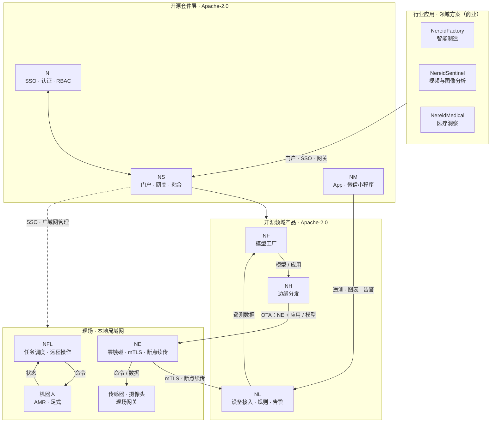

# NereidAI 产品套件

NereidAI 是面向气隙（air-gapped）与多芯片环境的端到端 AIoT 平台。它把
边缘数据采集（**Edge**）→ 多芯片模型工厂（**Forge**）→
大规模离线边缘分发（**Horizon**）→ 推理与反馈（**Link**）
这一闭环打通，且不强制依赖云端。

NereidAI 以一组专注的产品形态交付，每个产品都可独立部署，组合起来构成统一平台。
一个轻量的套件层把它们串联起来，而不吞并各自的领域逻辑：**Sphere**
门户与 API 网关，以及 **Identity** 单点登录与访问控制中心。

## 两个轻量服务，六个领域产品

每个领域产品都是能独立运行的完整系统——套件服务只做联邦，不代管。
**正文用短词**、**图表用缩写**——见 [命名与简写](../reference/naming.md)。

| 产品 | 缩写 | 职责 | 仓库 |
|---|---|---|---|
| **NereidSphere** | NS | 轻量套件层——统一门户、统一 API 网关，以及产品之间的闭环事件粘合。自身不含领域逻辑，认证委托给 Identity。 | [`NereidSphere`](https://github.com/NereidAI) |
| **NereidIdentity** | NI | 套件认证与身份中心——覆盖所有产品的单点登录、OIDC / LDAP / SAML 联邦、RBAC、令牌签发与租户级访问治理。 | [`NereidIdentity`](https://github.com/NereidAI) |
| **NereidLink** | NL | 私有化 IoT 数据管道——多协议设备接入、统一消息、规则引擎、告警与实时看板。一套代码两种形态：all-in-one 单二进制或 Kubernetes 微服务。 | [`NereidLink`](https://github.com/NereidAI) |
| **NereidForge** | NF | 模型工厂——数据集 / 标注管理、训练与微调、优化与量化、面向硬件的导出、评估与模型仓库。 | [`NereidForge`](https://github.com/NereidAI) |
| **NereidHorizon** | NH | 边缘分发与部署——把 Edge 本身以及应用和模型分发到大量远程边缘节点：策略化 rollout、带宽感知投递、OTA 生命周期与离线期间自治对账。 | [`NereidHorizon`](https://github.com/NereidAI) |
| **NereidEdge** | NE | 南向边缘接入，由 Horizon 交付并持续更新——运行在现场网关上，把现场设备接入 Link，具备零触碰上线、mTLS 安全链路、断点续传缓冲、本地自治与 OTA 生命周期。 | [`NereidEdge`](https://github.com/NereidAI) |
| **NereidFleet** | NFL | 机器人集群管理——多机器人任务调度、交通协调、实时运营看板与远程操作，覆盖轮式 AMR 到足式机器人。 | [`NereidFleet`](https://github.com/NereidAI) |
| **NereidMobile** | NM | Link 的移动窗口——App 与微信小程序：经 Identity 登录，浏览设备遥测与看板、轻量时序图表分析与告警推送。 | [`NereidMobile`](https://github.com/NereidAI) |

## 默认可独立 { #standalone-by-default }

产品之间是松耦合，而非单体。**每个领域产品都可以完全独立地部署与使用**——自己的
登录、自己的数据、自己的发布节奏——无需安装 Sphere 或 Identity，运行期也不依赖其他
产品。你可以从单个产品起步，之后再加入套件层。

套件级的绑定**只在你选择 Sphere 作为入口时**才出现：

- **认证。** 被集成的产品信任 Sphere 交给它的身份（默认密封票据移交，或直接 OIDC）。
  Sphere 与产品必须就模式达成一致，不一致会导致登录循环。没有 Sphere 时，产品使用
  自己的直接 OIDC 客户端或本地账号。见 [SSO 与 OIDC](../security/sso-oidc.md)。
- **导航 / 跳转。** 门户的单点登录“进入产品”重定向经 Sphere；独立部署时直接打开产品
  自己的 URL。
- **跨产品事件粘合。** 可选的闭环事件（例如 Forge → Horizon → Edge）经套件层流转；
  它们是可选的，并非启动前提。

除此之外产品之间没有耦合。NereidEdge 根本不是中心门户入口：它在每个边缘站点独立运行。

## 整体如何协作

每个产品端到端拥有自己的领域——自己的 UI、API 与发布节奏。套件层刻意保持轻量：
Sphere 提供统一门户、API 网关与跨产品事件粘合，Identity 负责认证与
访问控制。两者都不复制产品功能，且对单产品部署均为可选。

## 平台不变量

- **私有化设计**：所有产品支持完全气隙运行，运行期无强制回连、不依赖互联网。
- **产品自治**：每个产品端到端拥有自己的领域；Sphere 与 Mobile 是轻量
  层，绝不复制或吞并其他产品的功能或业务逻辑。
- **中立契约**：南向 / 线契约与平台 API 保持协议、技术栈与厂商中立。
- **多芯片经由模型工厂**：厂商特有的加速、镜像与工具链都隔离在 Forge 流水线
  内部——其他产品只消费版本化产物，不直接依赖厂商工具。

## 下一步

- [架构总览](../architecture/overview.md) —— 各部分如何通信。
- [部署](../deployment/air-gapped.md) —— 气隙安装。
- [社区版与企业版](../community/community-vs-enterprise.md) —— 哪些开源、哪些商业。
