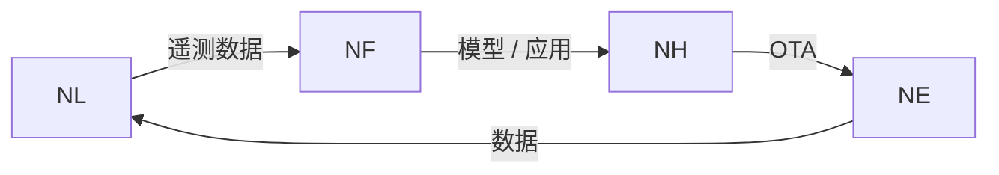

# NereidForge

NereidForge 是企业自己的**模型工厂**：把你手里已有的数据——图像、视频、数据集——
变成真正能在现场设备上跑起来的模型，整个过程都在企业自己的网络内完成。数据不出机房、
不依赖云账号，也不需要养一支 AI 专家团队才能运转。

如果你曾经问过下面这些问题，Forge 就是为你准备的：

- "我们积累了多年的现场数据，怎么才能把它变成一个能用的模型？"
- "开源模型通用能力不错，但不认识我们的场景，能自己把它调出来吗？"
- "厂商给了一个模型文件，我怎么知道它够不够准、敢不敢上生产线？"
- "我们的网关和相机配置都不高，模型塞得进去吗？压缩之后到底损失多少？"
- "核心工程师离职了，数据集、训练参数和评估报告都在哪？"

## Forge 能帮你做什么

### 只用自己的数据，从零训练模型

你只需要带着业务数据和要解决的问题来，不需要先有模型。Forge 提供一条标准化的
生产线——数据准备、训练、算力调度、过程记录——普通工程师照着流程就能走完全程，
不必再自己拼装十几个互不连通的开源工具。计算机视觉模型（检测、分类、分割等）与
语言 / 视觉语言模型都是一等公民，常规工作通过模板完成，而不是写定制代码。

### 让现有模型学会你的业务

不必从零开始。可以拿一个开源模型或基础模型，用企业自己的数据做微调，让它认识你的
产品、你的现场和你的术语。常规微调提供零代码模板（如 LoRA、QLoRA 等方式）；算法
团队也可以通过一个轻量 Python SDK 带入自研训练框架，契约很简单——环境变量进、
产物出。厂商特有的加速能力隔离在各自独立的训练镜像中，不存在一个"万能"镜像；
两条路产出的都是同样经过登记、带版本号的模型。

### 回答"这个模型到底够不够好"

模型质量靠数据说话，不靠感觉。每次训练完成后都会自动评估，评估报告与该模型版本
永久绑定存档：

- **视觉模型**看 mAP、召回率等硬性指标，对照团队设定的质量门限判定；
- **语言模型**跑标准基准题库（如 MMLU），并在企业自己的问题集上评分，包括生成
  答案的质量。

达不到质量门限的模型无法被误提升为正式版本。任何一个历史版本，都能追溯到它用了
哪份数据集、什么训练参数、得了多少分、部署在哪些地方。

### 把模型压缩到现场设备上——精度代价写在纸面上

现场网关和相机算力有限，大模型必须"瘦身"。Forge 支持 fp16、int8、int4 等多种
精度压缩（量化）及其他优化手段，并针对你实际采购的硬件导出——NVIDIA、AMD、
Intel 或国产芯片路线都可以，硬件选型不被单一厂商绑定。

关键在于：**每一个压缩版本都附带与原模型的前后对比报告**——体积小了多少、速度
快了多少、精度损失多少，全部量化列出。决策依据是桌面上的数字，而不是厂商的口头
承诺。

### 让数据、模型和经验沉淀为组织资产

一切皆登记、皆有版本：数据集有来源溯源，模型有完整血缘，评估报告和部署记录统一
留存。模型版本沿着清晰的阶段流转——候选、预发布、生产、归档——能力沉淀在组织
内部，而不是依附于某个专家个人。任何模型在提升为正式版本之前，都可以先上传一张
测试图片，直观看到它关注了哪些区域，无需先部署。

### 标注不必从零开始

内置标注工作台覆盖图像、文本与视频。先由模型给出候选标签和候选框，标注员只做
审核与修正，而不是空白画布上手工绘制；视频标注只需处理关键帧，中间帧由平台自动
跟踪补全。项目支持指派处理人与协作评审，数据集一旦定稿即不可变。

## 一个模型在 Forge 中的旅程

1. **采集**——导入常见格式的图像、视频或指令数据（检测、分类、分割与指令
   布局），训练 / 测试划分原样保留；每份数据集自动带版本与完整溯源，并支持
   从草稿到定稿的评审流程。
2. **标注**——机器预标注加人工复核，在集成的工作台内完成。
3. **训练**——从零训练或微调基础模型，可按需选择不同厂商的 GPU。
4. **评估**——自动生成报告并对照质量门限，判断结果是否值得走出实验室。
5. **优化**——量化并针对具体硬件导出，每个压缩版本都与父模型逐项对比。
6. **登记与交接**——通过的模型进入模型仓库，随后经
   [NereidHorizon](nereidhorizon.md) 投递到边缘现场。

## 在套件中的位置

Forge 是 NereidAI 闭环里的工厂车间：消费边缘侧采集、由
[NereidLink](nereidlink.md) 落地的数据，产出模型与应用，再交给
[NereidHorizon](nereidhorizon.md) 分发到现场节点。厂商特有的加速能力与工具链
都隔离在 Forge 内部，其他产品拿到的永远是干净的、带版本的模型包。

!!! info "开发者文档"

    关于 Forge 的权威、详细的开发者文档位于其自身仓库：
    <https://github.com/NereidAI/NereidForge>。

!!! tip "免费使用，亦可选购企业保障"

    NereidForge 以 Apache-2.0 开源，可免费用于生产环境，包括商业用途。
    多站点发布、HA/DR 指导、带回填修复的 LTS、契约化 CVE 响应 SLA 与交钥匙
    气隙交付，可通过企业订阅获得。见[价格与购买](../community/pricing.md)，
    或邮件 [jiekechoo@gmail.com](mailto:jiekechoo@gmail.com)。

## 技术一览

本节面向技术评估人员；以上内容均无需机器学习背景即可阅读。

| 方面 | 说明 |
|---|---|
| 职责 | 私有化模型工厂——数据集、训练、优化、导出、评估、模型仓库 |
| 价值 | 把业务数据转化为可在现场设备运行的模型；资产留在客户手中 |
| 标注 | 集成 Label Studio 与 CVAT 工作台，支持机器预标注与视频关键帧跟踪 |
| 模型类型 | 计算机视觉模型与语言 / 视觉语言模型；支持从零训练与微调 |
| 优化 | 发布前应用量化（fp16 / int8 / int4）与优化插件 |
| 导出 | 多框架导出为可移植运行格式，自动识别来源框架，覆盖 NVIDIA、AMD、Intel 与国产芯片路线 |
| 评估 | 评估报告随版本留存；视觉看 mAP / 召回率门限，语言看基准题库与生成质量评分 |
| 服务 | 模型仓库带血缘与阶段流转；模型服务支持权重按需加载与"上传图片试跑"验证 |
| 私有化设计 | 在客户自有环境完全离线运行；基础模型随系统预置 |
| 交付形态 | 从内部镜像仓库出发的声明式 Kubernetes 部署 |
| 语言 / 技术栈 | Python 后端与 React 前端；在 Kubernetes 上编排流水线并提供模型服务 |
| 许可证 | Apache-2.0 |

## 资源

- GitHub：<https://github.com/NereidAI/NereidForge>
- 套件：[产品总览](index.md) · [Link](nereidlink.md) ·
  [Horizon](nereidhorizon.md)
- [架构总览](../architecture/overview.md) ·
  [气隙安装](../deployment/air-gapped.md)
- [Kubernetes 与 Helm](../deployment/kubernetes.md) · [SSO 与 OIDC](../security/sso-oidc.md)
- [社区版与企业版](../community/community-vs-enterprise.md)
