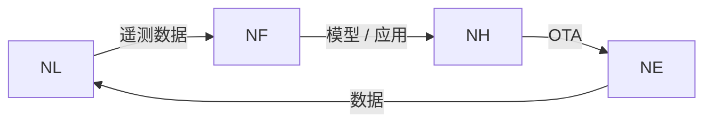

# NereidForge

Forge 是私有化模型工厂：一个部署在本地机房的平台，把业务数据——数据集、
图像与视频——转化为可在现场设备上运行的模型，覆盖数据集与标注管理、训练与
微调、优化与量化、面向硬件的导出、评估与模型仓库。

## 解决什么问题

- **数据不能离开组织。** 工业、政务与安防数据受合规约束；整座工厂运行在客户
  自有环境内、可完全离线运转，基础模型随系统预置而无需联网下载。
- **AI 项目靠手工拼接。** 数据准备、标注、训练、评估与部署由少数专家在多个
  互不连通的工具间串联；Forge 把它变成一条可复用的生产线。
- **能力长在个人身上，而非组织里。** 数据、模型与评估报告统一登记并版本化，
  知识不再随人员流动而流失。
- **实验室模型下不到现场。** 现场设备算力有限、芯片种类繁多；一次训练即可产出
  面向多条硬件路线的模型。
- **厂商与云端锁定。** 平台私有化，且在数据与格式选择上保持开放，今天的投资
  不会成为明天的孤岛。

## 核心能力

**数据与标注**

- 数据集管理，具备版本与可追溯的来源，支持草稿到定稿的流程。
- 多格式导入——目标检测、分类、分割与指令格式——采用规范且保留划分（split）
  的目录布局。
- 通过集成的 Label Studio 与 CVAT 标注工作台完成标注，覆盖图像与视频。
- 机器预标注：由模型先给出候选框，标注员只做审核与修正，而非从零绘制；视频
  标注只需标注关键帧，中间帧由平台自动跟踪补全。
- 按项目指派处理人并支持协作评审。

**训练与微调**

- 标准化流水线，普通工程师即可操作，从数据集一路到训练完成的模型。
- 同时支持计算机视觉模型与语言 / 视觉语言模型，可在组织数据上微调。
- 按厂商划分训练镜像，使厂商特有的加速与工具链彼此隔离，绝不使用单一“万能”
  镜像。

**优化、导出与评估**

- 发布前应用优化与量化插件（编译 / 量化）。
- 多框架导出为可移植的运行格式，并自动识别来源框架家族。
- 面向硬件的导出，覆盖 NVIDIA、AMD、Intel 以及国产芯片路线，让硬件采购保留
  选择权。
- 发布前自动评估，评估报告与模型版本一并留存。

**模型仓库、服务与验证**

- 模型仓库可对任一版本回答：用什么数据训练、效果如何、部署在哪里。
- 模型服务按需加载已上传的权重。
- 任意模型产物无需先部署即可“上传图片试跑”验证，并可视化模型关注区域。

**交付**

- 完全私有化交付：镜像来自内部仓库，整栈可在离线机房运行。
- 在 Kubernetes 上以声明式方式部署与升级。

## 在套件中的位置

Forge 是闭环中的模型工厂环节。它消费边缘采集的数据——即
[Link](nereidlink.md) 落地的遥测——并产出模型与应用，交由
[Horizon](nereidhorizon.md) 分发到边缘节点。按套件设计，厂商特有的加速、
镜像与工具链都隔离在 Forge 流水线内部；其他产品只消费版本化产物，
不直接依赖厂商工具。

!!! info "开发者文档"

    关于 Forge 的权威、详细的开发者文档位于其自身仓库：
    <https://github.com/NereidAI>。

## 关键事实

| 方面 | 说明 |
|---|---|
| 职责 | 私有化模型工厂——数据集、训练、优化、导出、评估、模型仓库 |
| 价值 | 把业务数据转化为可在现场设备运行的模型；资产留在客户手中 |
| 标注 | 集成 Label Studio 与 CVAT 工作台，支持机器预标注 |
| 模型类型 | 计算机视觉模型与语言 / 视觉语言模型 |
| 导出 | 多框架导出为可移植运行格式，面向多条硬件路线 |
| 服务 | 模型仓库，以及带“上传图片试跑”验证的模型服务 |
| 私有化设计 | 在客户自有环境完全离线运行；基础模型随系统预置 |
| 交付形态 | 从内部镜像仓库出发的声明式 Kubernetes 部署 |
| 语言 / 技术栈 | Python 后端与 React 前端；在 Kubernetes 上编排流水线并提供模型服务 |
| 许可证 | Apache-2.0 |

## 资源

- GitHub：<https://github.com/NereidAI>
- 套件：[产品总览](index.md) · [Link](nereidlink.md) ·
  [Horizon](nereidhorizon.md)
- [架构总览](../architecture/overview.md) ·
  [气隙安装](../deployment/air-gapped.md)
- [Kubernetes 与 Helm](../deployment/kubernetes.md) · [SSO 与 OIDC](../security/sso-oidc.md)
- [社区版与企业版](../community/community-vs-enterprise.md)
