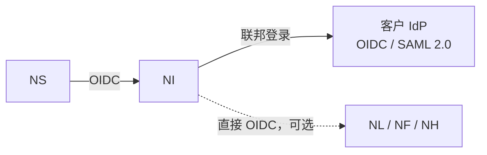

# NereidIdentity

Identity 是 NereidAI 的套件级身份平面：位于 Sphere、Link、
Horizon 与 Forge 之后、可替换的共享单点登录与访问控制中心。

## 解决什么问题

- **多产品、一个身份。** 用户与管理员在套件内使用同一个共享账号，而无需为
  每个产品单独登录。
- **认证工作重复。** 在默认集成中，产品完全不实现身份协议；它们信任来自
  Sphere 的一次性交接。
- **客户身份系统分散。** 客户身份系统只需在身份平面之后接入一次，而不必接入
  每一个产品。
- **身份引擎锁定。** 身份引擎只是实现细节：任何符合标准的引擎都可通过修改
  依赖方的连接设置来替换。
- **不安全的旧式流程。** 全平台排除密码授权（ROPC）登录，符合当前 OAuth 2.0
  最佳实践。

## 核心能力

**套件级单点登录**

- 标准 OIDC/OAuth2 单点登录，支持授权码 + PKCE、刷新令牌与单点登出；依赖方
  依据公开的身份元数据校验令牌。
- 在默认集成中，Sphere 是唯一必需的依赖方；它所保持的套件会话随后即可
  抵达各产品，无需二次登录。

**集成模式**

- **套件联邦（默认）：** 产品信任来自 Sphere 的一次性交接，自身无需任何
  身份配置，且账号治理能力完整可用。
- **直接 OIDC（可选，按产品）：** 产品作为身份平面的标准 OIDC 客户端注册，
  同时仍参与套件 SSO。
- **独立客户 IdP：** 仅在单个产品脱离套件交付时使用；明确处于套件治理之外。
- 混合部署是一等场景：例如一个产品走直接 OIDC，其余走套件联邦交接。

**身份联邦**

- 外部客户身份提供方（例如 Microsoft Entra ID、Okta、Auth0、Authing、
  AD FS）以 OIDC 或 SAML 2.0 在身份平面**之后**接入。
- 新增、替换或停用客户提供方，无需改动 Sphere 或产品，也无需重启。
- 组/声明到角色的映射只在一处完成，因此每个产品都从同一上游身份获得相同的
  套件角色。

**角色与账号治理**

- 稳定、精简的套件角色词汇——`user`、`operator`、`admin`——细粒度授权保留在
  各产品内部。
- 账号管理集中化：在一个控制台内创建、启用/停用、重置密码与分配角色；
  停用账号会在整个套件范围内生效。
- 来自客户提供方的联邦账号在套件控制台中保持只读，其生命周期归客户所有。
- 当身份服务不可达时，内置的本地管理员仍可作为应急（break-glass）路径使用。

**私有化设计**

- 完全气隙运行，无强制回连、无外部运行期依赖；支持内部证书颁发机构。

## 在套件中的位置

Identity 是身份的事实来源：Sphere 与之通信，账号治理也由它驱动。
在默认的交接集成中，它对领域产品不可见；当某产品走直接 OIDC 时，它就成为该
产品自身的身份提供方。

!!! info "开发者文档"

    关于 Identity 的权威、详细的开发者文档位于其自身仓库：
    <https://github.com/NereidAI>。

## 关键事实

| 方面 | 说明 |
|---|---|
| 职责 | 套件级身份平面——单点登录与访问控制中心 |
| 提供 | 套件 SSO、账号与角色治理、客户身份联邦 |
| 集成模式 | 套件联邦交接（默认）、直接 OIDC、独立客户 IdP |
| 联邦 | 外部 OIDC 与 SAML 2.0 提供方，在身份平面之后接入 |
| 治理 | 集中账号管理；联邦账号只读 |
| 交付形态 | 面向中心 Kubernetes 部署的容器镜像 + Helm Chart；另有本地开发栈 |
| 定位 | 作为独立服务部署；不是面向产品的门户 |
| 语言 / 技术栈 | Keycloak + PostgreSQL，可由任何符合标准的 OIDC/OAuth2 引擎替换 |
| 许可证 | Apache-2.0 |

## 资源

- GitHub：<https://github.com/NereidAI>
- 套件：[产品总览](index.md) · [Sphere](nereidsphere.md)
- [SSO 与 OIDC](../security/sso-oidc.md) · [RBAC](../security/rbac.md)
- [架构总览](../architecture/overview.md) ·
  [气隙安装](../deployment/air-gapped.md)
- [社区版与企业版](../community/community-vs-enterprise.md)
