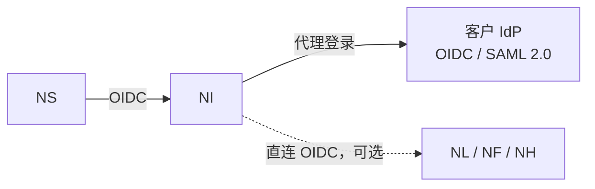

# NereidIdentity

NereidIdentity 是 NereidAI 套件的**证件管理处**：你是谁、你能访问什么，由它判定，并签发
其他所有产品都信任的身份凭证。用户在整个平台只有一个账号；企业已有的身份系统——
Microsoft Entra ID、Okta、Auth0、AD FS 等——只需对接一次，不必逐个产品重复接线。

Identity 的存在，是为了回答组织反复提出的这些问题：

- "为什么每上一个新系统，员工就要多记一个密码？"
- "我们已经有企业身份系统了，平台能不能直接用，而不是另建一套用户目录？"
- "员工离职时，要去多少个地方停用账号？"
- "审计点名的那些不安全的老式登录流程，我们还在用吗？"
- "这套东西能在完全隔离的网络里运行、不向厂商回连吗？"

## Identity 能帮你做什么

### 一个人，在整个套件只有一个身份

一个共享账号即可通行 Sphere、Link、Horizon 与 Forge。账号管理集中化——创建、
启用/停用、重置密码、分配角色都在一个控制台完成；停用一个账号，全套件立即生效。
默认集成方式下，各领域产品根本不实现身份协议，而是信任套件的一次性交接。

### 直接对接你已经在用的身份系统

外部身份提供方经标准 OIDC 或 SAML 2.0 协议，被统一代理在身份平面**之后**。新增、
更换或停用一个提供方，Sphere 与各产品都无需改动、无需重启；组/声明到角色的映射
只在一处完成，每个产品从同一个上游身份拿到一致的套件角色。

### 产品集成松紧，由你选择

三种模式，可按产品自由混用：

- **套件联邦（默认）：**产品信任 Sphere 的一次性交接，自身无需任何身份配置，享受
  完整账号治理。
- **直连 OIDC：**产品作为身份平面的标准 OIDC 客户端注册，仍然参与套件单点登录。
- **独立客户 IdP：**仅用于单产品脱离套件交付的场景，明确置于套件治理之外。

### 治理角色与账号生命周期

一套小而稳定的角色词汇——`user`、`operator`、`admin`——让授权关系清晰可懂，
细粒度权限仍保留在各产品内部。从客户提供方联邦进来的账号在套件控制台中保持只读，
因为其生命周期归客户所有；身份服务不可达时，仍保留内置本地管理员作为破玻璃
（break-glass）通道。

### 满足现代安全审计要求

认证采用带 PKCE 的授权码流程、刷新令牌与单点登出，依赖方对照公开发布的元数据
验证令牌。不安全的密码授予（ROPC）流程在所有产品中被彻底排除，符合当前
OAuth 2.0 最佳实践。

### 完全隔离运行

支持彻底气隙运行：无回连、无外部运行时依赖，并支持内部证书机构。底层引擎
（当前为 Keycloak 加 PostgreSQL）只是实现细节：任何符合标准的引擎都可以通过
连接设置替换，平台不会把你锁定在某一家身份厂商上。

## 身份如何在套件中流转

1. **账号创建或联邦**——本地创建，或从客户自有身份提供方代理接入。
2. **角色一次映射**——上游组与声明在中心一处转换为套件的
   `user` / `operator` / `admin` 角色。
3. **用户登录**——经 Sphere，在身份提供方自己的登录页完成。
4. **令牌验证**——依赖方对照公开发布的身份元数据校验令牌；产品拿到的永远是
   已验证身份，而非自报身份。
5. **权限即时变更**——停用账号即移除全套件访问权；联邦账号在其源头治理。

## 在套件中的位置

Identity 是 Sphere 对接的身份事实源，也是账号治理的驱动中心。默认交接集成下，
它对领域产品不可见；当产品走直连 OIDC 时，它就成为该产品自己的身份提供方。

!!! info "开发者文档"

    关于 Identity 的权威、详细的开发者文档位于其自身仓库：
    <https://github.com/NereidAI/NereidIdentity>。

## 技术一览

本节面向技术评估人员；以上内容均无需身份与访问管理背景即可阅读。

| 方面 | 说明 |
|---|---|
| 职责 | 套件级身份平面——单点登录与访问控制中心 |
| 提供 | 套件 SSO、账号与角色治理、客户身份联邦 |
| 标准 | OIDC / OAuth 2.0 授权码加 PKCE、刷新令牌、单点登出、公开发布元数据；排除 ROPC |
| 集成模式 | 套件联邦交接（默认）、直连 OIDC、独立客户 IdP；支持混合部署 |
| 联邦 | 外部 OIDC 与 SAML 2.0 提供方（如 Microsoft Entra ID、Okta、Auth0、Authing、AD FS），代理在身份平面之后；不停机热增/换/停 |
| 角色 | 稳定的 `user` / `operator` / `admin` 词汇；细粒度授权在各产品内部；中心声明到角色映射 |
| 治理 | 集中账号管理、停用全套件生效；联邦账号只读；本地破玻璃管理员 |
| 私有化设计 | 完全气隙、无回连、支持内部证书机构 |
| 可替换性 | 当前为 Keycloak 加 PostgreSQL；任何合规 OIDC/OAuth2 引擎均可经依赖方连接设置替换 |
| 交付形态 | 中心 Kubernetes 部署的容器镜像加 Helm chart；另提供本地开发栈 |
| 定位 | 作为独立服务部署；不是面向产品用户的门户 |
| 许可证 | Apache-2.0 |

## 资源

- GitHub：<https://github.com/NereidAI/NereidIdentity>
- 套件：[产品总览](index.md) · [Sphere](nereidsphere.md)
- [SSO 与 OIDC](../security/sso-oidc.md) · [RBAC 权限模型](../security/rbac.md)
- [架构总览](../architecture/overview.md) ·
  [气隙安装](../deployment/air-gapped.md)
- [社区版与企业版](../community/community-vs-enterprise.md)
