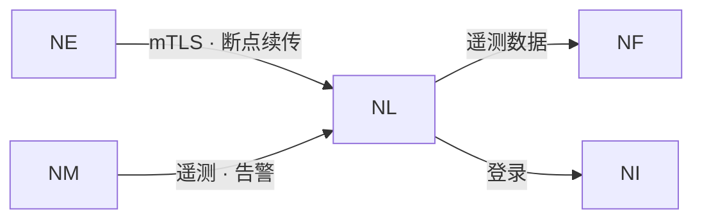

# NereidLink

Link 是面向企业私有化部署的 IoT 数据管道平台：多协议设备接入、统一消息
管道、规则引擎、告警通知与实时可视化。

## 解决什么问题

- **协议与设备碎片化。** 现场设备与网关协议繁多；Link 通过统一的设备
  契约把它们汇入同一条管道，取代逐个厂商的集成。
- **轮询与数据过时。** 运维需要实时状态而非周期快照；所有数据变化都随发生时
  推送至客户端。
- **私有化、受监管的运行。** 数据留在客户自有环境内，无强制云端依赖。
- **多租户治理。** 一套部署服务多个租户，数据隔离、权限细粒度、容量可计量。
- **打通边缘闭环。** 它为套件提供现场遥测的落地与处置之处，并反馈到模型生产。

## 核心能力

**实时通信**

- 所有数据变化经 WebSocket 推送——遥测、在线状态、属性、设备影子、域事件、
  告警、命令进度、连接器状态与 OTA 进度。不使用轮询。
- 一条连接承载多个订阅、服务端纯推送；支持断线重连与会话恢复。
- 推送按租户隔离并与访问控制数据范围联动；消费过慢或半开的客户端被丢弃，
  不影响其他客户端。

**设备接入与管理**

- 四种设备凭据：Token、密码、JWT（支持远程密钥发现）与双向 TLS 的 X.509
  证书。
- 凭据全生命周期：生效/失效窗口、启用停用、就地轮换与重叠窗口轮换、到期预警。
- 设备生命周期：预注册与单次认领令牌、客户/分组间移交、非破坏性报废与召回
  窗口、恢复与归档。
- 网关与子设备为简单包含关系；支持带校验预览的 CSV/XLSX 批量导入；展示别名
  与备注。

**命令与远程控制**

- 同步请求-响应命令；离线设备立即失败，而不是在“看似成功”之后排队。
- 命令目录即安全边界：命令须先声明、启用并限定范围才能执行。
- 支持按设备组子树或显式列表下发批量命令，并实时推送聚合进度。
- 支持经网关中继至子设备的命令、带风险分级的一键网关操作，以及按需探测。

**遥测与数据管道**

- MQTT、HTTP、CoAP 三种入口共用统一上行；点位类型化（数值 / 布尔 / 字符串），
  单位仅来自用户定义的描述符。
- 平台与协议无关、不内置业务逻辑；边缘网关与直连设备均通过通用设备 SDK 接入。
- 进入流处理前按设备限流，支持可选消息压缩；向第三方系统异步转发并做逐目的地
  背压隔离；提供死信队列。

**存储、设备状态与规则**

- 实体数据与时序数据统一底座，外加 S3 兼容对象存储承载固件、导入导出与冷数据。
- Hot / Warm / Cold 分层存储，支持按租户、按数据域的保留期与法律冻结。
- 设备影子（期望态/上报态合并与漂移检测）、三作用域属性与追加式设备事件账本。
- 版本化规则链，配合可视化节点编辑器与三档脚本能力，从内嵌表达式到外挂运行器。

**告警与通知**

- 触发 / 确认 / 清除的完整告警生命周期，支持指派处理人与评论协作。
- 升级链按有序延迟与目标角色编排，并支持固定节奏重复提醒。
- 多通道投递：站内信、Webhook 与 SMTP 邮件。
- 链路断链告警、每网关每日断链摘要，以及与租户通知体系隔离的平台级故障兜底。

**边缘管理与 OTA**

- 边缘握手协商与会话恢复；连接器全生命周期；两级配置配合 Schema 校验与漂移
  对账。
- 候选设备自动发现与注册、配置清单对账，以及链路看门狗。
- 固件既可从外部 URL、也可从平台托管包升级；具备阶段化状态、结构化结果码、
  灰度发布、熔断与断点续传。

**安全、多租户与运维**

- 内置证书颁发机构支撑设备双向 TLS；TOTP 多因素认证与恢复码；危险操作二次确认。
- 权限决定“能做什么”，数据范围决定“能触达哪些数据”，读写两侧均强制收口；
  租户密钥保险库与防篡改审计日志。
- 租户开通自动化与暂停/恢复；OAuth2 服务账号承载机器身份；签名许可证在超配时
  进入只读降级而非中断上报。
- Prometheus 指标与 Grafana 仪表盘、租户业务指标、通知服务级指标与接入资源核算。
- 公开设备 SDK 与适配器 SDK、协议模拟器、厂商中立 Profile 库，以及官方设备服务
  目录（Modbus、OPC-UA、ONVIF、BACnet、S7、LLRP、CoAP 等）。

## 在套件中的位置

Link 是闭环中的推理与反馈环节。Edge 通过双向认证、断点续传的链路
把现场设备接入 Link；由此产生的遥测作为训练数据回流至
[Forge](nereidforge.md)，而 [Mobile](nereidmobile.md) 是运维人员
查看 Link 的窗口。登录经 Identity 联邦。

!!! info "开发者文档"

    关于 Link 的权威、详细的开发者文档位于其自身仓库：
    <https://github.com/NereidAI>。

## 关键事实

| 方面 | 说明 |
|---|---|
| 职责 | 私有化 IoT 数据管道——设备接入、消息、规则、告警、看板 |
| 实时模型 | 经 WebSocket 服务端推送；不使用轮询 |
| 设备接入 | MQTT、HTTP、CoAP 入口；Token、密码、JWT 与 X.509 凭据 |
| 设备服务 | Modbus、OPC-UA、ONVIF、BACnet、S7、LLRP、CoAP 等 |
| 多租户 | 多租户，具备 RBAC、数据范围与签名许可证 |
| 交付形态 | 一套代码两种形态——all-in-one 单二进制或 Kubernetes 微服务 |
| 定位 | 私有化、气隙部署；中英双语运维界面 |
| 语言 / 技术栈 | Go；消息骨干；PostgreSQL + TimescaleDB；S3 兼容对象存储 |
| 许可证 | Apache-2.0 |

## 资源

- GitHub：<https://github.com/NereidAI>
- 套件：[产品总览](index.md) · [Forge](nereidforge.md) ·
  [Mobile](nereidmobile.md)
- [跨产品契约](../architecture/contracts.md) ·
  [边缘分发](../deployment/edge-delivery.md)
- [Kubernetes 与 Helm](../deployment/kubernetes.md) · [安全](../security/index.md)
- [社区版与企业版](../community/community-vs-enterprise.md)
