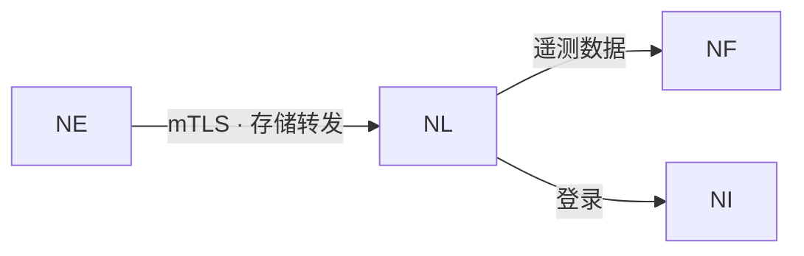

# NereidLink

NereidLink 是所有设备及其数据的**中央调度室**。无论你运营的是机器、传感器还是相机，
也无论它们各自"说"什么协议语言，Link 都能把它们接入同一个平台：实时查看数据、在故障
升级前收到告警、安全地下发指令，并对整批设备统一升级。整套系统运行在你自己的环境内，
设备数据无需离开现场。

如果下面这些问题正困扰你的团队，Link 就是答案：

- "车间里的机器来自六七个厂商，能不能在一个系统里全看到？"
- "五分钟刷新一次的看板太慢了——数据能不能一变就推过来？"
- "谁能对哪台设备下发指令？网络断了的时候指令会怎样？"
- "几千台设备要升级，难道每个现场都派工程师出差吗？"
- "客户的数据必须留在客户现场，而且不同团队之间不能互看设备。"

## Link 能帮你做什么

### 接入任何设备，不管它说什么"语言"

工业设备的协议五花八门——Modbus、OPC-UA、ONVIF、BACnet、S7、LLRP、CoAP 等等。
Link 通过不断扩充的官方设备服务库全部支持，新增一台机器不再意味着一个定制集成项目。
网关与子设备可以逐个注册，也可以用表格批量导入，并在进入平台前先做校验预览，把错误
挡在门外。

### 实时掌握现场正在发生什么

任何变化都会在发生的一瞬间推送到你的屏幕——读数、在线状态、设备状态、告警与指令
进度——基于常驻实时连接，而不是定时轮询。可视化编辑器搭建的规则链把原始数据变成
决策：阈值判断、数据转换与自动动作，无需编写应用代码。

### 远程控制，但不留后门

远程指令受"指令目录"治理：能调哪些指令、谁有权调、超时时间和读写边界都有明确规定。
批量指令可面向整组设备并实时汇总进度；危险操作要求二次确认。设备离线时指令立即明确
失败，而不是悄悄排队、给你一个虚假的成功承诺。

### 永远比故障先一步知道

告警具备完整生命周期——产生、确认、评论、清除——支持指派人、升级链路，并通过站内
收件箱、webhook 或邮件送达。Link 还会"盯梢"自己：链路中断告警、每网关每日摘要、
平台级"看门狗"兜底机制，保证沉默的设备不会被遗漏。

### 管理设备的完整一生

从首次入网（一次性认领令牌），到在客户与分组之间调拨，再到带召回窗口期的非破坏性
退役，每台设备都有可审计的历史。固件升级支持灰度发布、熔断与断点续传，一个坏版本
不可能拖垮整支机队。

### 数据、租户与权限尽在掌控

Link 为受监管的多客户运营而生：租户彼此隔离；权限决定"你能做什么"、数据范围决定
"你能看到哪些行"；防篡改审计日志、租户密钥保险库、热/温/冷三级存储与保留策略、
法律封存一应俱全。认证方式从简单令牌到双向 TLS 证书与多因素认证均可，整站支持
完全气隙离线运行。

## 一台设备在 Link 上的第一天

1. **入网**——设备或网关用一次性令牌认领预先注册的身份，或经批量导入完成登记。
2. **连接**——以原生协议（MQTT、HTTP 或 CoAP）接入，凭据可在不停机的情况下轮换。
3. **上数**——读数即刻流动、实时上屏；设备影子保留其最近一次已知状态。
4. **自动化**——规则链处理数据流，触发告警或动作。
5. **控制与升级**——运维人员下发受目录治理的指令，固件以受保护的波次滚动升级。
6. **反哺闭环**——积累的遥测数据成为 [NereidForge](nereidforge.md) 的训练原料。

## 在套件中的位置

Link 是闭环中的推理与反馈环节。[NereidEdge](nereidedge.md) 通过双向认证、
存储转发的链路把现场设备接入 Link；产生的遥测数据供给
[Forge](nereidforge.md) 作为训练数据。登录则通过
[Identity](nereididentity.md) 联邦认证。

!!! info "开发者文档"

    关于 Link 的权威、详细的开发者文档位于其自身仓库：
    <https://github.com/NereidAI/NereidLink>。

## 技术一览

本节面向技术评估人员；以上内容均无需物联网背景即可阅读。

| 方面 | 说明 |
|---|---|
| 职责 | 私有化 IoT 数据管道——设备接入、消息、规则、告警、看板 |
| 实时模型 | 基于 WebSocket 的服务端推送，不使用轮询；内置重连与会话恢复 |
| 设备接入 | MQTT、HTTP、CoAP 三类入口；令牌、密码、JWT、X.509 凭据，支持重叠窗口轮换 |
| 设备服务 | Modbus、OPC-UA、ONVIF、BACnet、S7、LLRP、CoAP 等；提供设备/适配器 SDK 与模拟器 |
| 指令 | 同步请求-响应，指令目录带开关、超时与读写掩码；支持批量与网关中继指令、风险等级、按需探针 |
| 数据与存储 | 统一类型化上行；热/温/冷三级分层，按租户保留并支持法律封存；S3 兼容对象存储；死信队列 |
| 规则与状态 | 可视化规则链编辑器、带漂移检测的设备影子、三域属性、只追加事件台账 |
| 告警 | 产生/确认/清除生命周期、指派人、升级链路，站内/webhook/邮件多通道，看门狗兜底 |
| 边缘与 OTA | 边缘握手与会话恢复、连接器生命周期、漂移对账、链路看门狗；灰度固件 OTA 带熔断与断点续传 |
| 多租户 | RBAC 加数据范围、租户密钥保险库、防篡改审计、降级为只读的签名许可证 |
| 安全 | 内置证书机构签发设备 mTLS 证书、TOTP 多因素认证、危险操作二次确认 |
| 交付形态 | 一套代码两种形态——一体化单二进制或 Kubernetes 微服务 |
| 可观测性 | Prometheus 与 Grafana；入口流量核算；中英双语运维界面 |
| 语言 / 技术栈 | Go；消息骨干；PostgreSQL + TimescaleDB；S3 兼容对象存储 |
| 许可证 | Apache-2.0 |

## 资源

- GitHub：<https://github.com/NereidAI/NereidLink>
- 套件：[产品总览](index.md) · [Forge](nereidforge.md)
- [跨产品契约](../architecture/contracts.md) ·
  [边缘分发](../deployment/edge-delivery.md)
- [Kubernetes 与 Helm](../deployment/kubernetes.md) · [安全](../security/index.md)
- [社区版与企业版](../community/community-vs-enterprise.md)
