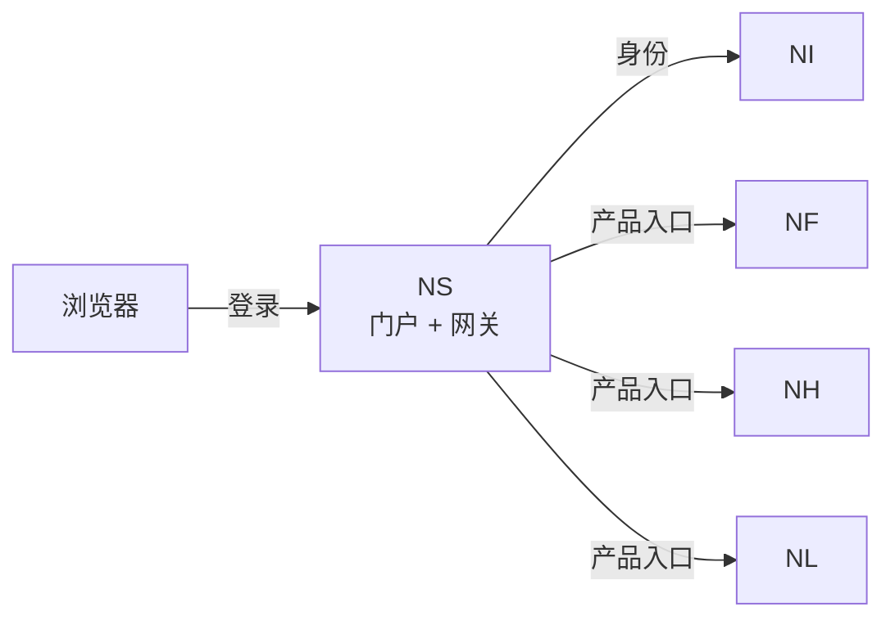

# NereidSphere

NereidSphere 是整个 NereidAI 套件的**统一大门**：一个门户、一次登录、一道挡在所有产品
前面的安全关卡。登录一次，就能直接打开 Forge、Horizon 或 Link，无需再次认证。它刻意
不含任何业务逻辑——只负责把各产品联邦起来，而这些产品脱离它也完全可以独立运行。

当你装到第二个产品时，这些问题自然会出现，Sphere 就是答案：

- "员工真的需要为每个系统各记一套账号密码吗？"
- "有没有一个统一入口，让大家看清楚我们到底买了什么？"
- "怎么保证用户不能从一个产品溜进从未授权的另一个产品？"
- "暴力破解登录、跨站请求、伪造身份头，这些谁来挡？"
- "身份系统万一挂了，管理员还有没有安全的办法进去？"

## Sphere 能帮你做什么

### 每个用户只需一次登录

Sphere 是挡在 [NereidIdentity](nereididentity.md) 前面的标准协议依赖方
（OIDC/OAuth2）：用户在身份提供方自己的登录页输入凭据，Sphere 自身永远看不到、
也不存上游密码。随后一个密封会话让用户在整个套件内保持登录，带空闲超时与绝对
超时，会话有效期间透明续期；登出时清除套件会话，并在支持的情况下一并结束上游
会话。

### 一个门户，代替一堆浏览器书签

双语门户按闭环顺序列出核心产品——Forge → Horizon → Link——并可直接启动。进入
任何产品都遵循默认拒绝原则：用户必须被显式分配该产品，套件管理员是唯一的隐含
例外。进入时通过短时有效的一次性票据交接；多副本部署下，重放存储保证票据只能
被消费一次。

### 在边界上强制执行访问控制

一个反向代理挡在所有集成产品前面：认证会话、丢弃客户端自带的任何身份头（使其
无法伪造），只转发经过验证的身份。横切保护只在这里实现一次，而不是每个产品各做
一遍：精确来源白名单、按客户端限流（登录限流更严）、跨站请求伪造防护、上游超时
与浏览器安全头。

### 不靠"万能密码"管理账号

内置管理控制台负责身份账号管理——创建、启用/停用、重置密码、分配套件角色与逐
产品的租户访问——底层使用专用服务账号，而非权力无限的管理员密码。同时防止最后
一个管理员被锁死；联邦账号保持只读，因为其生命周期归客户自己的身份提供方所有。

### 保留一条明确标注的"破玻璃"通道

身份服务不可用时，紧急本地账号模式保证管理入口仍然可达。它被显式标记为破玻璃
（break-glass）手段，不是默认路径，也不会削弱日常运行的安全性。

### 始终保持可选

每个产品都能带着自己的登录独立运行。当你同时运营多个产品、想要统一入口与统一
策略时，Sphere 才有存在的必要；单产品部署完全可以不装它，也没有套件业务数据库
需要运维。

## 一次登录如何到达每个产品

1. **登录**——用户经 Sphere 在 Identity 的登录页完成认证。
2. **建立会话**——Sphere 持有一个密封、带过期时间的套件会话。
3. **选择产品**——门户检查该用户是否被显式分配了此产品。
4. **票据交接**——产品用一次性、短时有效的票据换取已验证身份。
5. **在产品内工作**——产品建立自己的会话；网关对每个请求持续执行身份与流量
   防护。
6. **一次登出**——清除套件会话，并在支持的情况下结束上游会话。

## 在套件中的位置

Sphere 联邦各领域产品，但不吞并它们。它是**唯一**与 Identity 进行 OIDC 对话的
套件组件，并通过短时票据把已验证身份交给每个产品建立自己的会话。

[NereidEdge](nereidedge.md) 在各个边缘现场独立运行，刻意**不**作为中心门户入口。
身份平面是 [Identity](nereididentity.md)；完整闭环见
[架构总览](../architecture/overview.md)。

!!! info "开发者文档"

    关于 Sphere 的权威、详细的开发者文档位于其自身仓库：
    <https://github.com/NereidAI/NereidSphere>。

## 技术一览

本节面向技术评估人员；以上内容均无需身份与访问管理背景即可阅读。

| 方面 | 说明 |
|---|---|
| 职责 | 薄套件层——统一门户、单点登录、API 网关与跨产品粘合 |
| 范围 | 联邦各领域产品；自身不含业务逻辑 |
| 前置产品 | Forge、Horizon、Link（按闭环顺序） |
| 身份 | OIDC/OAuth2 依赖方，认证委托给 Identity；可选紧急本地账号 |
| 会话 | 密封套件会话，带空闲与绝对超时、透明续期、单点登出 |
| 产品入口 | 默认拒绝加显式分配；一次性短时票据；多副本下重放存储保证单次消费，失败即关闭 |
| 网关 | 反向代理剥离客户端身份头；精确来源白名单、按客户端限流、CSRF 防护、上游超时、浏览器安全头 |
| 账号控制台 | 经专用服务账号完成创建、启用/停用、密码重置与角色分配；防止最后管理员锁死；联邦账号只读 |
| 交付形态 | 自包含二进制 / 容器镜像加 Kubernetes Helm chart；无套件业务数据库 |
| 可选性 | 每个产品可独立运行；单产品部署可不装 Sphere |
| 语言 / 技术栈 | Go 后端，内嵌 React 单页前端 |
| 许可证 | Apache-2.0 |

## 资源

- GitHub：<https://github.com/NereidAI/NereidSphere>
- 套件：[产品总览](index.md) · [Identity](nereididentity.md)
- [架构总览](../architecture/overview.md) ·
  [跨产品契约](../architecture/contracts.md)
- [SSO 与 OIDC](../security/sso-oidc.md) · [RBAC](../security/rbac.md)
- [Kubernetes 与 Helm](../deployment/kubernetes.md) ·
  [社区版与企业版](../community/community-vs-enterprise.md)
