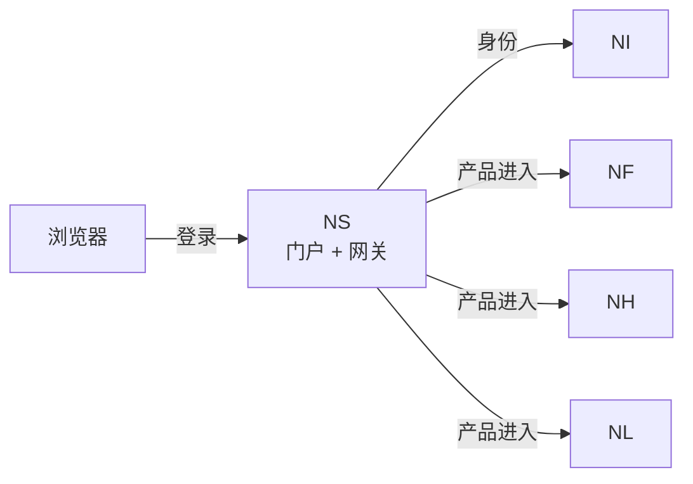

# NereidSphere

Sphere 是 NereidAI 的轻量套件层：统一门户、单点登录（SSO）、统一 API
网关，以及产品之间的闭环事件粘合。它自身不含任何领域逻辑。

## 解决什么问题

- **整个套件只需登录一次。** 没有 Sphere 时，每个产品仍可独立认证并
  运行；启用后，用户登录一次即可打开任一已集成产品，无需重复认证。
- **缺少统一入口。** 它提供统一门户，并按闭环顺序列出中心产品——
  Forge → Horizon → Link。
- **跨产品访问控制。** 会话只证明身份，不授予产品授权；产品进入采用默认拒绝，
  由套件分配决定。
- **边缘关注点分散。** 它把登录、访问控制与共享防护集中在每个产品之前，
  使各产品无需各自重复解决这些问题。
- **账号治理。** 它内置账号管理控制台，用于管理身份服务的账号，而自身不保存
  主管理员密码。

## 核心能力

**套件 SSO 与会话**

- 面向 Identity 的标准 OIDC/OAuth2 依赖方：用户在身份提供方自身的登录页
  完成登录，Sphere 从不接触上游密码。
- 一个密封会话让用户在套件内保持登录，具备空闲与绝对超时，并在会话有效期内
  透明续期。
- 登出会清除套件会话，并在身份提供方支持时一并结束上游会话。

**跨产品进入**

- 一次登录即可服务于每个已集成产品。进入某产品采用默认拒绝：用户需要为该
  产品显式分配，套件管理员是唯一的隐式例外。
- 产品进入以短期、一次性票据交接；产品凭票据换取已验证身份，随后自行维护
  本地会话。
- 每个产品可选择通过套件交接（默认）或作为独立的身份提供方客户端集成。
- 多副本部署共享重放存储，确保票据只能被消费一次；无法保证时进入失败即关闭。

**统一 API 网关**

- 一个反向代理位于所有已集成产品之前：它认证会话，丢弃客户端自带的身份头，
  并把经过验证的身份转发给产品。
- 跨领域防护集中于此：精确来源白名单、按客户端限流（登录更严格）、跨站请求
  伪造防护、上游超时与浏览器安全头。

**账号控制台与应急访问**

- 内置管理控制台管理身份账号：创建、启用/停用、重置密码与分配套件角色。
  它使用专用服务账号而非主管理员密码，并防止锁死最后一个管理员。联邦账号
  只读。
- 按产品的租户与角色分配也在此控制台完成。
- 当身份服务不可用时，本地应急账号模式仍可维持管理可用；它被明确标注为
  应急（break-glass），且不是默认方式。

**门户与交付**

- 双语门户呈现各产品，并可从门户逐一启动。
- 以自包含二进制与容器镜像交付，并提供面向 Kubernetes 的 Helm Chart；
  无需运维套件自身的业务数据库。

## 在套件中的位置

Sphere 联邦领域产品，而不吞并它们。它是套件中**唯一**对 Identity
讲 OIDC 的组件，并向每个产品下发短期票据，由产品自行建立会话。

Edge 在各边缘站点独立运行，刻意**不**作为中心门户入口。
身份平面见 [Identity](nereididentity.md)，完整闭环见
[架构总览](../architecture/overview.md)。

!!! info "开发者文档"

    关于 Sphere 的权威、详细的开发者文档位于其自身仓库：
    <https://github.com/NereidAI>。

## 关键事实

| 方面 | 说明 |
|---|---|
| 职责 | 轻量套件层——统一门户、SSO、API 网关与跨产品粘合 |
| 范围 | 联邦各领域产品；自身不含领域逻辑 |
| 前置产品 | Forge、Horizon、Link（按闭环顺序） |
| 身份 | 认证委托给 Identity；可选本地应急账号 |
| 交付形态 | 自包含二进制 / 容器镜像，外加面向 Kubernetes 的 Helm Chart |
| 可选性 | 各产品均可独立运行；单产品部署中 Sphere 可选 |
| 语言 / 技术栈 | Go 后端，内嵌 React 单页前端 |
| 许可证 | Apache-2.0 |

## 资源

- GitHub：<https://github.com/NereidAI>
- 套件：[产品总览](index.md) · [Identity](nereididentity.md)
- [架构总览](../architecture/overview.md) ·
  [跨产品契约](../architecture/contracts.md)
- [SSO 与 OIDC](../security/sso-oidc.md) · [RBAC](../security/rbac.md)
- [Kubernetes 与 Helm](../deployment/kubernetes.md) ·
  [社区版与企业版](../community/community-vs-enterprise.md)
