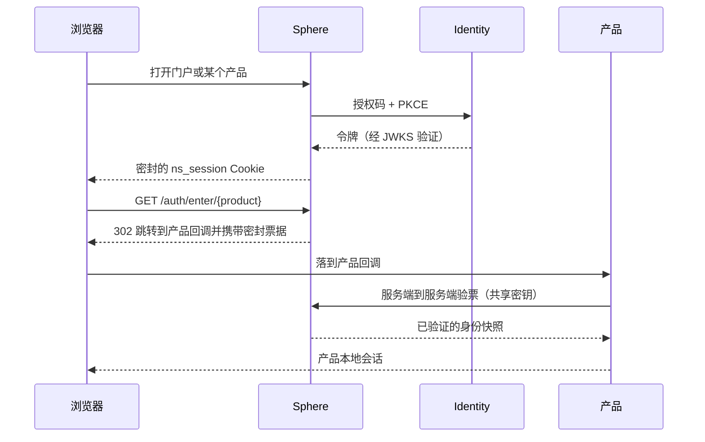

# SSO 与 OIDC

NereidAI 为整套件提供单点登录。身份事实来源只有一个，各产品经由两种模式之一与其
集成。模型刻意保持狭窄：Sphere是套件 SSO 入口，也是**唯一**与身份
平面 Identity对接 OIDC 的组件。

## 两种集成模式

| 模式 | 谁在浏览器侧完成登录 | 产品如何获得身份 |
|---|---|---|
| **`ns`**（默认）——票据交接 | Sphere（对着 Identity） | Sphere 签发一张短时、一次性、绑定受众的**密封票据**；产品后端**服务端到服务端**换取已验证身份，再建立自己的会话。 |
| **`oidc`**——直连 OIDC 客户端 | 产品自身（对着 Identity） | Sphere 把浏览器直接重定向到产品；产品自行走 OIDC 授权码 + PKCE 登录并建立自己的会话。 |

**Sphere 与产品必须就模式达成一致。** 一旦不一致，用户就会遇到登录死循环或票据 / 重定向
错误——这是最常见的集成配置错误。

在票据流程中，浏览器只持有 Sphere 的会话 Cookie，因此由独立方托管的产品无法依赖自己的
身份 Cookie——这正是需要服务端到服务端换取的原因。在直连 OIDC 流程中，产品自身的
会话与 Sphere 无关。

!!! note "默认为 `ns`"
    门户默认把每个集成产品设为票据模式，且每个产品都有自己的开关。混合部署是一等
    公民——例如某个产品走直连 OIDC，其余走票据。无论哪种，浏览器都只需在 Sphere 登录
    一次。

## 身份的事实来源

- **Identity**（身份引擎，当前为 Keycloak，realm `nereidai`）是身份的唯
  一事实来源。该引擎可在已发布的 OIDC 契约之后被替换。
- **Sphere 从不存储用户。** 其账号控制台通过服务账号客户端、经身份平面的 Admin API
  管理身份——从不使用引擎自身的 master 密码。
- **本地 bcrypt 账号仅是应急通道。** Sphere 可以在部署时声明本地账号运行，但该模式是
  身份平面不可达时的应急路径——绝不是生产默认。

## 授权属于产品本地

身份与授权是两件事。Identity/Sphere 提供身份——主体、邮箱、姓名，以及一小组粗粒度套件角色——
而 **RBAC、租户与功能权限完全留在各产品内部**。有效的 Sphere 会话只证明用户是谁，本身
并不授予对某个产品的访问权。

产品访问权通过形如 `/nereid{product}/{tenant}/{role}` 的**套件分配组**授予。这是
套件级的默认拒绝策略：对某产品没有分配组的用户无法进入该产品。唯一例外是 realm
管理员，他隐含地管理每个产品，因此新部署的引导管理员永不会被锁在门外。见
[RBAC](rbac.md)。

## 身份联邦

客户的身份系统——OIDC 或 SAML 2.0（Entra ID、Okta、Auth0、AD FS 等）——一律经由
**身份代理（Identity Brokering）接在 Identity 之后**，绝不直接对接 Sphere 或
某个产品。新增、替换或移除客户 IdP 无需改动 Sphere 或产品：它们始终看到同一个 issuer、
同一批客户端与同一组声明。把客户的分组映射到套件角色只在一处完成，即在代理处。

唯一例外是**脱离套件单独售卖的单产品**，它可以直接对客户 IdP 配置为标准 OIDC
依赖方。这明确处于套件治理之外，并随各产品仓库文档化。

## 直连 NI 的客户端

身份平面发布一小组客户端：

- **Sphere 登录客户端**始终存在——在默认（票据）集成中，Sphere 是唯一的 OIDC 依赖方。
- 各产品客户端只为以直连 OIDC 模式部署的产品存在，各自带固定回调路径。票据流程
  不需要它们；票据所用的产品回调是产品自身的路由，而非身份平面的客户端。

资源所有者密码凭据（`grant_type=password`）在任何地方都不使用：它已被 OAuth 2.0
最佳实践弃用，妨碍 MFA 与通行密钥，也无法对接被代理的身份提供方。

!!! info "运维文档"
    客户端注册、realm 供给与代理 IdP 配置细节在各产品仓库中：
    [github.com/NereidAI](https://github.com/NereidAI)。

## 相关

- [RBAC](rbac.md) —— 角色、租户范围与权限点。
- [安全总览](index.md) —— 完整基线。
- [架构总览](../architecture/overview.md) —— 管理平面。
