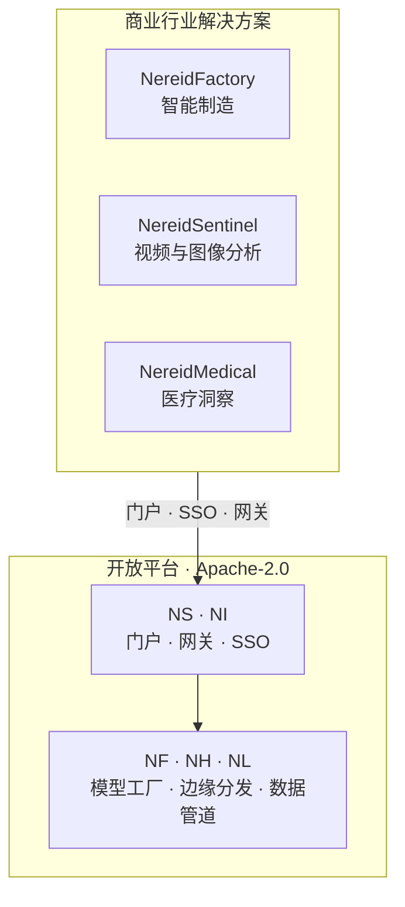

# 商业行业解决方案

NereidAI 的开放平台——即[产品](../products/index.md)文档中记录的产品套件——
是一系列**商业行业解决方案**的基础。这些解决方案构建在开放平台**之上**，
**不属于社区版**。

!!! note "商业产品，独立协议"
    NereidFactory、NereidSentinel 与 NereidMedical 按**独立的商业协议**授权、
    交付与支持，不包含在 Apache-2.0 社区版中。哪些开源、哪些商业，请见
    [社区版与企业版](../community/community-vs-enterprise.md)。

## 解决方案为何叠加在平台之上

开放平台已经提供了边缘 AIoT 系统中困难且可复用的部分——边缘数据采集、多芯片
模型工厂、离线边缘分发，以及推理与反馈。行业解决方案把这些构件组合成面向特定
领域的产品，因此每个解决方案都继承同一套「私有化设计」底座：气隙运行、无强制
回连、mTLS 链路、统一 SSO 与 RBAC，以及多厂商芯片支持。

## 三个解决方案

| 解决方案 | 领域 | 定位 |
|---|---|---|
| [NereidFactory](nereidfactory.md) | 智能制造 | 工厂运营与智能生产。 |
| [NereidSentinel](nereidsentinel.md) | 视频与图像分析 | *Guard with Insight, Shape the Future.* |
| [NereidMedical](nereidmedical.md) | 医疗洞察 | *Empower Healing with Intelligent Insights.* |

-   :material-factory:{ .lg .middle } **NereidFactory**

    ---

    智能制造——工厂运营与智能生产。

    [:octicons-arrow-right-24: 了解更多](nereidfactory.md)

-   :material-cctv:{ .lg .middle } **NereidSentinel**

    ---

    视频与图像分析——*Guard with Insight, Shape the Future.*

    [:octicons-arrow-right-24: 了解更多](nereidsentinel.md)

-   :material-hospital-box:{ .lg .middle } **NereidMedical**

    ---

    医疗洞察——*Empower Healing with Intelligent Insights.*

    [:octicons-arrow-right-24: 了解更多](nereidmedical.md)

## 解决方案如何交付

每个解决方案都按**具体项目（per engagement）**确定范围、授权与支持。由于开放
平台提供共享底座，商业解决方案可以针对客户环境量身定制——包括交钥匙气隙交付、
定制集成与私有化培训——而无需分叉平台。

!!! info "范围按项目逐一确认"
    公开材料有意保持高层描述。每个解决方案的具体功能集、集成面、交付模式与支持
    条款，均在商业协议中约定，而不在本站公布。

## 下一步

- [社区版与企业版对比](../community/community-vs-enterprise.md) —— 哪些开源、哪些商业。
- [开源许可与支持](../community/license.md) —— Apache-2.0 与商业选项。
- [支持](../community/support.md) —— 如何联系我们。
