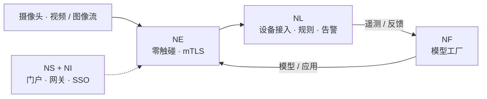

# NereidSentinel

**Guard with Insight, Shape the Future.**

NereidSentinel 是构建在开放 NereidAI 平台**之上**、面向**视频与图像分析**的
**商业行业解决方案**。

!!! note "商业解决方案"
    NereidSentinel 按**独立的商业协议**授权、交付与支持，不包含在 Apache-2.0
    社区版中。请见[社区版与企业版](../community/community-vs-enterprise.md)。

## 思路

视频与图像流所承载的信息，只有及时到达、且留在其被允许停留之处，才有价值。
NereidSentinel 把这一点当作平台问题来处理：在边缘采集，在私有化模型工厂中生产与
优化模型，离线分发到大量节点，并在贴近摄像头处推理——且不强制依赖云端。

!!! abstract "平台组合"
    下图展示的是分析类负载如何映射到**开放平台**。它是平台构件的组合，而非
    NereidSentinel 已公布的功能清单。

## 它建立在什么之上

分析类解决方案复用与整套件相同的平台构件：

| 平台构件 | 对分析方案的作用 |
|---|---|
| [Edge](../products/nereidedge.md) | 以零触碰上线、mTLS 与本地自治连接摄像头与网关。 |
| [Forge](../products/nereidforge.md) | 模型工厂——数据集、训练、量化，以及面向边缘目标的硬件适配导出。 |
| [Horizon](../products/nereidhorizon.md) | 离线把模型与应用分发到大量远程节点。 |
| [Link](../products/nereidlink.md) | 设备接入、统一消息、规则引擎、告警与看板。 |
| [Sphere](../products/nereidsphere.md) / [Identity](../products/nereididentity.md) | 门户、API 网关，以及整套件统一 SSO / RBAC。 |

## 这里能说——与不能说的

由于 NereidSentinel 按商业方式交付，其具体功能集与范围**按项目逐一确定**。本页仅在
高层描述价值主张，不公布固定功能清单、价格或服务水平。

!!! info "细节按项目确定"
    适用于您环境的具体能力、集成面、交付计划与支持条款，请
    [联系我们](../community/support.md)。

## 下一步

- [NereidFactory](nereidfactory.md) —— 智能制造
- [NereidMedical](nereidmedical.md) —— 医疗洞察
- [全部商业解决方案](index.md)
- [社区版与企业版](../community/community-vs-enterprise.md)
